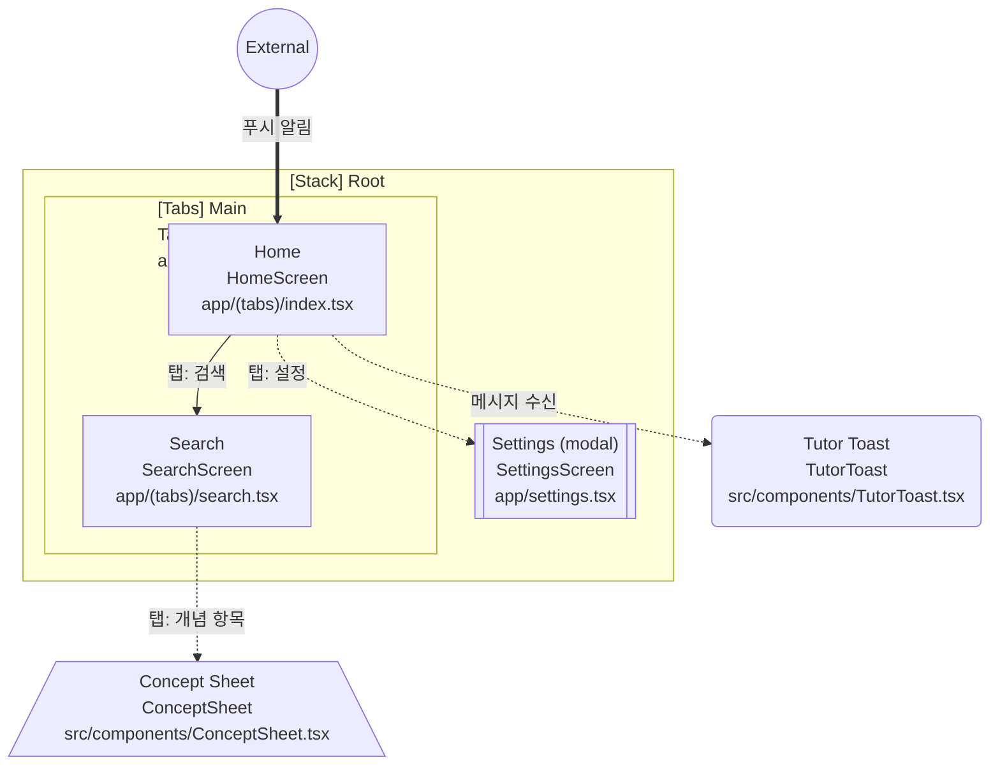

# Expo 앱 UI 구조 Block Diagram 작성 스펙

> 대상: Claude (코드베이스 접근 가능한 코딩 에이전트)
> 목적: Expo 앱의 Screen / Modal / Modeless / Bottom Sheet / Navigator 사이의 구조와 전환 관계를 코드에서 추출해 block diagram으로 문서화한다.
> 원칙: **코드에서 확인한 사실만 그린다.** 추측한 연결은 그리지 않거나 `미확인`으로 표시한다. 이 작업에서는 앱 코드를 수정하지 않는다.

---

## 1. 입력

| 항목 | 값 |
|---|---|
| 프로젝트 루트 | `<프로젝트 경로>` (예: `go3math-study-agent-app`) |
| 라우팅 방식 | Expo Router(`app/` 디렉터리) 또는 React Navigation. 둘 다 있으면 둘 다 분석 |
| 기준 브랜치/커밋 | `<branch 또는 commit>` |
| 레이아웃 모드 | Phone, Tablet(짧은 변 ≥ 600). 모드별로 구조가 다르면 각각 그린다 |

## 2. 요소 정의 (분류 기준)

| 종류 | 정의 | 코드에서 찾는 단서 |
|---|---|---|
| **Navigator** | 화면 스택·탭·드로어 등 하위 화면을 관리하는 컨테이너 | `_layout.tsx`의 `Stack`/`Tabs`/`Drawer`/`Slot`, `createNativeStackNavigator`, `createBottomTabNavigator`, `createDrawerNavigator` |
| **Screen** | 라우트로 진입하는 전체 화면 | `app/**` 라우트 파일, `<Stack.Screen>`, `<Tab.Screen>` |
| **Modal** | 뒤 화면 조작을 막는 화면. 닫아야 원래 화면으로 돌아감 | `presentation: 'modal' \| 'formSheet' \| 'fullScreenModal' \| 'transparentModal'`, RN `<Modal>`, 확인/경고 다이얼로그 |
| **Modeless** | 뒤 화면을 계속 조작할 수 있는 떠 있는 UI | 오버레이 패널, 토스트, 플로팅 툴바, 도킹 패널, 비차단 팝오버 |
| **Bottom Sheet** | 하단에서 올라오는 시트. 차단형과 비차단형을 구분 | `@gorhom/bottom-sheet`(`BottomSheet`, `BottomSheetModal`), `presentation: 'formSheet'`, 자체 구현 시트 |

분류 규칙:
- Bottom Sheet는 별도 종류로 표시하되 속성에 `blocking: true|false`를 단다. backdrop이 있고 뒤 화면 터치를 막으면 `blocking: true`.
- Expo Router `presentation: 'modal'` 라우트는 **Screen이면서 Modal**이다. 종류는 Modal로 두고 `route: /경로`를 속성으로 남긴다.
- 라우트가 아닌 컴포넌트 내부 UI(드로어 안의 패널 등)도 사용자가 열고 닫을 수 있으면 포함한다.
- 단순 시각 요소(버튼, 카드)는 포함하지 않는다.

## 3. 관계(엣지) 정의

| 관계 | 의미 | 표기 |
|---|---|---|
| `contains` | Navigator가 하위 Navigator/Screen을 포함 | 실선 화살표, 부모 → 자식 |
| `navigate` | push/replace/router.push 등 화면 이동 | 실선 화살표, 라벨에 트리거 |
| `present` | Modal/Bottom Sheet/Modeless를 띄움 | 점선 화살표, 라벨에 트리거 |
| `dismiss_to` | 닫힌 뒤 돌아가는 곳이 원래 화면이 아닐 때만 | 점선 화살표, 라벨 `dismiss` |
| `deeplink` | 외부 링크·알림으로 진입 | 굵은 화살표, 시작점 `External` |

엣지 라벨 규칙: `트리거(조건)` 형식. 예: `탭: 검색 버튼`, `로그인 성공`, `푸시 알림 탭 (Tablet만)`.

## 4. 수행 절차

1. **라우트 수집**: `app/` 트리(그룹 `(group)`, 동적 `[id]`, `+not-found`, `_layout` 포함) 또는 Navigator 정의를 모두 나열한다.
2. **Navigator 계층 구성**: 루트부터 중첩 Navigator와 소속 Screen을 트리로 만든다. 인증 분기(로그인 전/후)가 있으면 조건으로 표시한다.
3. **표시 방식 판별**: 각 라우트의 `presentation`, `headerShown`, 제스처 옵션을 확인해 Modal 여부를 판단한다.
4. **비라우트 UI 수집**: `Modal`, `BottomSheet`, `BottomSheetModal`, 드로어, 토스트, 오버레이 컴포넌트를 검색하고, 어느 Screen에서 어떤 상태값/핸들러로 열리는지 추적한다.
5. **전환 수집**: `router.push/replace/back/dismiss`, `navigation.navigate`, `<Link href>`, `Redirect`, 시트의 `present()/expand()/snapToIndex()`, `setVisible(true)` 류 호출을 찾아 엣지로 만든다.
6. **레이아웃 모드 분기**: `useWindowDimensions`, 태블릿 판별 훅 등으로 Phone/Tablet 구조가 달라지는 지점을 찾아 다이어그램을 나누거나 엣지에 `(Tablet만)` 조건을 단다.
7. **검증**: 모든 노드에 최소 1개의 진입 경로가 있는지 확인한다. 진입 경로를 못 찾은 노드는 `orphan`으로 표에 남긴다.

검색 예시(참고용):
```bash
rg -n "presentation\s*:" app src
rg -n "<Modal|BottomSheet(Modal)?|useBottomSheet|present\(\)" app src
rg -n "router\.(push|replace|back|dismiss|navigate)|navigation\.navigate|<Link " app src
rg -n "create(NativeStack|Stack|BottomTab|Drawer|MaterialTopTab)Navigator|<(Stack|Tabs|Drawer)\b" app src
```

## 5. 산출물

모든 산출물은 `docs/ui-structure/` 아래에 둔다.

### 5.1 `ui-structure.md`
1. **개요**: 분석 기준(브랜치/커밋, 라우팅 방식, 분석 날짜)
2. **전체 Block Diagram** (Mermaid `flowchart TD`)
3. **모드별 Diagram**: Phone, Tablet이 다를 때만 각각
4. **노드 목록 표**

| id | 종류 | 이름 | 파일 경로 | route | 부모 | blocking | 비고 |
|---|---|---|---|---|---|---|---|

5. **엣지 목록 표**

| from | to | 관계 | 트리거 | 조건 | 근거(파일:라인) |
|---|---|---|---|---|---|

6. **미확인/이슈 목록**: orphan 노드, 판별 불가 항목, 중복·데드 라우트, 닫힌 뒤 돌아갈 곳이 불명확한 Modal

### 5.2 `ui-structure.json`
기계 판독용. 위 표와 동일한 내용:
```json
{
  "meta": { "commit": "", "router": "expo-router", "generatedAt": "" },
  "nodes": [
    { "id": "", "kind": "navigator|screen|modal|modeless|bottomsheet",
      "name": "", "file": "", "route": null, "parent": null,
      "blocking": null, "modes": ["phone", "tablet"] }
  ],
  "edges": [
    { "from": "", "to": "", "rel": "contains|navigate|present|dismiss_to|deeplink",
      "trigger": "", "condition": null, "source": "file:line" }
  ],
  "unresolved": []
}
```

## 6. Mermaid 표기 규칙

- 방향: `flowchart TD`. 노드가 40개를 넘으면 Navigator 단위로 subgraph를 나누고, 별도 상세 다이어그램을 추가한다.
- Navigator는 `subgraph`로 감싸 포함 관계를 표현한다. `contains` 엣지는 subgraph로 대체할 수 있다.
- 노드 모양:

| 종류 | 모양 | 예 |
|---|---|---|
| Navigator | subgraph 제목 `[Stack] Root` | `subgraph RootStack["[Stack] Root"]` |
| Screen | 사각형 | `home["Home"]` |
| Modal | 이중 사각형 | `settings[["Settings (modal)"]]` |
| Modeless | 둥근 사각형 | `toast("Tutor Toast")` |
| Bottom Sheet | 사다리꼴 | `sheet[/"Concept Sheet"\]` |
| 외부 진입 | 원 | `ext((External))` |

- 엣지: `navigate` `-->|라벨|`, `present` `-.->|라벨|`, `deeplink` `==>|라벨|`.
- 색상은 `classDef`로 종류별 지정. 색만으로 의미를 구분하지 않고 모양도 함께 쓴다.
- 노드 id는 영문 소문자와 `_`만 사용. 화면 표시 이름은 한국어 가능.
- **블록 라벨 필수 형식:** 모든 블록(노드와 Navigator subgraph 제목) 안에 **컴포넌트명**과 **파일명**을 반드시 적는다. 표시 이름은 선택이다.
  - 형식: `표시 이름<br/>ComponentName<br/>파일경로` (표시 이름이 없으면 두 줄)
  - 컴포넌트명은 코드의 실제 export 이름(예: `HomeScreen`, `ConceptSheet`). default export가 익명이면 `(anonymous)`로 쓰고 이슈 목록에 남긴다.
  - 파일명은 프로젝트 루트 기준 상대 경로(예: `app/(tabs)/index.tsx`, `src/components/ConceptSheet.tsx`). 경로가 길면 `app/`·`src/` 이하만 써도 되지만 파일명과 확장자는 생략하지 않는다.
  - Navigator subgraph 제목은 `[Stack] Root<br/>RootLayout<br/>app/_layout.tsx` 형식.
  - 한 파일에 컴포넌트가 여러 개면 각 블록에 해당 컴포넌트명을 적고 파일명은 같게 둔다.
  - 라벨에 `(`, `)`, `[`, `]`, `/` 등 특수문자가 있으므로 라벨 전체를 큰따옴표로 감싼다.
  - 노드 목록 표의 `이름`/`파일 경로` 열과 블록 라벨 내용이 일치해야 한다.

예시(구조 예시일 뿐, 실제 앱 구조 아님):


## 7. 완료 조건

- [ ] 모든 라우트 파일과 Navigator 정의가 노드 목록에 있다.
- [ ] 코드에서 찾은 Modal / Modeless / Bottom Sheet가 모두 노드로 있고 열리는 Screen과 연결돼 있다.
- [ ] 모든 엣지에 근거 `파일:라인`이 있다.
- [ ] 모든 블록과 Navigator subgraph 제목에 컴포넌트명과 파일명이 적혀 있다.
- [ ] Phone/Tablet 구조 차이가 있으면 반영돼 있다.
- [ ] Mermaid가 문법 오류 없이 렌더링된다(`npx @mermaid-js/mermaid-cli`로 SVG 생성 확인 권장).
- [ ] `ui-structure.md`와 `ui-structure.json`의 노드·엣지 수가 일치한다.
- [ ] 앱 소스 코드는 변경하지 않았다.

## 8. 하지 말 것

- 코드에서 확인하지 못한 화면이나 전환을 추가하지 않는다.
- 계획 중인 기능을 실제 구조처럼 그리지 않는다. 필요하면 별도 섹션 `계획(미구현)`에 점선 회색으로만 둔다.
- 다이어그램 작성을 위해 라우트나 컴포넌트를 리팩터링하지 않는다.

## 9. 보고 형식

작업이 끝나면 다음을 짧게 보고한다.
- 노드 수(종류별), 엣지 수(관계별)
- orphan·미확인 항목 수와 대표 사례
- 구조상 눈에 띄는 문제(예: Modal 위 Modal 중첩, 닫힌 뒤 복귀 경로 불명확, 도달 불가 라우트)
