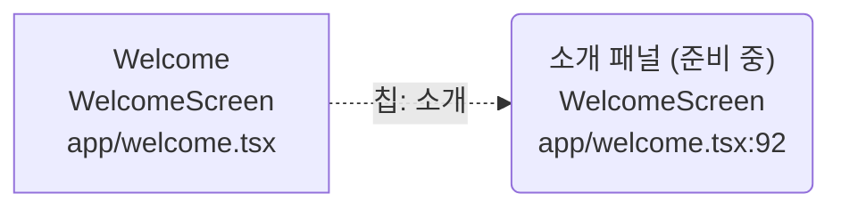

# Go3Math 학생 앱 UI 구조

> 이 파일은 `ui-structure.html`의 데이터에서 만든다. 고칠 때는 HTML의 `NODES`·`EDGES`·`ISSUES`를 고치고 다시 내보낸다.

## 개요

| 항목 | 값 |
|---|---|
| 프로젝트 | go3math-study-agent-app (qoolla-agent-app 3.0.0) |
| 기준 | `feat/study-note` @ `76b99e3` |
| 라우팅 | expo-router ~6.0.24 (app/ 디렉터리, Expo SDK 54). React Navigation 직접 정의 없음 |
| 분석 날짜 | 2026-11-10 |
| 레이아웃 모드 | Phone / Tablet — useDeviceMode(): 짧은 변 ≥ 600 진입, < 560 이탈, 200ms 디바운스 (src/layout/deviceMode.ts) |
| 노드 | 66개 (navigator 6, external 1, screen 24, bottomsheet 6, modeless 16, modal 13) |
| 엣지 | 115개 (contains 29, deeplink 1, navigate 35, present 50) |

블록 모양: 사각형 Screen, 이중 사각형 Modal, 둥근 사각형 Modeless, 사다리꼴 Bottom Sheet, 원 External. 실선 navigate, 점선 present, 굵은 선 deeplink. `contains`는 subgraph로 그렸고 엣지 표에는 남겼다.

## Block Diagram — 전체

모든 노드와 엣지. 노드가 40개를 넘어 Navigator·레이어 단위 subgraph로 나눴다. 모드별 보기가 더 읽기 쉽다.

```mermaid
flowchart TD
  subgraph nav_root["[Stack] Root<br/>RootLayout<br/>app/_layout.tsx"]
    direction TB
    subgraph nav_main["[Tabs] Main (인증 게이트)<br/>MainLayout<br/>app/(main)/_layout.tsx"]
      direction TB
      subgraph nav_timeline["[Stack] History 탭<br/>TimelineTabLayout<br/>app/(main)/timeline/_layout.tsx"]
        direction TB
        timeline_index["History<br/>TimelineTabScreen<br/>app/(main)/timeline/index.tsx"]
        timeline_problems["문제 목록<br/>TimelineProblemsScreen<br/>app/(main)/timeline/problems.tsx"]
        timeline_topic["⚠ orphan · 주제 문제<br/>TimelineTopicScreen<br/>app/(main)/timeline/topic.tsx"]
        timeline_solution["해답<br/>SolutionResultScreen<br/>app/(main)/timeline/solution.tsx"]
      end
      subgraph nav_search["[Stack] 검색 탭<br/>SearchTabLayout<br/>app/(main)/search/_layout.tsx"]
        direction TB
        search_index["검색<br/>SearchTabScreen<br/>app/(main)/search/index.tsx"]
        search_problems["문제 목록<br/>SearchProblemsScreen<br/>app/(main)/search/problems.tsx"]
        search_topic["주제 문제<br/>SearchTopicScreen<br/>app/(main)/search/topic.tsx"]
        search_solution["해답<br/>SolutionResultScreen<br/>app/(main)/search/solution.tsx"]
      end
      subgraph nav_diary["[Stack] Diary 탭<br/>DiaryTabLayout<br/>app/(main)/diary/_layout.tsx"]
        direction TB
        diary_index["Diary<br/>DiaryTabScreen<br/>app/(main)/diary/index.tsx"]
        diary_day["그날 풀이 기록<br/>DiaryDayScreen<br/>app/(main)/diary/day.tsx"]
        diary_solution["답안 예시<br/>SolutionResultScreen<br/>app/(main)/diary/solution.tsx"]
      end
      subgraph nav_chat["[Stack] Study Log 탭<br/>ChatTabLayout<br/>app/(main)/chat/_layout.tsx"]
        direction TB
        chat_index["Study Log<br/>ChatTabScreen<br/>app/(main)/chat/index.tsx"]
        chat_problems["문제 목록<br/>ChatProblemsScreen<br/>app/(main)/chat/problems.tsx"]
        chat_topic["주제 문제<br/>ChatTopicScreen<br/>app/(main)/chat/topic.tsx"]
        chat_solution["해답<br/>SolutionResultScreen<br/>app/(main)/chat/solution.tsx"]
      end
      agent_home["에이전트 홈 (Stage)<br/>AgentHome<br/>app/(main)/index.tsx"]
      profile["내 정보 탭<br/>ProfileTabScreen<br/>app/(main)/profile.tsx"]
    end
    welcome["Welcome (로그인)<br/>WelcomeScreen<br/>app/welcome.tsx"]
    auth_callback["OAuth 콜백<br/>AuthCallback<br/>app/auth/callback.tsx"]
    public_questions["공개 문제 목록<br/>PublicQuestionsViewScreen<br/>app/public-questions.tsx"]
    public_solution["공개 해답<br/>PublicSolutionViewScreen<br/>app/public-solution.tsx"]
    notebook["문제 풀이 캔버스<br/>NotebookScreen<br/>app/notebook.tsx"]
    topic_live["주제 실황 수업<br/>TopicLiveClassScreen<br/>app/topic-live-class.tsx"]
    hotline["선생님 수업<br/>HotlineClassScreen<br/>app/hotline-class.tsx"]
  end
  subgraph grp_tablet["태블릿 에이전트 레이어<br/>TabletAgentLayer<br/>src/agent/tablet/TabletAgentLayer.tsx"]
    direction TB
    chat_rail("세로 pill 툴바<br/>ChatRail<br/>src/agent/tablet/ChatRail.tsx")
    dock_timeline("Study dock<br/>DockWrapper · TimelinePanel<br/>src/agent/tablet/TabletAgentLayer.tsx")
    dock_notice("Diary dock<br/>DockWrapper · DiaryPanel<br/>src/agent/tablet/TabletAgentLayer.tsx")
    dock_search("검색 dock<br/>DockWrapper · ResearchPanel<br/>src/agent/tablet/TabletAgentLayer.tsx")
    dock_live("실황 수업 dock<br/>DockWrapper · LiveClassListPanel<br/>src/agent/tablet/TabletAgentLayer.tsx")
    dock_profile("내 정보 dock<br/>DockWrapper · ProfileActions<br/>src/agent/tablet/TabletAgentLayer.tsx")
    dock_chat("Study Log dock<br/>DockWrapper · ChatTimeline<br/>src/agent/tablet/TabletAgentLayer.tsx")
    agent_toast("튜터·에이전트 토스트<br/>Toast<br/>src/ui/toast/Toast.tsx")
  end
  subgraph grp_canvas["캔버스 공통 오버레이<br/>CanvasChrome<br/>src/kit/canvas/CanvasChrome.tsx"]
    direction TB
    canvas_toolbar("캔버스 하단 툴바<br/>FloatingToolbar<br/>src/kit/canvas/FloatingToolbar.tsx")
    concept_sheet[/"개념 검색 시트<br/>CanvasChrome · ConceptLookupPanel<br/>src/kit/canvas/CanvasChrome.tsx"\]
    clear_confirm[["전체 지우기 확인<br/>CanvasChrome (inline Modal)<br/>src/kit/canvas/CanvasChrome.tsx"]]
    landscape_notice("가로 모드 안내<br/>LandscapeNotice<br/>src/kit/canvas/LandscapeNotice.tsx")
    pencil_popover[["펜 설정 팝오버<br/>PencilPropsModal<br/>src/kit/canvas/note-canvas/pencil-props-modal.tsx"]]
  end
  ext(("External"))
  study_note_sheet[/"학습장 시트<br/>SheetHost<br/>src/host/SheetHost.tsx"\]
  global_loading("⚠ orphan · 앱 차단 로딩<br/>GlobalLoadingOverlay<br/>src/kit/ui/loading-view/global-overlay.tsx")
  tablet_launch("태블릿 런치 로고<br/>TabletLaunchOverlay<br/>src/ui/TabletLaunchOverlay.tsx")
  concept_detail[["개념 설명 모달<br/>ConceptLookupPanel (inline Modal)<br/>src/kit/concepts/ConceptLookupPanel.tsx"]]
  name_edit_modal[["이름 변경<br/>ProfileActions (inline Modal)<br/>src/kit/profile/ProfileActions.tsx"]]
  pdf_viewer[["사서함 PDF<br/>PdfViewerModal<br/>src/kit/ui/PdfViewerModal.tsx"]]
  upload_alert[["풀이 업로드 결과<br/>Alert.alert (SolutionRow)<br/>src/phone/PhoneScreens.tsx"]]
  bookmark_alert[["책갈피 결과<br/>Alert.alert (DailyRecordsList)<br/>src/kit/diary/DailyRecordsList.tsx"]]
  quiz_modal[["실황 퀴즈<br/>QuizResponseModal<br/>src/kit/live-class/QuizResponseModal.tsx"]]
  nb_list_modal[["문제 목록 모달<br/>NotebookScreen (inline Modal)<br/>app/notebook.tsx"]]
  nb_answer_sheet[/"해답 시트<br/>NotebookScreen (BottomSheetModal)<br/>app/notebook.tsx"\]
  nb_workout_sheet[/"내 풀이 시트<br/>NotebookScreen (BottomSheetModal)<br/>app/notebook.tsx"\]
  tl_list_modal[["수업 문제 목록<br/>TopicLiveClassScreen (inline Modal)<br/>app/topic-live-class.tsx"]]
  tl_answer_sheet[/"답안 예시 시트<br/>TopicLiveClassScreen (BottomSheetModal)<br/>app/topic-live-class.tsx"\]
  tl_toast("상단 토스트<br/>TopicLiveClassScreen (inline View)<br/>app/topic-live-class.tsx")
  tl_memo("선생님 메모<br/>TopicLiveClassCanvasPanel<br/>src/kit/canvas/note-canvas/topic-live-canvas.tsx")
  tl_popup[["⚠ orphan · 해설 팝업<br/>Sheet<br/>src/kit/canvas/note-canvas/topic-live-canvas.tsx"]]
  hl_list_modal[["수업 문제 목록<br/>HotlineClassScreen (inline Modal)<br/>app/hotline-class.tsx"]]
  hl_answer_sheet[/"답안 예시 시트<br/>HotlineClassScreen (BottomSheetModal)<br/>app/hotline-class.tsx"\]
  hl_toast("상단 토스트<br/>HotlineClassScreen (inline View)<br/>app/hotline-class.tsx")
  hl_memo("선생님 메모<br/>HotlineClassCanvasPanel<br/>src/kit/canvas/note-canvas/hotline-class-canvas.tsx")
  hl_popup[["⚠ orphan · 해설 팝업<br/>Sheet<br/>src/kit/canvas/note-canvas/hotline-class-canvas.tsx"]]
  ext ==>|"OAuth 리디렉트 com.qoolla.student://auth/callback"| auth_callback
  auth_callback -->|"Redirect /welcome (콜백 화면에 직접 도착)"| welcome
  nav_main -->|"Redirect /welcome (비로그인·로그아웃 (gate signedOut))"| welcome
  welcome -->|"Redirect / (로그인 성공·개발용 둘러보기) (gate signedIn)"| agent_home
  agent_home -->|"Redirect /timeline (Phone만)"| timeline_index
  welcome -->|"탭: 가자 (2026·모의 기출)"| public_questions
  welcome -->|"탭: 토픽 (과목별)"| public_questions
  public_questions -->|"탭: 해답"| public_solution
  agent_home -->|"탭: 연필 FAB (Stage 문제 목록·주제 문제·책갈피) (Tablet만)"| notebook
  agent_home -->|"탭: 연필 FAB (실황 주제 수업 문제 목록) (source.kind 'topic_live')"| topic_live
  agent_home -->|"탭: 연필 FAB (선생님 수업 문제 목록) (source.kind 'hotline')"| hotline
  dock_notice -->|"탭: 가자!!! (그날 문제)"| notebook
  dock_live -->|"탭: 주제 실황 수업"| topic_live
  dock_live -->|"탭: 선생님 수업"| hotline
  notebook -->|"툴바: 나가기 (back, 없으면 replace /) · Redirect / (Redirect는 solveStore 비었을 때)"| agent_home
  topic_live -->|"툴바: 나가기 · 강의 미준비 토스트 후 자동 · Redirect / (Redirect는 topicId 없을 때)"| agent_home
  hotline -->|"툴바: 나가기 · Redirect / (Redirect는 tutorId 없을 때)"| agent_home
  timeline_index -->|"탭: 타임라인 task"| timeline_problems
  search_index -->|"기출 검색 제출"| search_problems
  search_index -->|"탭: 토픽"| search_topic
  chat_index -->|"에이전트 show_component problem_list (채팅 탭 포커스 중)"| chat_problems
  chat_index -->|"에이전트 show_component problem_preview (채팅 탭 포커스 중)"| chat_topic
  timeline_problems -->|"탭: 눈(해답)"| timeline_solution
  timeline_topic -->|"탭: 눈(해답)"| timeline_solution
  timeline_problems -->|"헤더 뒤로 (dismissTo)"| timeline_index
  timeline_topic -->|"헤더 뒤로 (dismissTo)"| timeline_index
  search_problems -->|"탭: 눈(해답)"| search_solution
  search_topic -->|"탭: 눈(해답)"| search_solution
  search_problems -->|"헤더 뒤로 (dismissTo)"| search_index
  search_topic -->|"헤더 뒤로 (dismissTo)"| search_index
  chat_problems -->|"탭: 눈(해답)"| chat_solution
  chat_topic -->|"탭: 눈(해답)"| chat_solution
  chat_problems -->|"헤더 뒤로 (dismissTo)"| chat_index
  chat_topic -->|"헤더 뒤로 (dismissTo)"| chat_index
  diary_index -->|"탭: 달력 날짜"| diary_day
  diary_day -->|"탭: 답안 예시"| diary_solution
  nav_root -.->|"앱 시작 (Android 태블릿만)"| tablet_launch
  timeline_index -.->|"탭: 학습장"| study_note_sheet
  dock_timeline -.->|"탭: 학습장"| study_note_sheet
  notebook -.->|"화면 나감 → solve_finished → 에이전트 show_component(study_note) (푼 문제 ≥1·에이전트가 응답할 때 (mockAgent로만 확인))"| study_note_sheet
  topic_live -.->|"화면 나감 → solve_finished → 에이전트 show_component(study_note) (푼 문제 ≥1·에이전트가 응답할 때 (mockAgent로만 확인))"| study_note_sheet
  hotline -.->|"화면 나감 → solve_finished → 에이전트 show_component(study_note) (푼 문제 ≥1·에이전트가 응답할 때 (mockAgent로만 확인))"| study_note_sheet
  agent_home -.->|"항상 표시"| chat_rail
  chat_rail -.->|"탭: 타임라인 / 홈 진입 시 기본"| dock_timeline
  chat_rail -.->|"탭: Diary"| dock_notice
  chat_rail -.->|"탭: 검색"| dock_search
  chat_rail -.->|"탭: 실황 수업"| dock_live
  chat_rail -.->|"탭: 내 정보"| dock_profile
  chat_rail -.->|"탭: 채팅"| dock_chat
  agent_home -.->|"에이전트 instruction 도착 (dock 닫힘·응답 필요)"| dock_chat
  agent_home -.->|"에이전트 instruction 도착 (다른 dock 열림, 또는 응답 불필요한 튜터 메시지·문제 목록 중)"| agent_toast
  agent_toast -.->|"탭: 토스트"| dock_chat
  search_index -.->|"탭: 개념 칩 (개념 카테고리)"| concept_detail
  dock_search -.->|"탭: 개념 칩 (개념 카테고리)"| concept_detail
  concept_sheet -.->|"탭: 개념 칩 (Bottom Sheet 위 Modal)"| concept_detail
  profile -.->|"탭: 이름 변경"| name_edit_modal
  dock_profile -.->|"탭: 이름 변경"| name_edit_modal
  profile -.->|"탭: 사서함 답변 (Phone: fullScreen)"| pdf_viewer
  dock_profile -.->|"탭: 사서함 답변 (Tablet: 투명 카드)"| pdf_viewer
  timeline_problems -.->|"탭: 카메라 → 업로드 끝"| upload_alert
  timeline_topic -.->|"탭: 카메라 → 업로드 끝"| upload_alert
  search_problems -.->|"탭: 카메라 → 업로드 끝"| upload_alert
  search_topic -.->|"탭: 카메라 → 업로드 끝"| upload_alert
  chat_problems -.->|"탭: 카메라 → 업로드 끝"| upload_alert
  chat_topic -.->|"탭: 카메라 → 업로드 끝"| upload_alert
  diary_day -.->|"탭: 책갈피"| bookmark_alert
  notebook -.->|"항상 표시"| canvas_toolbar
  topic_live -.->|"항상 표시"| canvas_toolbar
  hotline -.->|"항상 표시"| canvas_toolbar
  canvas_toolbar -.->|"툴바: 개념"| concept_sheet
  canvas_toolbar -.->|"툴바: 전체 지우기"| clear_confirm
  canvas_toolbar -.->|"툴바: Options(color)"| pencil_popover
  canvas_toolbar -.->|"가로 회전 / 제한 버튼 탭 (가로 + 제한 도구 있음)"| landscape_notice
  notebook -.->|"툴바: 목록"| nb_list_modal
  notebook -.->|"툴바: 해답"| nb_answer_sheet
  notebook -.->|"툴바: 내 풀이 · 저장 후 · 이전 풀이 있으면 자동"| nb_workout_sheet
  topic_live -.->|"툴바: 목록 (수업 문제 2개 이상)"| tl_list_modal
  topic_live -.->|"툴바: 답안 예시"| tl_answer_sheet
  topic_live -.->|"실황 메시지 action 'quiz'"| quiz_modal
  topic_live -.->|"답안 전송·오류·강의 미준비"| tl_toast
  topic_live -.->|"스크립트 MEMO 컷"| tl_memo
  hotline -.->|"툴바: 목록 (수업 문제 2개 이상)"| hl_list_modal
  hotline -.->|"툴바: 답안 예시"| hl_answer_sheet
  hotline -.->|"실황 메시지 action 'quiz'"| quiz_modal
  hotline -.->|"Notes 준비·답안 전송·오류"| hl_toast
  hotline -.->|"스크립트 MEMO 컷"| hl_memo
  linkStyle 0 stroke:#e8630a,stroke-width:3px
  linkStyle 1 stroke:#475467,stroke-width:1.6px
  linkStyle 2 stroke:#475467,stroke-width:1.6px
  linkStyle 3 stroke:#475467,stroke-width:1.6px
  linkStyle 4 stroke:#475467,stroke-width:1.6px
  linkStyle 5 stroke:#475467,stroke-width:1.6px
  linkStyle 6 stroke:#475467,stroke-width:1.6px
  linkStyle 7 stroke:#475467,stroke-width:1.6px
  linkStyle 8 stroke:#475467,stroke-width:1.6px
  linkStyle 9 stroke:#475467,stroke-width:1.6px
  linkStyle 10 stroke:#475467,stroke-width:1.6px
  linkStyle 11 stroke:#475467,stroke-width:1.6px
  linkStyle 12 stroke:#475467,stroke-width:1.6px
  linkStyle 13 stroke:#475467,stroke-width:1.6px
  linkStyle 14 stroke:#475467,stroke-width:1.6px
  linkStyle 15 stroke:#475467,stroke-width:1.6px
  linkStyle 16 stroke:#475467,stroke-width:1.6px
  linkStyle 17 stroke:#475467,stroke-width:1.6px
  linkStyle 18 stroke:#475467,stroke-width:1.6px
  linkStyle 19 stroke:#475467,stroke-width:1.6px
  linkStyle 20 stroke:#475467,stroke-width:1.6px
  linkStyle 21 stroke:#475467,stroke-width:1.6px
  linkStyle 22 stroke:#475467,stroke-width:1.6px
  linkStyle 23 stroke:#475467,stroke-width:1.6px
  linkStyle 24 stroke:#475467,stroke-width:1.6px
  linkStyle 25 stroke:#475467,stroke-width:1.6px
  linkStyle 26 stroke:#475467,stroke-width:1.6px
  linkStyle 27 stroke:#475467,stroke-width:1.6px
  linkStyle 28 stroke:#475467,stroke-width:1.6px
  linkStyle 29 stroke:#475467,stroke-width:1.6px
  linkStyle 30 stroke:#475467,stroke-width:1.6px
  linkStyle 31 stroke:#475467,stroke-width:1.6px
  linkStyle 32 stroke:#475467,stroke-width:1.6px
  linkStyle 33 stroke:#475467,stroke-width:1.6px
  linkStyle 34 stroke:#475467,stroke-width:1.6px
  linkStyle 35 stroke:#475467,stroke-width:1.6px
  classDef screen fill:#eef7f1,stroke:#3f8f63,color:#1d1d1b,stroke-width:1.4px
  classDef modal fill:#fdecec,stroke:#c0392b,color:#1d1d1b,stroke-width:1.4px
  classDef modeless fill:#e8f4fd,stroke:#2b7bb9,color:#1d1d1b,stroke-width:1.4px
  classDef bottomsheet fill:#f4ebfd,stroke:#8e44ad,color:#1d1d1b,stroke-width:1.4px
  classDef external fill:#eeeeee,stroke:#666,color:#1d1d1b,stroke-width:1.4px
  classDef orphan stroke-dasharray:5 4,stroke:#999,color:#777,fill:#f5f5f3
  class welcome,auth_callback,public_questions,public_solution,notebook,topic_live,hotline,agent_home,profile,timeline_index,timeline_problems,timeline_solution,search_index,search_problems,search_topic,search_solution,chat_index,chat_problems,chat_topic,chat_solution,diary_index,diary_day,diary_solution screen
  class clear_confirm,pencil_popover,concept_detail,name_edit_modal,pdf_viewer,upload_alert,bookmark_alert,quiz_modal,nb_list_modal,tl_list_modal,hl_list_modal modal
  class tablet_launch,chat_rail,dock_timeline,dock_notice,dock_search,dock_live,dock_profile,dock_chat,agent_toast,canvas_toolbar,landscape_notice,tl_toast,tl_memo,hl_toast,hl_memo modeless
  class study_note_sheet,concept_sheet,nb_answer_sheet,nb_workout_sheet,tl_answer_sheet,hl_answer_sheet bottomsheet
  class ext external
  class timeline_topic,global_loading,tl_popup,hl_popup orphan
```

## Block Diagram — Phone

짧은 변 < 600. 하단 탭 5개(History·검색·Diary·내 정보·Study Log)와 각 탭 Stack의 결과 child 화면.

```mermaid
flowchart TD
  subgraph nav_root["[Stack] Root<br/>RootLayout<br/>app/_layout.tsx"]
    direction TB
    subgraph nav_main["[Tabs] Main (인증 게이트)<br/>MainLayout<br/>app/(main)/_layout.tsx"]
      direction TB
      subgraph nav_timeline["[Stack] History 탭<br/>TimelineTabLayout<br/>app/(main)/timeline/_layout.tsx"]
        direction TB
        timeline_index["History<br/>TimelineTabScreen<br/>app/(main)/timeline/index.tsx"]
        timeline_problems["문제 목록<br/>TimelineProblemsScreen<br/>app/(main)/timeline/problems.tsx"]
        timeline_topic["⚠ orphan · 주제 문제<br/>TimelineTopicScreen<br/>app/(main)/timeline/topic.tsx"]
        timeline_solution["해답<br/>SolutionResultScreen<br/>app/(main)/timeline/solution.tsx"]
      end
      subgraph nav_search["[Stack] 검색 탭<br/>SearchTabLayout<br/>app/(main)/search/_layout.tsx"]
        direction TB
        search_index["검색<br/>SearchTabScreen<br/>app/(main)/search/index.tsx"]
        search_problems["문제 목록<br/>SearchProblemsScreen<br/>app/(main)/search/problems.tsx"]
        search_topic["주제 문제<br/>SearchTopicScreen<br/>app/(main)/search/topic.tsx"]
        search_solution["해답<br/>SolutionResultScreen<br/>app/(main)/search/solution.tsx"]
      end
      subgraph nav_diary["[Stack] Diary 탭<br/>DiaryTabLayout<br/>app/(main)/diary/_layout.tsx"]
        direction TB
        diary_index["Diary<br/>DiaryTabScreen<br/>app/(main)/diary/index.tsx"]
        diary_day["그날 풀이 기록<br/>DiaryDayScreen<br/>app/(main)/diary/day.tsx"]
        diary_solution["답안 예시<br/>SolutionResultScreen<br/>app/(main)/diary/solution.tsx"]
      end
      subgraph nav_chat["[Stack] Study Log 탭<br/>ChatTabLayout<br/>app/(main)/chat/_layout.tsx"]
        direction TB
        chat_index["Study Log<br/>ChatTabScreen<br/>app/(main)/chat/index.tsx"]
        chat_problems["문제 목록<br/>ChatProblemsScreen<br/>app/(main)/chat/problems.tsx"]
        chat_topic["주제 문제<br/>ChatTopicScreen<br/>app/(main)/chat/topic.tsx"]
        chat_solution["해답<br/>SolutionResultScreen<br/>app/(main)/chat/solution.tsx"]
      end
      profile["내 정보 탭<br/>ProfileTabScreen<br/>app/(main)/profile.tsx"]
    end
    welcome["Welcome (로그인)<br/>WelcomeScreen<br/>app/welcome.tsx"]
    auth_callback["OAuth 콜백<br/>AuthCallback<br/>app/auth/callback.tsx"]
    public_questions["공개 문제 목록<br/>PublicQuestionsViewScreen<br/>app/public-questions.tsx"]
    public_solution["공개 해답<br/>PublicSolutionViewScreen<br/>app/public-solution.tsx"]
  end
  ext(("External"))
  study_note_sheet[/"학습장 시트<br/>SheetHost<br/>src/host/SheetHost.tsx"\]
  global_loading("⚠ orphan · 앱 차단 로딩<br/>GlobalLoadingOverlay<br/>src/kit/ui/loading-view/global-overlay.tsx")
  concept_detail[["개념 설명 모달<br/>ConceptLookupPanel (inline Modal)<br/>src/kit/concepts/ConceptLookupPanel.tsx"]]
  name_edit_modal[["이름 변경<br/>ProfileActions (inline Modal)<br/>src/kit/profile/ProfileActions.tsx"]]
  pdf_viewer[["사서함 PDF<br/>PdfViewerModal<br/>src/kit/ui/PdfViewerModal.tsx"]]
  upload_alert[["풀이 업로드 결과<br/>Alert.alert (SolutionRow)<br/>src/phone/PhoneScreens.tsx"]]
  bookmark_alert[["책갈피 결과<br/>Alert.alert (DailyRecordsList)<br/>src/kit/diary/DailyRecordsList.tsx"]]
  ext ==>|"OAuth 리디렉트 com.qoolla.student://auth/callback"| auth_callback
  auth_callback -->|"Redirect /welcome (콜백 화면에 직접 도착)"| welcome
  nav_main -->|"Redirect /welcome (비로그인·로그아웃 (gate signedOut))"| welcome
  welcome -->|"탭: 가자 (2026·모의 기출)"| public_questions
  welcome -->|"탭: 토픽 (과목별)"| public_questions
  public_questions -->|"탭: 해답"| public_solution
  timeline_index -->|"탭: 타임라인 task"| timeline_problems
  search_index -->|"기출 검색 제출"| search_problems
  search_index -->|"탭: 토픽"| search_topic
  chat_index -->|"에이전트 show_component problem_list (채팅 탭 포커스 중)"| chat_problems
  chat_index -->|"에이전트 show_component problem_preview (채팅 탭 포커스 중)"| chat_topic
  timeline_problems -->|"탭: 눈(해답)"| timeline_solution
  timeline_topic -->|"탭: 눈(해답)"| timeline_solution
  timeline_problems -->|"헤더 뒤로 (dismissTo)"| timeline_index
  timeline_topic -->|"헤더 뒤로 (dismissTo)"| timeline_index
  search_problems -->|"탭: 눈(해답)"| search_solution
  search_topic -->|"탭: 눈(해답)"| search_solution
  search_problems -->|"헤더 뒤로 (dismissTo)"| search_index
  search_topic -->|"헤더 뒤로 (dismissTo)"| search_index
  chat_problems -->|"탭: 눈(해답)"| chat_solution
  chat_topic -->|"탭: 눈(해답)"| chat_solution
  chat_problems -->|"헤더 뒤로 (dismissTo)"| chat_index
  chat_topic -->|"헤더 뒤로 (dismissTo)"| chat_index
  diary_index -->|"탭: 달력 날짜"| diary_day
  diary_day -->|"탭: 답안 예시"| diary_solution
  timeline_index -.->|"탭: 학습장"| study_note_sheet
  search_index -.->|"탭: 개념 칩 (개념 카테고리)"| concept_detail
  profile -.->|"탭: 이름 변경"| name_edit_modal
  profile -.->|"탭: 사서함 답변 (Phone: fullScreen)"| pdf_viewer
  timeline_problems -.->|"탭: 카메라 → 업로드 끝"| upload_alert
  timeline_topic -.->|"탭: 카메라 → 업로드 끝"| upload_alert
  search_problems -.->|"탭: 카메라 → 업로드 끝"| upload_alert
  search_topic -.->|"탭: 카메라 → 업로드 끝"| upload_alert
  chat_problems -.->|"탭: 카메라 → 업로드 끝"| upload_alert
  chat_topic -.->|"탭: 카메라 → 업로드 끝"| upload_alert
  diary_day -.->|"탭: 책갈피"| bookmark_alert
  linkStyle 0 stroke:#e8630a,stroke-width:3px
  linkStyle 1 stroke:#475467,stroke-width:1.6px
  linkStyle 2 stroke:#475467,stroke-width:1.6px
  linkStyle 3 stroke:#475467,stroke-width:1.6px
  linkStyle 4 stroke:#475467,stroke-width:1.6px
  linkStyle 5 stroke:#475467,stroke-width:1.6px
  linkStyle 6 stroke:#475467,stroke-width:1.6px
  linkStyle 7 stroke:#475467,stroke-width:1.6px
  linkStyle 8 stroke:#475467,stroke-width:1.6px
  linkStyle 9 stroke:#475467,stroke-width:1.6px
  linkStyle 10 stroke:#475467,stroke-width:1.6px
  linkStyle 11 stroke:#475467,stroke-width:1.6px
  linkStyle 12 stroke:#475467,stroke-width:1.6px
  linkStyle 13 stroke:#475467,stroke-width:1.6px
  linkStyle 14 stroke:#475467,stroke-width:1.6px
  linkStyle 15 stroke:#475467,stroke-width:1.6px
  linkStyle 16 stroke:#475467,stroke-width:1.6px
  linkStyle 17 stroke:#475467,stroke-width:1.6px
  linkStyle 18 stroke:#475467,stroke-width:1.6px
  linkStyle 19 stroke:#475467,stroke-width:1.6px
  linkStyle 20 stroke:#475467,stroke-width:1.6px
  linkStyle 21 stroke:#475467,stroke-width:1.6px
  linkStyle 22 stroke:#475467,stroke-width:1.6px
  linkStyle 23 stroke:#475467,stroke-width:1.6px
  linkStyle 24 stroke:#475467,stroke-width:1.6px
  classDef screen fill:#eef7f1,stroke:#3f8f63,color:#1d1d1b,stroke-width:1.4px
  classDef modal fill:#fdecec,stroke:#c0392b,color:#1d1d1b,stroke-width:1.4px
  classDef modeless fill:#e8f4fd,stroke:#2b7bb9,color:#1d1d1b,stroke-width:1.4px
  classDef bottomsheet fill:#f4ebfd,stroke:#8e44ad,color:#1d1d1b,stroke-width:1.4px
  classDef external fill:#eeeeee,stroke:#666,color:#1d1d1b,stroke-width:1.4px
  classDef orphan stroke-dasharray:5 4,stroke:#999,color:#777,fill:#f5f5f3
  class welcome,auth_callback,public_questions,public_solution,profile,timeline_index,timeline_problems,timeline_solution,search_index,search_problems,search_topic,search_solution,chat_index,chat_problems,chat_topic,chat_solution,diary_index,diary_day,diary_solution screen
  class concept_detail,name_edit_modal,pdf_viewer,upload_alert,bookmark_alert modal
  class study_note_sheet bottomsheet
  class ext external
  class timeline_topic,global_loading orphan
```

## Block Diagram — Tablet

짧은 변 ≥ 600. 탭 바 없이 에이전트 홈(Stage) 위에 pill 툴바·dock·토스트가 떠 있고, 캔버스 3화면으로 들어간다.

```mermaid
flowchart TD
  subgraph nav_root["[Stack] Root<br/>RootLayout<br/>app/_layout.tsx"]
    direction TB
    subgraph nav_main["[Tabs] Main (인증 게이트)<br/>MainLayout<br/>app/(main)/_layout.tsx"]
      direction TB
      agent_home["에이전트 홈 (Stage)<br/>AgentHome<br/>app/(main)/index.tsx"]
    end
    welcome["Welcome (로그인)<br/>WelcomeScreen<br/>app/welcome.tsx"]
    auth_callback["OAuth 콜백<br/>AuthCallback<br/>app/auth/callback.tsx"]
    public_questions["공개 문제 목록<br/>PublicQuestionsViewScreen<br/>app/public-questions.tsx"]
    public_solution["공개 해답<br/>PublicSolutionViewScreen<br/>app/public-solution.tsx"]
    notebook["문제 풀이 캔버스<br/>NotebookScreen<br/>app/notebook.tsx"]
    topic_live["주제 실황 수업<br/>TopicLiveClassScreen<br/>app/topic-live-class.tsx"]
    hotline["선생님 수업<br/>HotlineClassScreen<br/>app/hotline-class.tsx"]
  end
  subgraph grp_tablet["태블릿 에이전트 레이어<br/>TabletAgentLayer<br/>src/agent/tablet/TabletAgentLayer.tsx"]
    direction TB
    chat_rail("세로 pill 툴바<br/>ChatRail<br/>src/agent/tablet/ChatRail.tsx")
    dock_timeline("Study dock<br/>DockWrapper · TimelinePanel<br/>src/agent/tablet/TabletAgentLayer.tsx")
    dock_notice("Diary dock<br/>DockWrapper · DiaryPanel<br/>src/agent/tablet/TabletAgentLayer.tsx")
    dock_search("검색 dock<br/>DockWrapper · ResearchPanel<br/>src/agent/tablet/TabletAgentLayer.tsx")
    dock_live("실황 수업 dock<br/>DockWrapper · LiveClassListPanel<br/>src/agent/tablet/TabletAgentLayer.tsx")
    dock_profile("내 정보 dock<br/>DockWrapper · ProfileActions<br/>src/agent/tablet/TabletAgentLayer.tsx")
    dock_chat("Study Log dock<br/>DockWrapper · ChatTimeline<br/>src/agent/tablet/TabletAgentLayer.tsx")
    agent_toast("튜터·에이전트 토스트<br/>Toast<br/>src/ui/toast/Toast.tsx")
  end
  subgraph grp_canvas["캔버스 공통 오버레이<br/>CanvasChrome<br/>src/kit/canvas/CanvasChrome.tsx"]
    direction TB
    canvas_toolbar("캔버스 하단 툴바<br/>FloatingToolbar<br/>src/kit/canvas/FloatingToolbar.tsx")
    concept_sheet[/"개념 검색 시트<br/>CanvasChrome · ConceptLookupPanel<br/>src/kit/canvas/CanvasChrome.tsx"\]
    clear_confirm[["전체 지우기 확인<br/>CanvasChrome (inline Modal)<br/>src/kit/canvas/CanvasChrome.tsx"]]
    landscape_notice("가로 모드 안내<br/>LandscapeNotice<br/>src/kit/canvas/LandscapeNotice.tsx")
    pencil_popover[["펜 설정 팝오버<br/>PencilPropsModal<br/>src/kit/canvas/note-canvas/pencil-props-modal.tsx"]]
  end
  ext(("External"))
  study_note_sheet[/"학습장 시트<br/>SheetHost<br/>src/host/SheetHost.tsx"\]
  global_loading("⚠ orphan · 앱 차단 로딩<br/>GlobalLoadingOverlay<br/>src/kit/ui/loading-view/global-overlay.tsx")
  tablet_launch("태블릿 런치 로고<br/>TabletLaunchOverlay<br/>src/ui/TabletLaunchOverlay.tsx")
  concept_detail[["개념 설명 모달<br/>ConceptLookupPanel (inline Modal)<br/>src/kit/concepts/ConceptLookupPanel.tsx"]]
  name_edit_modal[["이름 변경<br/>ProfileActions (inline Modal)<br/>src/kit/profile/ProfileActions.tsx"]]
  pdf_viewer[["사서함 PDF<br/>PdfViewerModal<br/>src/kit/ui/PdfViewerModal.tsx"]]
  quiz_modal[["실황 퀴즈<br/>QuizResponseModal<br/>src/kit/live-class/QuizResponseModal.tsx"]]
  nb_list_modal[["문제 목록 모달<br/>NotebookScreen (inline Modal)<br/>app/notebook.tsx"]]
  nb_answer_sheet[/"해답 시트<br/>NotebookScreen (BottomSheetModal)<br/>app/notebook.tsx"\]
  nb_workout_sheet[/"내 풀이 시트<br/>NotebookScreen (BottomSheetModal)<br/>app/notebook.tsx"\]
  tl_list_modal[["수업 문제 목록<br/>TopicLiveClassScreen (inline Modal)<br/>app/topic-live-class.tsx"]]
  tl_answer_sheet[/"답안 예시 시트<br/>TopicLiveClassScreen (BottomSheetModal)<br/>app/topic-live-class.tsx"\]
  tl_toast("상단 토스트<br/>TopicLiveClassScreen (inline View)<br/>app/topic-live-class.tsx")
  tl_memo("선생님 메모<br/>TopicLiveClassCanvasPanel<br/>src/kit/canvas/note-canvas/topic-live-canvas.tsx")
  tl_popup[["⚠ orphan · 해설 팝업<br/>Sheet<br/>src/kit/canvas/note-canvas/topic-live-canvas.tsx"]]
  hl_list_modal[["수업 문제 목록<br/>HotlineClassScreen (inline Modal)<br/>app/hotline-class.tsx"]]
  hl_answer_sheet[/"답안 예시 시트<br/>HotlineClassScreen (BottomSheetModal)<br/>app/hotline-class.tsx"\]
  hl_toast("상단 토스트<br/>HotlineClassScreen (inline View)<br/>app/hotline-class.tsx")
  hl_memo("선생님 메모<br/>HotlineClassCanvasPanel<br/>src/kit/canvas/note-canvas/hotline-class-canvas.tsx")
  hl_popup[["⚠ orphan · 해설 팝업<br/>Sheet<br/>src/kit/canvas/note-canvas/hotline-class-canvas.tsx"]]
  ext ==>|"OAuth 리디렉트 com.qoolla.student://auth/callback"| auth_callback
  auth_callback -->|"Redirect /welcome (콜백 화면에 직접 도착)"| welcome
  nav_main -->|"Redirect /welcome (비로그인·로그아웃 (gate signedOut))"| welcome
  welcome -->|"Redirect / (로그인 성공·개발용 둘러보기) (gate signedIn)"| agent_home
  welcome -->|"탭: 가자 (2026·모의 기출)"| public_questions
  welcome -->|"탭: 토픽 (과목별)"| public_questions
  public_questions -->|"탭: 해답"| public_solution
  agent_home -->|"탭: 연필 FAB (Stage 문제 목록·주제 문제·책갈피) (Tablet만)"| notebook
  agent_home -->|"탭: 연필 FAB (실황 주제 수업 문제 목록) (source.kind 'topic_live')"| topic_live
  agent_home -->|"탭: 연필 FAB (선생님 수업 문제 목록) (source.kind 'hotline')"| hotline
  dock_notice -->|"탭: 가자!!! (그날 문제)"| notebook
  dock_live -->|"탭: 주제 실황 수업"| topic_live
  dock_live -->|"탭: 선생님 수업"| hotline
  notebook -->|"툴바: 나가기 (back, 없으면 replace /) · Redirect / (Redirect는 solveStore 비었을 때)"| agent_home
  topic_live -->|"툴바: 나가기 · 강의 미준비 토스트 후 자동 · Redirect / (Redirect는 topicId 없을 때)"| agent_home
  hotline -->|"툴바: 나가기 · Redirect / (Redirect는 tutorId 없을 때)"| agent_home
  nav_root -.->|"앱 시작 (Android 태블릿만)"| tablet_launch
  dock_timeline -.->|"탭: 학습장"| study_note_sheet
  notebook -.->|"화면 나감 → solve_finished → 에이전트 show_component(study_note) (푼 문제 ≥1·에이전트가 응답할 때 (mockAgent로만 확인))"| study_note_sheet
  topic_live -.->|"화면 나감 → solve_finished → 에이전트 show_component(study_note) (푼 문제 ≥1·에이전트가 응답할 때 (mockAgent로만 확인))"| study_note_sheet
  hotline -.->|"화면 나감 → solve_finished → 에이전트 show_component(study_note) (푼 문제 ≥1·에이전트가 응답할 때 (mockAgent로만 확인))"| study_note_sheet
  agent_home -.->|"항상 표시"| chat_rail
  chat_rail -.->|"탭: 타임라인 / 홈 진입 시 기본"| dock_timeline
  chat_rail -.->|"탭: Diary"| dock_notice
  chat_rail -.->|"탭: 검색"| dock_search
  chat_rail -.->|"탭: 실황 수업"| dock_live
  chat_rail -.->|"탭: 내 정보"| dock_profile
  chat_rail -.->|"탭: 채팅"| dock_chat
  agent_home -.->|"에이전트 instruction 도착 (dock 닫힘·응답 필요)"| dock_chat
  agent_home -.->|"에이전트 instruction 도착 (다른 dock 열림, 또는 응답 불필요한 튜터 메시지·문제 목록 중)"| agent_toast
  agent_toast -.->|"탭: 토스트"| dock_chat
  dock_search -.->|"탭: 개념 칩 (개념 카테고리)"| concept_detail
  concept_sheet -.->|"탭: 개념 칩 (Bottom Sheet 위 Modal)"| concept_detail
  dock_profile -.->|"탭: 이름 변경"| name_edit_modal
  dock_profile -.->|"탭: 사서함 답변 (Tablet: 투명 카드)"| pdf_viewer
  notebook -.->|"항상 표시"| canvas_toolbar
  topic_live -.->|"항상 표시"| canvas_toolbar
  hotline -.->|"항상 표시"| canvas_toolbar
  canvas_toolbar -.->|"툴바: 개념"| concept_sheet
  canvas_toolbar -.->|"툴바: 전체 지우기"| clear_confirm
  canvas_toolbar -.->|"툴바: Options(color)"| pencil_popover
  canvas_toolbar -.->|"가로 회전 / 제한 버튼 탭 (가로 + 제한 도구 있음)"| landscape_notice
  notebook -.->|"툴바: 목록"| nb_list_modal
  notebook -.->|"툴바: 해답"| nb_answer_sheet
  notebook -.->|"툴바: 내 풀이 · 저장 후 · 이전 풀이 있으면 자동"| nb_workout_sheet
  topic_live -.->|"툴바: 목록 (수업 문제 2개 이상)"| tl_list_modal
  topic_live -.->|"툴바: 답안 예시"| tl_answer_sheet
  topic_live -.->|"실황 메시지 action 'quiz'"| quiz_modal
  topic_live -.->|"답안 전송·오류·강의 미준비"| tl_toast
  topic_live -.->|"스크립트 MEMO 컷"| tl_memo
  hotline -.->|"툴바: 목록 (수업 문제 2개 이상)"| hl_list_modal
  hotline -.->|"툴바: 답안 예시"| hl_answer_sheet
  hotline -.->|"실황 메시지 action 'quiz'"| quiz_modal
  hotline -.->|"Notes 준비·답안 전송·오류"| hl_toast
  hotline -.->|"스크립트 MEMO 컷"| hl_memo
  linkStyle 0 stroke:#e8630a,stroke-width:3px
  linkStyle 1 stroke:#475467,stroke-width:1.6px
  linkStyle 2 stroke:#475467,stroke-width:1.6px
  linkStyle 3 stroke:#475467,stroke-width:1.6px
  linkStyle 4 stroke:#475467,stroke-width:1.6px
  linkStyle 5 stroke:#475467,stroke-width:1.6px
  linkStyle 6 stroke:#475467,stroke-width:1.6px
  linkStyle 7 stroke:#475467,stroke-width:1.6px
  linkStyle 8 stroke:#475467,stroke-width:1.6px
  linkStyle 9 stroke:#475467,stroke-width:1.6px
  linkStyle 10 stroke:#475467,stroke-width:1.6px
  linkStyle 11 stroke:#475467,stroke-width:1.6px
  linkStyle 12 stroke:#475467,stroke-width:1.6px
  linkStyle 13 stroke:#475467,stroke-width:1.6px
  linkStyle 14 stroke:#475467,stroke-width:1.6px
  linkStyle 15 stroke:#475467,stroke-width:1.6px
  classDef screen fill:#eef7f1,stroke:#3f8f63,color:#1d1d1b,stroke-width:1.4px
  classDef modal fill:#fdecec,stroke:#c0392b,color:#1d1d1b,stroke-width:1.4px
  classDef modeless fill:#e8f4fd,stroke:#2b7bb9,color:#1d1d1b,stroke-width:1.4px
  classDef bottomsheet fill:#f4ebfd,stroke:#8e44ad,color:#1d1d1b,stroke-width:1.4px
  classDef external fill:#eeeeee,stroke:#666,color:#1d1d1b,stroke-width:1.4px
  classDef orphan stroke-dasharray:5 4,stroke:#999,color:#777,fill:#f5f5f3
  class welcome,auth_callback,public_questions,public_solution,notebook,topic_live,hotline,agent_home screen
  class clear_confirm,pencil_popover,concept_detail,name_edit_modal,pdf_viewer,quiz_modal,nb_list_modal,tl_list_modal,hl_list_modal modal
  class tablet_launch,chat_rail,dock_timeline,dock_notice,dock_search,dock_live,dock_profile,dock_chat,agent_toast,canvas_toolbar,landscape_notice,tl_toast,tl_memo,hl_toast,hl_memo modeless
  class study_note_sheet,concept_sheet,nb_answer_sheet,nb_workout_sheet,tl_answer_sheet,hl_answer_sheet bottomsheet
  class ext external
  class global_loading,tl_popup,hl_popup orphan
```

## Block Diagram — 캔버스 상세

Tablet 캔버스 3화면(문제 풀이·주제 실황·선생님 수업)과 그 위의 Modal·Bottom Sheet·Modeless.

```mermaid
flowchart TD
  subgraph nav_root["[Stack] Root<br/>RootLayout<br/>app/_layout.tsx"]
    direction TB
    subgraph nav_main["[Tabs] Main (인증 게이트)<br/>MainLayout<br/>app/(main)/_layout.tsx"]
      direction TB
      agent_home["에이전트 홈 (Stage)<br/>AgentHome<br/>app/(main)/index.tsx"]
    end
    notebook["문제 풀이 캔버스<br/>NotebookScreen<br/>app/notebook.tsx"]
    topic_live["주제 실황 수업<br/>TopicLiveClassScreen<br/>app/topic-live-class.tsx"]
    hotline["선생님 수업<br/>HotlineClassScreen<br/>app/hotline-class.tsx"]
  end
  subgraph grp_tablet["태블릿 에이전트 레이어<br/>TabletAgentLayer<br/>src/agent/tablet/TabletAgentLayer.tsx"]
    direction TB
    dock_notice("Diary dock<br/>DockWrapper · DiaryPanel<br/>src/agent/tablet/TabletAgentLayer.tsx")
    dock_live("실황 수업 dock<br/>DockWrapper · LiveClassListPanel<br/>src/agent/tablet/TabletAgentLayer.tsx")
  end
  subgraph grp_canvas["캔버스 공통 오버레이<br/>CanvasChrome<br/>src/kit/canvas/CanvasChrome.tsx"]
    direction TB
    canvas_toolbar("캔버스 하단 툴바<br/>FloatingToolbar<br/>src/kit/canvas/FloatingToolbar.tsx")
    concept_sheet[/"개념 검색 시트<br/>CanvasChrome · ConceptLookupPanel<br/>src/kit/canvas/CanvasChrome.tsx"\]
    clear_confirm[["전체 지우기 확인<br/>CanvasChrome (inline Modal)<br/>src/kit/canvas/CanvasChrome.tsx"]]
    landscape_notice("가로 모드 안내<br/>LandscapeNotice<br/>src/kit/canvas/LandscapeNotice.tsx")
    pencil_popover[["펜 설정 팝오버<br/>PencilPropsModal<br/>src/kit/canvas/note-canvas/pencil-props-modal.tsx"]]
  end
  study_note_sheet[/"학습장 시트<br/>SheetHost<br/>src/host/SheetHost.tsx"\]
  concept_detail[["개념 설명 모달<br/>ConceptLookupPanel (inline Modal)<br/>src/kit/concepts/ConceptLookupPanel.tsx"]]
  quiz_modal[["실황 퀴즈<br/>QuizResponseModal<br/>src/kit/live-class/QuizResponseModal.tsx"]]
  nb_list_modal[["문제 목록 모달<br/>NotebookScreen (inline Modal)<br/>app/notebook.tsx"]]
  nb_answer_sheet[/"해답 시트<br/>NotebookScreen (BottomSheetModal)<br/>app/notebook.tsx"\]
  nb_workout_sheet[/"내 풀이 시트<br/>NotebookScreen (BottomSheetModal)<br/>app/notebook.tsx"\]
  tl_list_modal[["수업 문제 목록<br/>TopicLiveClassScreen (inline Modal)<br/>app/topic-live-class.tsx"]]
  tl_answer_sheet[/"답안 예시 시트<br/>TopicLiveClassScreen (BottomSheetModal)<br/>app/topic-live-class.tsx"\]
  tl_toast("상단 토스트<br/>TopicLiveClassScreen (inline View)<br/>app/topic-live-class.tsx")
  tl_memo("선생님 메모<br/>TopicLiveClassCanvasPanel<br/>src/kit/canvas/note-canvas/topic-live-canvas.tsx")
  tl_popup[["⚠ orphan · 해설 팝업<br/>Sheet<br/>src/kit/canvas/note-canvas/topic-live-canvas.tsx"]]
  hl_list_modal[["수업 문제 목록<br/>HotlineClassScreen (inline Modal)<br/>app/hotline-class.tsx"]]
  hl_answer_sheet[/"답안 예시 시트<br/>HotlineClassScreen (BottomSheetModal)<br/>app/hotline-class.tsx"\]
  hl_toast("상단 토스트<br/>HotlineClassScreen (inline View)<br/>app/hotline-class.tsx")
  hl_memo("선생님 메모<br/>HotlineClassCanvasPanel<br/>src/kit/canvas/note-canvas/hotline-class-canvas.tsx")
  hl_popup[["⚠ orphan · 해설 팝업<br/>Sheet<br/>src/kit/canvas/note-canvas/hotline-class-canvas.tsx"]]
  agent_home -->|"탭: 연필 FAB (Stage 문제 목록·주제 문제·책갈피) (Tablet만)"| notebook
  agent_home -->|"탭: 연필 FAB (실황 주제 수업 문제 목록) (source.kind 'topic_live')"| topic_live
  agent_home -->|"탭: 연필 FAB (선생님 수업 문제 목록) (source.kind 'hotline')"| hotline
  dock_notice -->|"탭: 가자!!! (그날 문제)"| notebook
  dock_live -->|"탭: 주제 실황 수업"| topic_live
  dock_live -->|"탭: 선생님 수업"| hotline
  notebook -->|"툴바: 나가기 (back, 없으면 replace /) · Redirect / (Redirect는 solveStore 비었을 때)"| agent_home
  topic_live -->|"툴바: 나가기 · 강의 미준비 토스트 후 자동 · Redirect / (Redirect는 topicId 없을 때)"| agent_home
  hotline -->|"툴바: 나가기 · Redirect / (Redirect는 tutorId 없을 때)"| agent_home
  notebook -.->|"화면 나감 → solve_finished → 에이전트 show_component(study_note) (푼 문제 ≥1·에이전트가 응답할 때 (mockAgent로만 확인))"| study_note_sheet
  topic_live -.->|"화면 나감 → solve_finished → 에이전트 show_component(study_note) (푼 문제 ≥1·에이전트가 응답할 때 (mockAgent로만 확인))"| study_note_sheet
  hotline -.->|"화면 나감 → solve_finished → 에이전트 show_component(study_note) (푼 문제 ≥1·에이전트가 응답할 때 (mockAgent로만 확인))"| study_note_sheet
  concept_sheet -.->|"탭: 개념 칩 (Bottom Sheet 위 Modal)"| concept_detail
  notebook -.->|"항상 표시"| canvas_toolbar
  topic_live -.->|"항상 표시"| canvas_toolbar
  hotline -.->|"항상 표시"| canvas_toolbar
  canvas_toolbar -.->|"툴바: 개념"| concept_sheet
  canvas_toolbar -.->|"툴바: 전체 지우기"| clear_confirm
  canvas_toolbar -.->|"툴바: Options(color)"| pencil_popover
  canvas_toolbar -.->|"가로 회전 / 제한 버튼 탭 (가로 + 제한 도구 있음)"| landscape_notice
  notebook -.->|"툴바: 목록"| nb_list_modal
  notebook -.->|"툴바: 해답"| nb_answer_sheet
  notebook -.->|"툴바: 내 풀이 · 저장 후 · 이전 풀이 있으면 자동"| nb_workout_sheet
  topic_live -.->|"툴바: 목록 (수업 문제 2개 이상)"| tl_list_modal
  topic_live -.->|"툴바: 답안 예시"| tl_answer_sheet
  topic_live -.->|"실황 메시지 action 'quiz'"| quiz_modal
  topic_live -.->|"답안 전송·오류·강의 미준비"| tl_toast
  topic_live -.->|"스크립트 MEMO 컷"| tl_memo
  hotline -.->|"툴바: 목록 (수업 문제 2개 이상)"| hl_list_modal
  hotline -.->|"툴바: 답안 예시"| hl_answer_sheet
  hotline -.->|"실황 메시지 action 'quiz'"| quiz_modal
  hotline -.->|"Notes 준비·답안 전송·오류"| hl_toast
  hotline -.->|"스크립트 MEMO 컷"| hl_memo
  linkStyle 0 stroke:#475467,stroke-width:1.6px
  linkStyle 1 stroke:#475467,stroke-width:1.6px
  linkStyle 2 stroke:#475467,stroke-width:1.6px
  linkStyle 3 stroke:#475467,stroke-width:1.6px
  linkStyle 4 stroke:#475467,stroke-width:1.6px
  linkStyle 5 stroke:#475467,stroke-width:1.6px
  linkStyle 6 stroke:#475467,stroke-width:1.6px
  linkStyle 7 stroke:#475467,stroke-width:1.6px
  linkStyle 8 stroke:#475467,stroke-width:1.6px
  classDef screen fill:#eef7f1,stroke:#3f8f63,color:#1d1d1b,stroke-width:1.4px
  classDef modal fill:#fdecec,stroke:#c0392b,color:#1d1d1b,stroke-width:1.4px
  classDef modeless fill:#e8f4fd,stroke:#2b7bb9,color:#1d1d1b,stroke-width:1.4px
  classDef bottomsheet fill:#f4ebfd,stroke:#8e44ad,color:#1d1d1b,stroke-width:1.4px
  classDef external fill:#eeeeee,stroke:#666,color:#1d1d1b,stroke-width:1.4px
  classDef orphan stroke-dasharray:5 4,stroke:#999,color:#777,fill:#f5f5f3
  class notebook,topic_live,hotline,agent_home screen
  class clear_confirm,pencil_popover,concept_detail,quiz_modal,nb_list_modal,tl_list_modal,hl_list_modal modal
  class dock_notice,dock_live,canvas_toolbar,landscape_notice,tl_toast,tl_memo,hl_toast,hl_memo modeless
  class study_note_sheet,concept_sheet,nb_answer_sheet,nb_workout_sheet,tl_answer_sheet,hl_answer_sheet bottomsheet
  class tl_popup,hl_popup orphan
```

## 노드 목록

| id | 종류 | 이름 | 컴포넌트 | 파일 경로 | route | 부모 | blocking | 모드 | 비고 |
|---|---|---|---|---|---|---|---|---|---|
| nav_root | navigator | Root | RootLayout | `app/_layout.tsx` | — | — | — | phone, tablet | headerShown:false. BottomSheetModalProvider·AdSlotFrame·전역 오버레이를 감싼다 |
| nav_main | navigator | Main (인증 게이트) | MainLayout | `app/(main)/_layout.tsx` | /(main) | nav_root | — | phone, tablet | useAuthGate: loading→null, signedOut→Redirect /welcome. Phone만 탭 바 표시, Tablet은 탭 바 숨김(index만 href) |
| nav_timeline | navigator | History 탭 | TimelineTabLayout | `app/(main)/timeline/_layout.tsx` | /timeline | nav_main | — | phone | initialRouteName: index |
| nav_search | navigator | 검색 탭 | SearchTabLayout | `app/(main)/search/_layout.tsx` | /search | nav_main | — | phone | initialRouteName: index |
| nav_diary | navigator | Diary 탭 | DiaryTabLayout | `app/(main)/diary/_layout.tsx` | /diary | nav_main | — | phone | initialRouteName: index |
| nav_chat | navigator | Study Log 탭 | ChatTabLayout | `app/(main)/chat/_layout.tsx` | /chat | nav_main | — | phone | initialRouteName: index |
| ext | external | External | — | `app.config.ts` | — | — | — | phone, tablet | scheme com.qoolla.student. 스펙 kind 목록 밖의 의사 노드 |
| welcome | screen | Welcome (로그인) | WelcomeScreen | `app/welcome.tsx` | /welcome | nav_root | — | phone, tablet | 소셜 로그인 + 공개 콘텐츠 패널(ExamSearchPanel / TopicTabsPanel) |
| auth_callback | screen | OAuth 콜백 | AuthCallback | `app/auth/callback.tsx` | /auth/callback | nav_root | — | phone, tablet | 화면 없이 Redirect만 한다 |
| public_questions | screen | 공개 문제 목록 | PublicQuestionsViewScreen | `app/public-questions.tsx` | /public-questions | nav_root | — | phone, tablet | headerShown:true (뒤로) |
| public_solution | screen | 공개 해답 | PublicSolutionViewScreen | `app/public-solution.tsx` | /public-solution | nav_root | — | phone, tablet | headerShown:true. WebView |
| notebook | screen | 문제 풀이 캔버스 | NotebookScreen | `app/notebook.tsx` | /notebook | nav_root | — | tablet | 패널 NotebookCanvasPanel(src/kit/canvas/note-canvas/notebook.tsx). 폰에서 여는 코드 없음 |
| topic_live | screen | 주제 실황 수업 | TopicLiveClassScreen | `app/topic-live-class.tsx` | /topic-live-class | nav_root | — | tablet | 패널 TopicLiveClassCanvasPanel(src/kit/canvas/note-canvas/topic-live-canvas.tsx). 폰에서 여는 코드 없음 |
| hotline | screen | 선생님 수업 | HotlineClassScreen | `app/hotline-class.tsx` | /hotline-class | nav_root | — | tablet | 패널 HotlineClassCanvasPanel(src/kit/canvas/note-canvas/hotline-class-canvas.tsx). 폰에서 여는 코드 없음 |
| agent_home | screen | 에이전트 홈 (Stage) | AgentHome | `app/(main)/index.tsx` | / | nav_main | — | tablet | Stage(src/host/Stage.tsx) + TabletAgentLayer. Phone이면 즉시 Redirect /timeline |
| profile | screen | 내 정보 탭 | ProfileTabScreen | `app/(main)/profile.tsx` | /profile | nav_main | — | phone | 구현 src/phone/PhoneScreens.tsx |
| timeline_index | screen | History | TimelineTabScreen | `app/(main)/timeline/index.tsx` | /timeline | nav_timeline | — | phone | 구현 src/phone/PhoneScreens.tsx. Phone 첫 화면 |
| timeline_problems | screen | 문제 목록 | TimelineProblemsScreen | `app/(main)/timeline/problems.tsx` | /timeline/problems | nav_timeline | — | phone | ProblemsResultScreen tab=timeline |
| timeline_topic | screen | 주제 문제 | TimelineTopicScreen | `app/(main)/timeline/topic.tsx` | /timeline/topic | nav_timeline | — | phone | orphan. TopicResultScreen tab=timeline. 이 탭에서 여는 코드 없음(이슈 참고) |
| timeline_solution | screen | 해답 | SolutionResultScreen | `app/(main)/timeline/solution.tsx` | /timeline/solution | nav_timeline | — | phone | WebView |
| search_index | screen | 검색 | SearchTabScreen | `app/(main)/search/index.tsx` | /search | nav_search | — | phone | 구현 src/phone/PhoneScreens.tsx. ResearchPanel |
| search_problems | screen | 문제 목록 | SearchProblemsScreen | `app/(main)/search/problems.tsx` | /search/problems | nav_search | — | phone | ProblemsResultScreen tab=search |
| search_topic | screen | 주제 문제 | SearchTopicScreen | `app/(main)/search/topic.tsx` | /search/topic | nav_search | — | phone | TopicResultScreen tab=search |
| search_solution | screen | 해답 | SolutionResultScreen | `app/(main)/search/solution.tsx` | /search/solution | nav_search | — | phone | WebView |
| chat_index | screen | Study Log | ChatTabScreen | `app/(main)/chat/index.tsx` | /chat | nav_chat | — | phone | 구현 src/phone/PhoneScreens.tsx. ChatTimeline |
| chat_problems | screen | 문제 목록 | ChatProblemsScreen | `app/(main)/chat/problems.tsx` | /chat/problems | nav_chat | — | phone | ProblemsResultScreen tab=chat |
| chat_topic | screen | 주제 문제 | ChatTopicScreen | `app/(main)/chat/topic.tsx` | /chat/topic | nav_chat | — | phone | TopicResultScreen tab=chat |
| chat_solution | screen | 해답 | SolutionResultScreen | `app/(main)/chat/solution.tsx` | /chat/solution | nav_chat | — | phone | WebView |
| diary_index | screen | Diary | DiaryTabScreen | `app/(main)/diary/index.tsx` | /diary | nav_diary | — | phone | 구현 src/phone/PhoneScreens.tsx. 달력 + 공지 |
| diary_day | screen | 그날 풀이 기록 | DiaryDayScreen | `app/(main)/diary/day.tsx` | /diary/day | nav_diary | — | phone | DailyRecordsList |
| diary_solution | screen | 답안 예시 | SolutionResultScreen | `app/(main)/diary/solution.tsx` | /diary/solution | nav_diary | — | phone | WebView |
| study_note_sheet | bottomsheet | 학습장 시트 | SheetHost | `src/host/SheetHost.tsx` | — | nav_main | true | phone, tablet | 자체 구현: RN Modal + scrim + 아래 붙은 카드. 내용 StudyNoteWidget→StudyNoteForm(src/host/widgets.tsx). Tablet은 카드 폭 560 제한 |
| global_loading | modeless | 앱 차단 로딩 | GlobalLoadingOverlay | `src/kit/ui/loading-view/global-overlay.tsx` | — | nav_root | false | phone, tablet | orphan. pointerEvents none. beginBlocking() 호출부가 없어 표시되지 않는다 |
| tablet_launch | modeless | 태블릿 런치 로고 | TabletLaunchOverlay | `src/ui/TabletLaunchOverlay.tsx` | — | nav_root | false | tablet | Android 태블릿만, 1초 후 페이드아웃. pointerEvents none |
| chat_rail | modeless | 세로 pill 툴바 | ChatRail | `src/agent/tablet/ChatRail.tsx` | — | agent_home | false | tablet | 끌어서 옮기는 플로팅 툴바. 항목 5개 + 채팅 버튼 |
| dock_timeline | modeless | Study dock | DockWrapper · TimelinePanel | `src/agent/tablet/TabletAgentLayer.tsx` | — | agent_home | false | tablet | box-none: Stage 조작 가능. 홈 진입 시 기본으로 열림 |
| dock_notice | modeless | Diary dock | DockWrapper · DiaryPanel | `src/agent/tablet/TabletAgentLayer.tsx` | — | agent_home | false | tablet | — |
| dock_search | modeless | 검색 dock | DockWrapper · ResearchPanel | `src/agent/tablet/TabletAgentLayer.tsx` | — | agent_home | false | tablet | — |
| dock_live | modeless | 실황 수업 dock | DockWrapper · LiveClassListPanel | `src/agent/tablet/TabletAgentLayer.tsx` | — | agent_home | false | tablet | — |
| dock_profile | modeless | 내 정보 dock | DockWrapper · ProfileActions | `src/agent/tablet/TabletAgentLayer.tsx` | — | agent_home | false | tablet | MyInfoPanel + MessageBoxPanel + ProfileActions |
| dock_chat | modeless | Study Log dock | DockWrapper · ChatTimeline | `src/agent/tablet/TabletAgentLayer.tsx` | — | agent_home | false | tablet | InstructionCard 선택지 포함 |
| agent_toast | modeless | 튜터·에이전트 토스트 | Toast | `src/ui/toast/Toast.tsx` | — | agent_home | false | tablet | 우상단, motion.toastMs 후 사라짐 |
| canvas_toolbar | modeless | 캔버스 하단 툴바 | FloatingToolbar | `src/kit/canvas/FloatingToolbar.tsx` | — | — | false | tablet | CanvasChrome가 3개 캔버스 패널 위에 띄운다. 화면별 버튼(나가기·목록·해답…) + 도구 |
| concept_sheet | bottomsheet | 개념 검색 시트 | CanvasChrome · ConceptLookupPanel | `src/kit/canvas/CanvasChrome.tsx` | — | — | false | tablet | @gorhom BottomSheetModal, snap 70%, backdropComponent 없음 |
| clear_confirm | modal | 전체 지우기 확인 | CanvasChrome (inline Modal) | `src/kit/canvas/CanvasChrome.tsx` | — | — | true | tablet | — |
| landscape_notice | modeless | 가로 모드 안내 | LandscapeNotice | `src/kit/canvas/LandscapeNotice.tsx` | — | — | false | tablet | pointerEvents none, 자동 사라짐 |
| pencil_popover | modal | 펜 설정 팝오버 | PencilPropsModal | `src/kit/canvas/note-canvas/pencil-props-modal.tsx` | — | — | true | tablet | ToolPopover: 캔버스 전체를 덮는 투명 Pressable이 바깥 탭을 받아 닫는다(light-dismiss) → Modal로 분류 |
| concept_detail | modal | 개념 설명 모달 | ConceptLookupPanel (inline Modal) | `src/kit/concepts/ConceptLookupPanel.tsx` | — | — | true | phone, tablet | ResearchPanel 개념 탭과 개념 검색 시트 안에서 열린다 |
| name_edit_modal | modal | 이름 변경 | ProfileActions (inline Modal) | `src/kit/profile/ProfileActions.tsx` | — | — | true | phone, tablet | — |
| pdf_viewer | modal | 사서함 PDF | PdfViewerModal | `src/kit/ui/PdfViewerModal.tsx` | — | — | true | phone, tablet | Phone: presentationStyle fullScreen / Tablet: 투명 카드 Modal |
| upload_alert | modal | 풀이 업로드 결과 | Alert.alert (SolutionRow) | `src/phone/PhoneScreens.tsx` | — | — | true | phone | 시스템 Alert(확인) |
| bookmark_alert | modal | 책갈피 결과 | Alert.alert (DailyRecordsList) | `src/kit/diary/DailyRecordsList.tsx` | — | diary_day | true | phone | 시스템 Alert |
| quiz_modal | modal | 실황 퀴즈 | QuizResponseModal | `src/kit/live-class/QuizResponseModal.tsx` | — | — | true | tablet | topic_live·hotline이 각각 하나씩 렌더 |
| nb_list_modal | modal | 문제 목록 모달 | NotebookScreen (inline Modal) | `app/notebook.tsx` | — | notebook | true | tablet | 카드별 교체·책갈피·해답 토글 |
| nb_answer_sheet | bottomsheet | 해답 시트 | NotebookScreen (BottomSheetModal) | `app/notebook.tsx` | — | notebook | false | tablet | backdropComponent 없음 |
| nb_workout_sheet | bottomsheet | 내 풀이 시트 | NotebookScreen (BottomSheetModal) | `app/notebook.tsx` | — | notebook | false | tablet | backdropComponent 없음 |
| tl_list_modal | modal | 수업 문제 목록 | TopicLiveClassScreen (inline Modal) | `app/topic-live-class.tsx` | — | topic_live | true | tablet | — |
| tl_answer_sheet | bottomsheet | 답안 예시 시트 | TopicLiveClassScreen (BottomSheetModal) | `app/topic-live-class.tsx` | — | topic_live | false | tablet | — |
| tl_toast | modeless | 상단 토스트 | TopicLiveClassScreen (inline View) | `app/topic-live-class.tsx` | — | topic_live | false | tablet | 2.5초 후 사라짐 |
| tl_memo | modeless | 선생님 메모 | TopicLiveClassCanvasPanel | `src/kit/canvas/note-canvas/topic-live-canvas.tsx` | — | topic_live | false | tablet | ✕로 닫음 |
| tl_popup | modal | 해설 팝업 | Sheet | `src/kit/canvas/note-canvas/topic-live-canvas.tsx` | — | topic_live | true | tablet | orphan. src/ui/Sheet.tsx 카드 모달. 여는 호출 없음 |
| hl_list_modal | modal | 수업 문제 목록 | HotlineClassScreen (inline Modal) | `app/hotline-class.tsx` | — | hotline | true | tablet | — |
| hl_answer_sheet | bottomsheet | 답안 예시 시트 | HotlineClassScreen (BottomSheetModal) | `app/hotline-class.tsx` | — | hotline | false | tablet | — |
| hl_toast | modeless | 상단 토스트 | HotlineClassScreen (inline View) | `app/hotline-class.tsx` | — | hotline | false | tablet | — |
| hl_memo | modeless | 선생님 메모 | HotlineClassCanvasPanel | `src/kit/canvas/note-canvas/hotline-class-canvas.tsx` | — | hotline | false | tablet | ✕로 닫음 |
| hl_popup | modal | 해설 팝업 | Sheet | `src/kit/canvas/note-canvas/hotline-class-canvas.tsx` | — | hotline | true | tablet | orphan. src/ui/Sheet.tsx 카드 모달. 여는 호출 없음 |

## 엣지 목록

| from | to | 관계 | 트리거 | 조건 | 근거(파일:라인) |
|---|---|---|---|---|---|
| nav_root | nav_main | contains | 그룹 (main) | — | `app/_layout.tsx:43` |
| nav_root | welcome | contains | 파일 기반 라우트 | — | `app/_layout.tsx:43` |
| nav_root | auth_callback | contains | 파일 기반 라우트 | — | `app/_layout.tsx:43` |
| nav_root | public_questions | contains | 파일 기반 라우트 | — | `app/_layout.tsx:43` |
| nav_root | public_solution | contains | 파일 기반 라우트 | — | `app/_layout.tsx:43` |
| nav_root | notebook | contains | 파일 기반 라우트 | — | `app/_layout.tsx:43` |
| nav_root | topic_live | contains | 파일 기반 라우트 | — | `app/_layout.tsx:43` |
| nav_root | hotline | contains | 파일 기반 라우트 | — | `app/_layout.tsx:43` |
| nav_main | agent_home | contains | Tabs.Screen index | Tablet만 href | `app/(main)/_layout.tsx:75` |
| nav_main | nav_timeline | contains | Tabs.Screen (PHONE_TABS) | Phone만 href | `app/(main)/_layout.tsx:77` |
| nav_main | nav_search | contains | Tabs.Screen (PHONE_TABS) | Phone만 href | `app/(main)/_layout.tsx:77` |
| nav_main | nav_diary | contains | Tabs.Screen (PHONE_TABS) | Phone만 href | `app/(main)/_layout.tsx:77` |
| nav_main | profile | contains | Tabs.Screen (PHONE_TABS) | Phone만 href | `app/(main)/_layout.tsx:77` |
| nav_main | nav_chat | contains | Tabs.Screen (PHONE_TABS) | Phone만 href | `app/(main)/_layout.tsx:77` |
| nav_timeline | timeline_index | contains | Stack.Screen index | — | `app/(main)/timeline/_layout.tsx:11` |
| nav_timeline | timeline_problems | contains | 파일 기반 child | — | `app/(main)/timeline/_layout.tsx:9` |
| nav_timeline | timeline_topic | contains | 파일 기반 child | — | `app/(main)/timeline/_layout.tsx:9` |
| nav_timeline | timeline_solution | contains | 파일 기반 child | — | `app/(main)/timeline/_layout.tsx:9` |
| nav_search | search_index | contains | Stack.Screen index | — | `app/(main)/search/_layout.tsx:11` |
| nav_search | search_problems | contains | 파일 기반 child | — | `app/(main)/search/_layout.tsx:9` |
| nav_search | search_topic | contains | 파일 기반 child | — | `app/(main)/search/_layout.tsx:9` |
| nav_search | search_solution | contains | 파일 기반 child | — | `app/(main)/search/_layout.tsx:9` |
| nav_chat | chat_index | contains | Stack.Screen index | — | `app/(main)/chat/_layout.tsx:11` |
| nav_chat | chat_problems | contains | 파일 기반 child | — | `app/(main)/chat/_layout.tsx:9` |
| nav_chat | chat_topic | contains | 파일 기반 child | — | `app/(main)/chat/_layout.tsx:9` |
| nav_chat | chat_solution | contains | 파일 기반 child | — | `app/(main)/chat/_layout.tsx:9` |
| nav_diary | diary_index | contains | Stack.Screen index | — | `app/(main)/diary/_layout.tsx:10` |
| nav_diary | diary_day | contains | 파일 기반 child | — | `app/(main)/diary/_layout.tsx:9` |
| nav_diary | diary_solution | contains | 파일 기반 child | — | `app/(main)/diary/_layout.tsx:9` |
| ext | auth_callback | deeplink | OAuth 리디렉트 com.qoolla.student://auth/callback | — | `app.config.ts:30` |
| auth_callback | welcome | navigate | Redirect /welcome | 콜백 화면에 직접 도착 | `app/auth/callback.tsx:6` |
| nav_main | welcome | navigate | Redirect /welcome | 비로그인·로그아웃 (gate signedOut) | `app/(main)/_layout.tsx:57` |
| welcome | agent_home | navigate | Redirect / (로그인 성공·개발용 둘러보기) | gate signedIn | `app/welcome.tsx:51` |
| agent_home | timeline_index | navigate | Redirect /timeline | Phone만 | `app/(main)/index.tsx:14` |
| welcome | public_questions | navigate | 탭: 가자 (2026·모의 기출) | — | `app/welcome.tsx:70` |
| welcome | public_questions | navigate | 탭: 토픽 (과목별) | — | `app/welcome.tsx:88` |
| public_questions | public_solution | navigate | 탭: 해답 | — | `app/public-questions.tsx:96` |
| agent_home | notebook | navigate | 탭: 연필 FAB (Stage 문제 목록·주제 문제·책갈피) | Tablet만 | `src/host/widgets.tsx:67 (호출 :111, :159, :178)` |
| agent_home | topic_live | navigate | 탭: 연필 FAB (실황 주제 수업 문제 목록) | source.kind 'topic_live' | `src/host/widgets.tsx:155 → :74` |
| agent_home | hotline | navigate | 탭: 연필 FAB (선생님 수업 문제 목록) | source.kind 'hotline' | `src/host/widgets.tsx:157 → :81` |
| dock_notice | notebook | navigate | 탭: 가자!!! (그날 문제) | — | `src/agent/tablet/TabletAgentLayer.tsx:136` |
| dock_live | topic_live | navigate | 탭: 주제 실황 수업 | — | `src/agent/tablet/TabletAgentLayer.tsx:147` |
| dock_live | hotline | navigate | 탭: 선생님 수업 | — | `src/agent/tablet/TabletAgentLayer.tsx:148` |
| notebook | agent_home | navigate | 툴바: 나가기 (back, 없으면 replace /) · Redirect / | Redirect는 solveStore 비었을 때 | `app/notebook.tsx:246, :113` |
| topic_live | agent_home | navigate | 툴바: 나가기 · 강의 미준비 토스트 후 자동 · Redirect / | Redirect는 topicId 없을 때 | `app/topic-live-class.tsx:178, :102, :163` |
| hotline | agent_home | navigate | 툴바: 나가기 · Redirect / | Redirect는 tutorId 없을 때 | `app/hotline-class.tsx:171, :156` |
| timeline_index | timeline_problems | navigate | 탭: 타임라인 task | — | `src/phone/PhoneScreens.tsx:95 → :65` |
| search_index | search_problems | navigate | 기출 검색 제출 | — | `src/phone/PhoneScreens.tsx:113 → :65` |
| search_index | search_topic | navigate | 탭: 토픽 | — | `src/phone/PhoneScreens.tsx:117 → :69` |
| chat_index | chat_problems | navigate | 에이전트 show_component problem_list | 채팅 탭 포커스 중 | `src/phone/PhoneScreens.tsx:175` |
| chat_index | chat_topic | navigate | 에이전트 show_component problem_preview | 채팅 탭 포커스 중 | `src/phone/PhoneScreens.tsx:176` |
| timeline_problems | timeline_solution | navigate | 탭: 눈(해답) | — | `src/phone/PhoneScreens.tsx:216` |
| timeline_topic | timeline_solution | navigate | 탭: 눈(해답) | — | `src/phone/PhoneScreens.tsx:216 (:253)` |
| timeline_problems | timeline_index | navigate | 헤더 뒤로 (dismissTo) | — | `src/phone/PhoneScreens.tsx:194` |
| timeline_topic | timeline_index | navigate | 헤더 뒤로 (dismissTo) | — | `src/phone/PhoneScreens.tsx:194` |
| search_problems | search_solution | navigate | 탭: 눈(해답) | — | `src/phone/PhoneScreens.tsx:216` |
| search_topic | search_solution | navigate | 탭: 눈(해답) | — | `src/phone/PhoneScreens.tsx:216 (:253)` |
| search_problems | search_index | navigate | 헤더 뒤로 (dismissTo) | — | `src/phone/PhoneScreens.tsx:194` |
| search_topic | search_index | navigate | 헤더 뒤로 (dismissTo) | — | `src/phone/PhoneScreens.tsx:194` |
| chat_problems | chat_solution | navigate | 탭: 눈(해답) | — | `src/phone/PhoneScreens.tsx:216` |
| chat_topic | chat_solution | navigate | 탭: 눈(해답) | — | `src/phone/PhoneScreens.tsx:216 (:253)` |
| chat_problems | chat_index | navigate | 헤더 뒤로 (dismissTo) | — | `src/phone/PhoneScreens.tsx:194` |
| chat_topic | chat_index | navigate | 헤더 뒤로 (dismissTo) | — | `src/phone/PhoneScreens.tsx:194` |
| diary_index | diary_day | navigate | 탭: 달력 날짜 | — | `src/phone/PhoneScreens.tsx:139` |
| diary_day | diary_solution | navigate | 탭: 답안 예시 | — | `src/phone/PhoneScreens.tsx:278` |
| nav_root | tablet_launch | present | 앱 시작 | Android 태블릿만 | `src/ui/TabletLaunchOverlay.tsx:18 (app/_layout.tsx:47)` |
| timeline_index | study_note_sheet | present | 탭: 학습장 | — | `src/phone/PhoneScreens.tsx:97 → src/agent/session.ts:119` |
| dock_timeline | study_note_sheet | present | 탭: 학습장 | — | `src/agent/tablet/TabletAgentLayer.tsx:125 → src/agent/session.ts:119` |
| notebook | study_note_sheet | present | 화면 나감 → solve_finished → 에이전트 show_component(study_note) | 푼 문제 ≥1·에이전트가 응답할 때 (mockAgent로만 확인) | `src/host/useSolveFinished.ts:12 → src/agent/commandRouter.ts:92` |
| topic_live | study_note_sheet | present | 화면 나감 → solve_finished → 에이전트 show_component(study_note) | 푼 문제 ≥1·에이전트가 응답할 때 (mockAgent로만 확인) | `src/host/useSolveFinished.ts:12 → src/agent/commandRouter.ts:92` |
| hotline | study_note_sheet | present | 화면 나감 → solve_finished → 에이전트 show_component(study_note) | 푼 문제 ≥1·에이전트가 응답할 때 (mockAgent로만 확인) | `src/host/useSolveFinished.ts:12 → src/agent/commandRouter.ts:92` |
| agent_home | chat_rail | present | 항상 표시 | — | `src/agent/tablet/TabletAgentLayer.tsx:109 (app/(main)/index.tsx:20)` |
| chat_rail | dock_timeline | present | 탭: 타임라인 / 홈 진입 시 기본 | — | `src/agent/tablet/ChatRail.tsx:123, src/agent/tablet/TabletAgentLayer.tsx:54` |
| chat_rail | dock_notice | present | 탭: Diary | — | `src/agent/tablet/ChatRail.tsx:123` |
| chat_rail | dock_search | present | 탭: 검색 | — | `src/agent/tablet/ChatRail.tsx:123` |
| chat_rail | dock_live | present | 탭: 실황 수업 | — | `src/agent/tablet/ChatRail.tsx:123` |
| chat_rail | dock_profile | present | 탭: 내 정보 | — | `src/agent/tablet/ChatRail.tsx:123` |
| chat_rail | dock_chat | present | 탭: 채팅 | — | `src/agent/tablet/ChatRail.tsx:137` |
| agent_home | dock_chat | present | 에이전트 instruction 도착 | dock 닫힘·응답 필요 | `src/agent/tablet/TabletAgentLayer.tsx:74` |
| agent_home | agent_toast | present | 에이전트 instruction 도착 | 다른 dock 열림, 또는 응답 불필요한 튜터 메시지·문제 목록 중 | `src/agent/tablet/TabletAgentLayer.tsx:71` |
| agent_toast | dock_chat | present | 탭: 토스트 | — | `src/agent/tablet/TabletAgentLayer.tsx:182` |
| search_index | concept_detail | present | 탭: 개념 칩 (개념 카테고리) | — | `src/kit/concepts/ConceptLookupPanel.tsx:147 (src/kit/research/ResearchPanel.tsx:75)` |
| dock_search | concept_detail | present | 탭: 개념 칩 (개념 카테고리) | — | `src/kit/concepts/ConceptLookupPanel.tsx:147 (src/kit/research/ResearchPanel.tsx:75)` |
| concept_sheet | concept_detail | present | 탭: 개념 칩 | Bottom Sheet 위 Modal | `src/kit/concepts/ConceptLookupPanel.tsx:147 (src/kit/canvas/CanvasChrome.tsx:137)` |
| profile | name_edit_modal | present | 탭: 이름 변경 | — | `src/kit/profile/ProfileActions.tsx:58` |
| dock_profile | name_edit_modal | present | 탭: 이름 변경 | — | `src/kit/profile/ProfileActions.tsx:58` |
| profile | pdf_viewer | present | 탭: 사서함 답변 | Phone: fullScreen | `src/kit/profile/MessageBoxPanel.tsx:148 (src/kit/ui/PdfViewerModal.tsx:41)` |
| dock_profile | pdf_viewer | present | 탭: 사서함 답변 | Tablet: 투명 카드 | `src/kit/profile/MessageBoxPanel.tsx:148 (src/kit/ui/PdfViewerModal.tsx:62)` |
| timeline_problems | upload_alert | present | 탭: 카메라 → 업로드 끝 | — | `src/phone/PhoneScreens.tsx:204, :207` |
| timeline_topic | upload_alert | present | 탭: 카메라 → 업로드 끝 | — | `src/phone/PhoneScreens.tsx:204, :207` |
| search_problems | upload_alert | present | 탭: 카메라 → 업로드 끝 | — | `src/phone/PhoneScreens.tsx:204, :207` |
| search_topic | upload_alert | present | 탭: 카메라 → 업로드 끝 | — | `src/phone/PhoneScreens.tsx:204, :207` |
| chat_problems | upload_alert | present | 탭: 카메라 → 업로드 끝 | — | `src/phone/PhoneScreens.tsx:204, :207` |
| chat_topic | upload_alert | present | 탭: 카메라 → 업로드 끝 | — | `src/phone/PhoneScreens.tsx:204, :207` |
| diary_day | bookmark_alert | present | 탭: 책갈피 | — | `src/kit/diary/DailyRecordsList.tsx:100, :103` |
| notebook | canvas_toolbar | present | 항상 표시 | — | `src/kit/canvas/CanvasChrome.tsx:95 (src/kit/canvas/note-canvas/notebook.tsx:162)` |
| topic_live | canvas_toolbar | present | 항상 표시 | — | `src/kit/canvas/CanvasChrome.tsx:95 (src/kit/canvas/note-canvas/topic-live-canvas.tsx:694)` |
| hotline | canvas_toolbar | present | 항상 표시 | — | `src/kit/canvas/CanvasChrome.tsx:95 (src/kit/canvas/note-canvas/hotline-class-canvas.tsx:715)` |
| canvas_toolbar | concept_sheet | present | 툴바: 개념 | — | `src/kit/canvas/CanvasChrome.tsx:77` |
| canvas_toolbar | clear_confirm | present | 툴바: 전체 지우기 | — | `src/kit/canvas/CanvasChrome.tsx:81` |
| canvas_toolbar | pencil_popover | present | 툴바: Options(color) | — | `src/kit/canvas/note-canvas/notebook.tsx:167, src/kit/canvas/note-canvas/topic-live-canvas.tsx:699, src/kit/canvas/note-canvas/hotline-class-canvas.tsx:720` |
| canvas_toolbar | landscape_notice | present | 가로 회전 / 제한 버튼 탭 | 가로 + 제한 도구 있음 | `src/kit/canvas/CanvasChrome.tsx:94` |
| notebook | nb_list_modal | present | 툴바: 목록 | — | `app/notebook.tsx:247` |
| notebook | nb_answer_sheet | present | 툴바: 해답 | — | `app/notebook.tsx:248` |
| notebook | nb_workout_sheet | present | 툴바: 내 풀이 · 저장 후 · 이전 풀이 있으면 자동 | — | `app/notebook.tsx:249, :132, :105` |
| topic_live | tl_list_modal | present | 툴바: 목록 | 수업 문제 2개 이상 | `app/topic-live-class.tsx:181` |
| topic_live | tl_answer_sheet | present | 툴바: 답안 예시 | — | `app/topic-live-class.tsx:182` |
| topic_live | quiz_modal | present | 실황 메시지 action 'quiz' | — | `app/topic-live-class.tsx:82, :220` |
| topic_live | tl_toast | present | 답안 전송·오류·강의 미준비 | — | `app/topic-live-class.tsx:66` |
| topic_live | tl_memo | present | 스크립트 MEMO 컷 | — | `src/kit/canvas/note-canvas/topic-live-canvas.tsx:283` |
| hotline | hl_list_modal | present | 툴바: 목록 | 수업 문제 2개 이상 | `app/hotline-class.tsx:174` |
| hotline | hl_answer_sheet | present | 툴바: 답안 예시 | — | `app/hotline-class.tsx:175` |
| hotline | quiz_modal | present | 실황 메시지 action 'quiz' | — | `app/hotline-class.tsx:110, :212` |
| hotline | hl_toast | present | Notes 준비·답안 전송·오류 | — | `app/hotline-class.tsx:65 (:210, :222)` |
| hotline | hl_memo | present | 스크립트 MEMO 컷 | — | `src/kit/canvas/note-canvas/hotline-class-canvas.tsx:291` |

## 기존 블록도 대비 변경

기존 `screen-block-diagram.html`(같은 커밋 `76b99e3`에서 작성)을 코드와 다시 대조했다.

| 분류 | 내용 |
|---|---|
| 추가 | 없음. `app/`의 라우트 파일 30개가 모두 노드에 있고, Modal·BottomSheetModal·Sheet·Alert·toast를 쓰는 파일이 모두 노드·엣지·이슈에 있다 |
| 삭제 | 없음 |
| 근거 라인 수정 | `canvas_toolbar → pencil_popover`의 근거 두 곳을 파일명만 적힌 것에서 전체 경로로 고쳤다 |
| 종류 수정 | 없음 |
| 파일 | `screen-block-diagram.html`을 `ui-structure.html`로 옮기고 `ui-structure.md`, `ui-structure.json`을 추가했다 |

검증: 엣지 115개의 근거 `파일:라인`이 모두 실제 파일의 줄 범위 안에 있고, 첫 근거 줄이 빈 줄이나 주석인 엣지는 없다. `src/kit/ui/PdfViewerModal.web.tsx`는 웹 전용 변형이라 노드로 두지 않았다. 네 개 뷰의 Mermaid는 `@mermaid-js/mermaid-cli`로 오류 없이 SVG로 렌더링됐다(2026-11-10).

## 미확인/이슈 목록

- **[orphan]** GlobalLoadingOverlay — app/_layout.tsx:45에 마운트돼 있지만 표시 조건인 beginBlocking()(src/state/blocking.ts:24)을 부르는 곳이 없다. 표시되지 않는 오버레이.
- **[orphan]** 해설 팝업 Sheet ×2 — topic-live-canvas.tsx:651, hotline-class-canvas.tsx:672. 여는 콜백 setShowPopupModal(:161, :169)을 부르는 곳이 없고, topic-live-canvas.tsx:278은 POPUP 컷을 건너뛴다.
- **[중첩]** Bottom Sheet 위 Modal — 캔버스의 개념 검색 시트(@gorhom BottomSheetModal) 안 ConceptLookupPanel이 개념 칩을 누르면 RN Modal을 띄운다(ConceptLookupPanel.tsx:172). 시트 → 모달 2단 중첩.
- **[모드]** 캔버스 3화면은 Tablet에서만 진입 — /notebook, /topic-live-class, /hotline-class를 여는 코드는 Stage 위젯·태블릿 dock뿐이다(src/phone/PhoneScreens.tsx:6 주석: 폰에는 풀이 캔버스가 없다). 라우트 자체는 폰에서도 존재하므로 딥 링크로 들어오면 열릴 수 있다(미확인).
- **[orphan]** /timeline/topic — History 탭에서 openTopic('timeline', …)을 부르는 곳이 없다(TimelineTabScreen은 openProblems만 부른다, src/phone/PhoneScreens.tsx:95). 라우트 파일은 있지만 앱 안 진입 경로가 없는 데드 라우트. 나가는 엣지(해답·뒤로)는 TopicResultScreen 공용 코드라 남겼다.
- **[미확인]** 캔버스 나감 → 학습장 시트 — 앱은 solve_finished만 보낸다(useSolveFinished.ts:12). 시트를 띄우는 show_component(study_note)는 에이전트 응답이고, 코드에서 확인한 것은 src/agent/mockAgent.ts:93뿐이다. 실서버 동작은 미확인.
- **[복귀]** 주제 실황 강의 미준비 — 토스트를 2.5초 띄운 뒤 자동으로 goBack한다(topic-live-class.tsx:102). 사용자 조작 없이 화면이 닫힌다.
- **[복귀]** 캔버스 나가기 — router.canGoBack() ? back() : replace('/'). 진입점이 모두 태블릿 홈이라 돌아가는 곳은 홈(Stage 문제 목록 유지)이다.
- **[분류]** 펜 설정 팝오버(ToolPopover) — 투명 전면 Pressable이 바깥 탭을 받아 닫히므로 뒤 캔버스 필기가 막힌다. "비차단 팝오버"가 아니어서 Modal(blocking)로 분류.
- **[분류]** @gorhom BottomSheetModal 4개(해답·내 풀이·답안 예시 ×2, 개념 검색)은 backdropComponent를 주지 않아 backdrop이 없다 → blocking: false로 판정. 실제 기기에서 뒤 캔버스 터치가 통과하는지는 확인하지 않았다.
- **[분류]** 학습장 시트는 @gorhom이 아니라 RN Modal + scrim + 아래 카드로 만든 자체 시트(SheetHost.tsx:31) → Bottom Sheet, blocking: true.
- **[데드 코드]** 어디서도 import하지 않는 UI: AgentDrawer(src/agent/tablet/AgentDrawer.tsx), DrawerFooter 컴포넌트(타입만 사용), ScriptMessageToast(src/kit/ui/toast.tsx), QFlatlist(내부 토스트 포함), src/kit/canvas/note-canvas/topic-notebook.tsx(Sheet 팝업 2개 포함). 노드로 넣지 않았다.
- **[공유]** SolutionResultScreen 한 컴포넌트가 4개 스택(timeline·search·chat·diary)의 해답 라우트로 재사용된다. 블록은 라우트마다 따로 그렸다.
- **[참고]** 탭 바 전환(History·검색·Diary·내 정보·Study Log)은 Tabs Navigator의 기본 동작이라 navigate 엣지로 그리지 않았다. Phone 탭 바는 결과 child 화면에서 숨는다(src/layout/fullScreenRoutes.ts).
- **[익명]** default export가 익명인 라우트·컴포넌트는 없다.

## 계획(미구현)

코드에 자리만 있고 동작이 없는 항목이다. 실제 구조가 아니므로 위 다이어그램에는 넣지 않았다.

