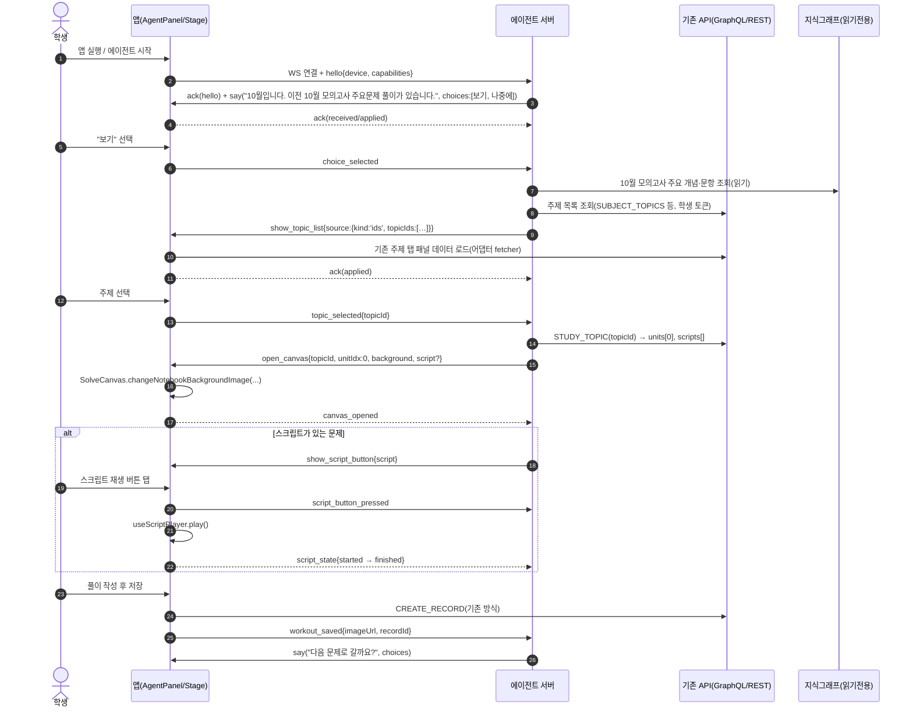

# Qoolla 에이전트 주도 수능 수학 학습 앱 — 구현 명세서

- 대상 독자: Claude(코딩 에이전트)
- 작성일: 2026-10-29 (Asia/Seoul)
- 문서 상태: v0.4.4 (2026-10-31: 앱 아이콘·스플래시·표시 이름 등 기존 앱 자산 계승). 이전: v0.4.3 (2026-10-31: 화면 방향 정책 제거 — 앱 전역 `orientation` 고정 없음, 캔버스 화면 landscape일 때 화면 내부에서 기능 제한). 이전: v0.4.2 (2026-10-31: 질문 24 결정 — 태블릿 판단 `min(w,h) ≥ 600`, 진입 600/이탈 560 히스테리시스, 200ms 디바운스, 펼친 폴더블 drawer 최대 40%). 이전: v0.4.1 (2026-10-31: 질문 20·21 결정 — 기본 흐름 서버 관리, drawer 좌→우. §4.7.1 태블릿 판단 기준 조사·제안 추가). 이전: v0.4 (2026-10-31 브레인스토밍 결정 반영: 인증 Supabase 전환, 결제 범위 제외, Supabase 크론, 에이전트 instruction 모델, 폰 하단 모달/태블릿 drawer·toast, 폴더블 실시간 전환). 이전: v0.3 (2026-10-29 사용자 결정 반영: ① 새 앱이 기존 앱을 **대체**하고 앱 ID `com.qoolla.student` 승계, ② 새 앱은 **React Native Expo(SDK 54, EAS)** 로 개발). 명세서이며, 이 문서 작성 단계에서는 구현·기존 리포 수정이 없었다.
- 표기 규칙
  - **[확인]** 기존 리포(`/Users/jaesungphi/QoollaWorkspace/qoolla-student-app`, HEAD `28ee405`, 2026-10-27)에서 직접 읽어 확인한 사실
  - **[가정]** 읽지 못했거나 추정한 내용. 구현 전에 반드시 검증한다.
  - 체크박스 `- [ ]`는 완료 조건(Done criteria)이다. 전부 충족해야 해당 단계를 닫는다.
- 변경 이력
  - v0.4.2 (2026-10-31): §9 질문 24 결정 처리 — 태블릿 판단을 `width ≥ 720`에서 **`min(window.width, window.height) ≥ 600`** 으로 교체, 진입 ≥600 / 이탈 <560(사이 구간은 직전 모드 유지), 크기 변화 200ms 디바운스, 펼친 폴더블 drawer 폭 최대 40%. §0·§2.2(기존 앱 기준 주석)·§4.1·§4.2·§4.3·§4.7·§4.7.1·M2·§9.0·§9.1 갱신.
  - v0.4.1 (2026-10-31): §9 질문 20(기본 instruction 흐름 = 서버/DB 상태 표, 앱은 내려받기만, 흐름 변경에 앱 재배포 불필요)·21(태블릿 drawer는 왼쪽→오른쪽으로 열림) 결정 처리, §9.0 결정 2건 추가. §4.5·§4.6 갱신. §4.7.1 태블릿/폰 판단 기준 조사 및 **제안**(짧은 변 600 + 히스테리시스) 추가, 질문 24는 사용자 결정 대기로 유지.
  - v0.4 (2026-10-31): §0 결정 요약 행 추가. §1.3 결제 비목표 추가. §4.1~4.3 에이전트 패널을 '항상 좌상단'에서 **폰 하단 모달 / 태블릿 필요 시 drawer(캔버스 위 오버레이)** 로 교체. §4.5 instruction 모델(튜터 메시지 + 기본 흐름), §4.6 태블릿 튜터 메시지 toast, §4.7 폴더블·듀얼 화면 실시간 모드 전환 신설. §7.3 Supabase Auth 전환, §7.7 Supabase 크론/트리거 신설. §9.0 결정 6건, §9.1 질문 20~24 추가.
  - v0.3 (2026-10-29): 앱 대체 + 앱 ID 승계, React Native Expo 결정.
- 보안 규칙: 비밀키, 토큰, 키스토어, `google-services.json`, `GoogleService-Info.plist`, `.env`, OAuth 앱 키, AdMob ID 등은 이 문서에 없고, 새 프로젝트로 복사하지 않는다(필요하면 사용자가 새 ID로 발급한다).

---

## 0. 한눈에 보는 결정 요약

| 주제 | 권장안 | 근거 |
|---|---|---|
| 프레임워크 | **[결정 완료] React Native Expo** — Expo SDK 54(RN 0.81 / React 19.1), TypeScript, Expo Router, expo-dev-client, CNG(prebuild), EAS Build/Submit/Update | §3.3 |
| 프로젝트 형태 | **새 Expo 프로젝트 `qoolla-agent-app`이 기존 학생 앱을 대체**. 기존 앱 리포는 출시 전까지 무변경 | 운영 중(v2.25, versionCode 125) |
| 코드 공유 | **별도 패키지 리포 `qoolla-student-kit`**(리포 루트가 곧 패키지). 기존 `@qoolla/script-parser`와 같은 패턴 | 기존 앱이 이미 `github:` 태그 방식으로 공용 패키지를 사용 [확인] |
| 기존 앱 리포 | 출시 전까지 **읽기 전용**. 출시 후에는 롤백용으로 빌드 가능 상태만 유지(동결 브랜치), kit 이식 작업 없음 | 대체 결정 |
| 앱 ID | **[결정 완료] 기존 ID `com.qoolla.student` 승계**(Android/iOS 동일). 같은 서명키로 스토어 업데이트 | §3.4 |
| 프로토콜 | JSON 엔벨로프 + **WebSocket(양방향)** + REST 폴백, seq/ack 재개 | §5 |
| 에이전트 서버 | 앱과 분리된 신규 서비스(Node.js/TypeScript 권장). 초기엔 **결정론적 플레이북**(LLM 없음), 이후 클라우드 LLM 도구호출 | 로컬 LLM 미사용 방침 |
| 출시 | EAS `preview`→테스트 트랙(TestFlight, Play 내부/비공개) + **기존 설치 위 업그레이드 테스트** → 단계적 출시. 롤백은 출시 중단·상위 버전 핫픽스·**EAS Update(OTA, JS만)**·서버 킬스위치 | §3.5, M10~M12 |
| 인증 | **[결정 완료] Supabase Auth로 전환**. Google/Apple은 네이티브 SDK 토큰 + `signInWithIdToken`, Kakao/Naver는 커스텀 프로바이더 + Edge Function(검증 필요). 서비스 키는 `username` 유지, `users.supabase_auth_id`로 매핑 | §7.3 |
| 결제 | **[결정 완료] 앱 범위 밖**. 별도 PAY WEB 프로젝트에서 다룸 | §1.3 |
| 크론/트리거 | **[결정 완료] Supabase `pg_cron` + Database Webhooks + Postgres 트리거** | §7.7 |
| 에이전트 UX | **[결정 완료]** instruction 정규화(튜터 메시지 + 기본 흐름). 폰: 하단 탭 위 모달. 태블릿: 필요 시 drawer(캔버스 위 오버레이, 필기 계속), 튜터 메시지는 우상단 toast(6.4초). 폴더블은 실시간 모드 전환. 태블릿 판단: 짧은 변 `min(w,h) ≥ 600`(이탈 < 560, 200ms 디바운스) | §4, §4.7.1 |
| 데이터 | 기존 API(GraphQL `activity.qoolla.com`, REST `m-cache`, `api-v2`)와 지식그래프(PostgreSQL) **읽기 전용**. 신규 저장은 에이전트 전용 스키마만 | §7 |

---

## 1. 목표, 범위, 비목표

### 1.1 목표
1. 수능 대비 수학 공부를 **AI 에이전트가 이끄는 앱**으로 전환한다. 학생이 메뉴를 찾아가는 대신, 에이전트가 내용을 제시하고 학생의 action/response에 따라 **에이전트가 화면 전환을 진행**한다.
2. 에이전트가 제시하는 내용은 **항상 화면 왼쪽 상단**에 위치한다. 제시 내용 안에 기존 컴포넌트(검색, 주제 탭 패널, 달력 등)가 포함될 수 있다.
3. 기존 앱의 검증된 화면 부품(풀이 캔버스, 스크립트 플레이어, 주제 탭 패널, 실황 수업 동기화)을 **공유 모듈로 분리**해 재사용한다. 기존 코드를 통째로 복사하지 않는다.
4. 에이전트 서버는 앱과 분리된 별도 서비스다. 에이전트는 화면 이름과 인자를 담은 **명령**을 내려보내고, 앱은 기존 화면을 띄운 뒤 학생의 선택과 풀이 결과를 **이벤트**로 되돌려 보낸다.
5. Qoolla 서비스 철학을 따른다: 콘텐츠를 개념/증명/에피소드/논술/예제 유형으로 다루고, 조회 경로를 짧게 유지하며, 2022 개정 교육과정과 연결한다.

### 1.2 범위 (In scope)
- 새 **Expo(React Native) 앱**(폰/태블릿 모드), 에이전트 패널, 컴포넌트 호스트, 명령 실행기
- 공유 패키지 `@qoolla/student-kit`(풀이 캔버스, 스크립트 플레이어, 주제 탭 패널, 실황 수업 동기화, MathJax HTML 빌더) 및 프로토콜 패키지 `@qoolla/agent-protocol`
- 에이전트 서버 v0(세션, 인증, 플레이어북, 이벤트 저장) 및 이후 LLM 연동 선택지
- 대표 시나리오: 10월 모의고사 주요문제 풀이 흐름

### 1.3 비목표 (Non-goals)
- 기존 `qoolla-student-app` 리포의 코드·설정·네이티브 프로젝트·`package.json`·락파일 수정(출시 전까지. 출시 후에도 롤백 대비 동결 유지). 스토어 업데이트는 새 앱이 같은 ID로 수행한다
- 로컬 LLM 사용(클라우드 API만 사용)
- 지식그래프 DB 스키마 변경, MariaDB 쓰기, math_concepts 이식 작업(별도 진행 중인 작업이며 이 명세는 읽기 소비자)
- 광고(AdMob), 결제, 알림 센터, 프로필 변경 등 기존 앱 부가 기능의 이식(필요 시 후속)
- 에이전트가 정답을 직접 알려주는 기능(기존 `docs/study-room.md`의 "답을 직접 알려주지 않는다" 원칙 유지) [확인]
- 임의 사용자 입력으로 임의 URL/스크립트 실행(명령은 §5의 화이트리스트만 허용)

- **결제(v0.4 결정)**: 결제·구독·결제 웹훅은 이 앱의 범위가 아니다. 별도 **PAY WEB** 프로젝트에서 다룬다. 앱에는 결제 UI를 두지 않는다.

---

## 2. 기존 앱 구조 분석 결과 (직접 읽은 내용)

### 2.1 기술 스택 [확인]
| 항목 | 값 | 근거 파일 |
|---|---|---|
| 프레임워크 | **React Native CLI(bare)** 0.81.4, React 19.1.0. **Expo/EAS 아님**(`eas.json`, `app.config.*` 없음, `app.json`은 `name/displayName`과 AdMob 설정만) | `package.json`, `app.json` |
| 언어/도구 | TypeScript ^5.8.3, Babel `module-resolver` alias(`@components @pages @utils @libs @ctx @config @navs @hooks @assets @res`), Metro(`cjs` 확장자 추가, android 빌드 산출물 blockList), Jest(`preset: react-native`, 테스트는 `__tests__/App.test.tsx` 1개), ESLint 8, Prettier 2.8.8, `patch-package`(5개 패치) | `babel.config.js`, `metro.config.js`, `tsconfig.json`, `jest.config.js`, `patches/` |
| 패키지 매니저 | Yarn(`yarn.lock`), Node ≥ 20 | `package.json` |
| 코드 규모 | `src` 하위 .ts/.tsx 약 36.6k줄. 300줄 초과 파일 다수(`topic-canvas-template.ts` 1408, `timeline/tablet.tsx` 1115, `timeline/index.tsx` 1032, `live-class-canvas-template.ts` 1014, `pages/share/study-note.tsx` 938) | 직접 집계 |
| 내비게이션 | `@react-navigation` v7 (native, native-stack, stack, bottom-tabs, drawer, material-top-tabs). `patches/`로 native-stack, bottom-tabs, elements 패치 | `docs/navigation.md`, `src/navs/*` |
| 상태 관리 | **React Context + useReducer** (`src/ctx/index.tsx`, `AppCtx`; 도메인 Context 4개가 `src/ctx/{auth,ui,content,notification}`에 분리 시작). 서버 상태는 **Apollo Client 4**(+ `@tanstack/react-query` Provider는 있으나 사용은 [가정] 미확인) | `src/ctx/index.tsx`, `App.tsx` |
| 영속 저장 | `react-native-mmkv` 싱글톤 `storage`(`src/utils/storage.ts`). 토큰 키 `'app-token'`, 캔버스 펜 설정 `canvasStrokeColor/Width`, 실황 동기화 `'syncPoint'` 등 | `src/utils/storage.ts` |
| 앱/번들 ID | Android `applicationId "com.qoolla.student"`, versionCode 125, versionName "2.25". iOS `PRODUCT_BUNDLE_IDENTIFIER = com.qoolla.student`, MARKETING_VERSION 2.22(Android와 불일치), `TARGETED_DEVICE_FAMILY = "1,2"`(iPhone+iPad). 딥링크 `https://www.qoolla.com/…`와 스킴 `com.qoolla.student://` | `android/app/build.gradle`, `ios/Go3Math.xcodeproj/project.pbxproj`, `src/config/api.constants.ts` |
| 빌드/배포 | 로컬 Gradle/Xcode(`./gradlew bundleRelease` 서명 AAB). **CI 설정 파일 없음**(`.github`, fastlane 없음). 원격은 GitLab `arasu0070/qoolla-student-app` | `README.md`, `git remote` |
| 앱 진입 | `index.js` → `App.tsx`: `QueryClientProvider → Go3MathClassProvider(AppCtx) → PaperProvider → SafeAreaProvider → StudyNoteLinkHandler → RootNav + GlobalLoadingOverlay + GlobalChatAgentButton`. `Orientation.lockToPortrait()` 호출(세로 고정) | `App.tsx` |

### 2.2 폰/태블릿 분기 [확인]
- 판별: `src/utils/dimensions/index.js`의 `isTablet()`은 **모듈 로드 시점의 window 너비 ≥ 720**(정적). `src/hooks/useDeviceType.ts`는 동일 기준(`TABLET_BREAKPOINT = 720`)의 반응형 훅. (새 앱은 이 720 기준을 쓰지 않는다 — v0.4.2 결정, §4.7.1) `react-native-device-info`의 `isTablet()`은 `App.tsx`에서 로그 용도로만 호출.
- 분기: `src/navs/index.tsx`의 `RootNav`가 인증 후 `isTablet()`이면 `MainTabletStacks`(`src/navs/main/tablet-nav.tsx`), 아니면 `MainStacks`(`src/navs/main/index.tsx`). 둘 다 **Drawer(스택 용도) + 내부 BottomTab** 2단 구조.
  - 폰 탭: HomeTab(`pages/home`), DiaryTab, BookmarksTab, ResearchTab(`pages/research`), ProfileTab
  - 태블릿 탭: TabletHomeTab(`pages/home/tablet-home.tsx`), DiaryTab(`pages/diary/tablet-diary.tsx`), ResearchTab
  - **풀이 캔버스 화면(`Notebook`, `TopicNotebook`, `LiveTopicClassView`, `HotlineClassView`)은 태블릿 스택에만 등록**되어 있다. 폰 스택에는 없다(폰에서 캔버스를 쓰려면 신규 UX 작업 필요).
- 중복: 폰/태블릿 파일 쌍이 28개 존재(`REFACTORING-PLAN.md`). 통합은 미완(Phase 4 미착수).
- 태블릿 홈(`pages/home/tablet-home.tsx`)이 좌측 학습기록 타임라인 + 우측 검색 패널(올해/기출/멘토 주제) + 공지를 한 화면에 구성. 검색 선택 결과는 `task(taskId, type, topicId)` 콜백으로 올려 `TabletQuestionsViewerModal` / `TabletTopicUnitwViewerModal`을 연다.
- **주의(발견)**: `tablet-nav.tsx:39`가 `@pages/research/tablet-search`를 import하지만 해당 파일은 커밋 `ebbf8f3`에서 삭제되었고 현재 트리에 없다. `TabletResearchScreen`은 파일 내에서 import 외 사용처가 없어(grep 1건) Babel이 import를 제거하는 것으로 [가정]하며 빌드 가능 여부는 직접 빌드하지 않아 미확인이다. 새 프로젝트에서는 이 import를 가져오지 않는다.

### 2.3 내비게이션 계약 [확인]
- 화면 이름은 `src/config/Navs.ts`의 `NAVS`, 탭은 `src/config/qoolla-features.ts`의 `QOOLLA_FEATURES`.
- 풀이 캔버스 진입: `navigation.navigate('TopicNotebook', { unit, topicId, taskId, studyRoomMode?, feedbackResponse? })`(스크립트 있는 문제) 또는 `navigate('Notebook', { unit, units, topicId, taskId, studyRoomMode? })`(스크립트 없는 문제).
  - `unit`(스크립트 문제) = `{ sourceId, sourceType, ...firstScript }` (`firstScript` = `{ id, releaseScriptUrl, filenames }`) — `components/panels/topic/tablet.tsx`의 `handleGoPress` 참고.
- 전역 싱글톤: `globalNavigationRef` / `globalNavigate`(`src/navs/index.tsx`). `ChatModal`처럼 NavigationContainer 밖 컴포넌트가 사용.
- 딥링크: `getStateFromPath` 커스텀(`calendar?noteId=`).

### 2.4 인증/API 계층 [확인]
- 로그인: `components/buttons/oauth.tsx`(카카오/네이버/구글/애플) → `helloQoollaService(token, provider)`(`POST {LOGIN_URL}/api/hello`) → 앱 토큰을 MMKV `'app-token'`에 저장. `RootNav`가 부팅 시 `storage.getString('app-token')`로 `RESTORE_TOKEN`. 토큰의 형식(JWT 여부)과 검증 방식은 **[가정] 미확인**.
- REST(axios, `src/libs/api/index.ts`): `API_BASE_URL=https://api-v2.qoolla.com`(사용자/오늘의 수업/월간 수업/미읽음 수), `CACHE_URL=https://m-cache.qoolla.com`(기출 검색 `/api/search`·`/api/search2`, 컬렉션 `/collection/:id`, 문제 `/api/cunit/:id`, 답안 `/unit-answer/:id` 등), `SERVICE_URL/api/storage`(업로드용 SAS URL 발급), 스토리지(Azure Blob) 이미지 경로 접두사들(`UNITIMAGE()` 빌더, `src/config/api.constants.ts`).
- GraphQL(Apollo, `src/libs/apollo/client.ts`): `https://activity.qoolla.com/graphql`(HTTP) + `wss://activity.qoolla.com/graphql`(graphql-ws, `connectionParams.authToken`). `getApolloClient(token, devType)` 모듈 싱글톤. 쿼리/뮤테이션은 `src/libs/apollo/{queries,mutations}/*`(topic, task, record, bookmark, messaging, study, user). 대표: `STUDY_TOPIC`, `SUBJECT_TOPICS`, `SUBJECT_TOTAL_PAGE_COUNT`, `MY_TASKS`, `MONTHRY_RECORDS`, `DAILY_RECORDS`, `UNIT_TRIES`, `CREATE_RECORD`, `SEND_REQUEST_MESSAGE`, `LAST_LIVE_TOPIC_MESSAGE`.
- 에이전트 서버가 쓰는 백엔드 후보: 워크스페이스의 `graphql-api-server`(패키지명 `go3math-activity-server`, Node/TypeScript + ts-node, Redis queue, Neo4j 스크립트 존재) [확인: 폴더/`package.json` 앞부분만 읽음]. 이 서버의 인증 검증 로직은 읽지 않았다 [가정].

### 2.5 재사용 대상 컴포넌트와 결합도 [확인]

> 결합도 약어: **Nav**=react-navigation 훅/객체 사용, **Ctx**=`AppCtx` 사용, **St**=MMKV `storage` 직접 사용, **Apo**=Apollo 훅(상위 `ApolloProvider` 필요), **Glb**=전역 싱글톤/모듈 레벨 `Dimensions.get`.

| 기능 | 파일(경로 기준 `src/`) | 줄 수 | 공개 인터페이스(props / ref) | 결합 | 추출 난이도 |
|---|---|---|---|---|---|
| **풀이 캔버스(fabric.js WebView)** | `components/note-canvas/topic-notebook.tsx` + `topic-canvas-template.ts` (HTML 문자열, fabric 4.3.0을 **jsDelivr CDN**에서 로드) | 600 + 1408 | props `loaded()`, `saveWorkout(imageUrl)`, `saveMentorRequestShot(imageUrl, lastObj)`. ref(`useImperativeHandle`): `changeNotebookBackgroundImage(url, sourceType, sourceId, unitModelId)`, `sendCut(msg)`, `saveSnapshotForMentoring()`, `addFeedback(obj)`, `sendFeedback(fb)`, `sendFeedbackGuides(g)` | Nav(`useIsFocused`), Ctx(`state.appToken`), St(펜 색/굵기), Glb(`Dimensions.get('window')`로 WebView 크기 결정), 업로드(`requestStorageUrl` + `ReactNativeBlobUtil` PUT), 폴백 UI(`react-native-paper` Portal 모달, `GoButton`) | 중. 크기를 props화, 업로드/저장소/포커스를 포트로 주입해야 함 |
| 캔버스 RN→WebView 메시지 | `postMessage(JSON.stringify({actionType, ...}))`. 처리 actionType(`switch (action.actionType)`에서 확인): `SCALE, CLEAN_SHEET, REMOVE, BACKGROUND, NOTEBOOK, ADD, MODIFY, TOGGLE_MODE, RESET, CLEAN_BOARD, CLEAR_CANVAS, CLEAN, ADD_LINE/CIRCLE/TRIANGLE/RECTANGLE/ARROW/IMAGE, WHITE_PAPER, SHOW_SUBSTANTIALS, SAVE, SNAPSHOT, ERASE_WRITTEN, MEMO, POPUP, ACT_SUBS, SCENE_SUBS, BACKGROUND_SUBS, ANIMATIONS, FADEOUTS, APPENDIX, GROUPS, PREPS, SYNCS, BACKWARD, PROLOGUE, EPILOGUE, DEFAULT, FEEDBACK, FEEDBACK_BKG, SYNCH, SYNC_CANVAS_OBJECTS, SYNC_OBJECTS` | | `topic-canvas-template.ts` L145~ 의 `switch (action.actionType)` | | 프로토콜로 문서화·타입화 필요 |
| 캔버스 WebView→RN 메시지 | `window.ReactNativeWebView.postMessage(JSON.stringify({contentMeta, ...}))`. `contentMeta`(확인된 값): `SAVE`(dataURL), `SNAPSHOT`(dataURL, lastObj), `SUB_CNT`, `TOGGLE_MODE`, `CLEANCUTS`, `CUT`, `RECT_INFO`, `LAST_PICK`, `GROUPS/PREPS/SYNCS`, `FEEDBAC_OBJ`(오타 그대로), `FEEDBACK_BKG`, `INJECTED_JAVASCRIPT` | | `topic-notebook.tsx` `handleCanvasMessage` | | |
| 캔버스 HTML 베이스 | `components/note-canvas/canvas-template-base.ts`(공통 구조, 부분 도입) | 88 | `buildCanvasTemplate`, `getCanvasInitVars` | | 양호 |
| 캔버스 화면(오케스트레이션) | `pages/notebook/topic-note/index.tsx`(268줄) — route.params `{unit, topicId, feedbackResponse, taskId, studyRoomMode}` | 268 | 훅 3개 + 컴포넌트 6개로 분해 완료(`hooks/useScriptPlayer.ts`, `useWorkout.ts`, `useFeedback.ts`, `components/{PlaybackToolbar,FloatingActionButton,TopicUnitListModal,FeedbackModal,AnswerBottomSheet,WorkoutSheetModal}.tsx`) | Nav(`route`, `navigation`, `useIsFocused`), **Ctx(`state.currentTopic.units`를 전역에서 읽음)**, Apo(`useWorkout`: `UNIT_TRIES`, `CREATE_RECORD`, `SEND_REQUEST_MESSAGE`), `@gorhom/bottom-sheet` | 중~상. 화면 자체는 재사용하지 않고 훅/컴포넌트만 추출 |
| 스크립트 플레이 훅 | `pages/notebook/topic-note/hooks/useScriptPlayer.ts` | 358 | 입력 `{canvasRef, currentSheet, feedbackResponse, feedbackMode, setFeedbackMode}` → 반환 `{currentUnitScript, currentCutIdx, subCutMode, currentScriptUrl, setCurrentScriptUrl, onScriptLoaded, startIdx, play, backward, rangePlay, canvasLoaded, replayCurrent, sendStuffs, ...}` | 거의 순수. 의존: `canvasRef.current.sendCut`, `@utils/script-maker`(= `@qoolla/script-parser` 재export), `UNITIMAGE`, RN `Image.getSize` | **하(쉬움)**. 가장 먼저 추출 |
| 스크립트 파서 | `@qoolla/script-parser` v1.3.1 (`github:arasu007-naver/qoolla-package#v1.3.1`, 로컬 사본 `/Users/jaesungphi/QoollaWorkspace/packages/script-parser`) | | `scriptMaker(url)`, `parseDocument`, `safeJsonParse`, `getLeaderIdForCut` 등. `src/utils/script-maker.ts`는 이를 재export + `sleep`, `makeTemporaryScript`만 보유 | 외부 패키지(이미 분리됨) | 새 앱에서 **그대로 의존**(수정 금지) |
| 재생 툴바 | `pages/notebook/topic-note/components/PlaybackToolbar.tsx` | 87 | props `navigation, startIdx, currentCutIdx, subCutMode, totalCuts, feedbackMode, setFeedbackMode, onRangePlay, onReplay, onBackward, onPlay, onShowWorkouts` | Nav(`navigation` prop) | 하 |
| **주제 탭 패널(주제 목록)** | `components/panels/research/tablet-mentor-topics.tsx`(330) / 폰 `mentor-topics.tsx`(342) | | props `{task(taskId,'topic',topicId), style?, onLoadingChange?, initialSubject, initialTopics, initialTotalPageCount}`. 과목 칩(`MATH_TOPIC_SUBJECTS`) 선택 시 `SUBJECT_TOPICS(subject,page,pageSize=12)` 재조회 + 무한 스크롤(`QFlatlist`) | Nav(`useNavigation`), Ctx(`dispatch`), St(`'current-topic-subject'`), Apo | 중 |
| 주제 상세(문제 목록 + 가자) | `components/panels/topic/tablet.tsx`(275) 및 래퍼 `components/modal/TabletTopicUnitwViewerModal.tsx` | | props `{topicId, taskId, onLoadingChange?, initialTopic?}`. `STUDY_TOPIC` 조회 → `dispatch({type:'TOPIC'})`로 Ctx에 저장 → `handleGoPress`가 `navigation.navigate(TopicNotebook \| Notebook)` | Nav, Ctx(쓰기), Apo | 중 |
| 올해/기출 검색 패널 | `components/panels/research/{tablet-this-year-exams,tablet-pre-exams}.tsx`(+폰 쌍), 카테고리 칩 `components/sections/research-sections.tsx` | 296/392 | props `{task}`. 내부: 과목 칩, 시행월(`thisMonths`, 기본 2026년 10월), 문항 번호 → `CHECK_PRE_EXAM_SEARCH`/`CREATE_SELECTION_TASK` → `getMemberMathPreExams(token, query)` → **Ctx에 `SHEETS`, `CURRENT_TASK` dispatch** → `task(id,'selection')` | Nav, Ctx(읽기/쓰기, 카테고리는 `state.currentStudyCategory`), St, Apo | 중~상 (Ctx에 결과를 "던지는" 패턴) |
| 학습기록(타임라인) | `components/panels/timeline/{index,tablet}.tsx`(1032/1115), 카드 `timeline/cards/*`, 쿼리 `MY_TASKS(page,pageSize)`, 페이지 `pages/home/*` | | props `{task, initialTasks, onLoadingChange}` | Nav, Ctx, Apo, 폰/태블릿 거의 동일한 두 파일 | 상. **재사용하지 말고 새 UI로 얇게 재구현**(같은 쿼리 사용) 권장 |
| 달력(공부 기록 열람) | `components/panels/record-calendar/index.tsx`(289) / `tablet-records-calendar.tsx`(315), 페이지 `pages/diary/*`, 쿼리 `MONTHRY_RECORDS(month)`, `DAILY_RECORDS(day)`, 화면 `pages/diary/daily-records-view.tsx` | | props `{thisMonth}`; `react-native-calendars` 1.1304.1 | Nav(`DailyRecordsView`로 이동), Ctx, Apo | 중 |
| **연습장 풀이 사진 업로드(카메라)** | `components/panels/questions.tsx`(폰, L94 `DocumentScanner.scanDocument`), `components/panels/study-note/index.tsx`, `components/cards/bookmark.tsx`, `tablet-bookmark.tsx`, `components/panels/essay/item.tsx` | | 흐름: `DocumentScanner.scanDocument({maxNumDocuments:1, responseType:Base64})` → `requestStorageUrl(fileName, token)` → `ReactNativeBlobUtil.fetch('PUT', signedUrl, headers, base64)` → `CREATE_RECORD({sourceType, sourceId, taskId, fileName: imageUrl, photoUnitId:0})` | Ctx(토큰), Apo, 네이티브 모듈(`react-native-document-scanner-plugin`, `blob-util`, `permissions`) | 하(로직은 단순). **공통 훅 `usePhotoUpload` 하나로 신규 작성**(5곳 복붙 구조라 추출 대신 재작성) |
| 실황 수업 수신 + 칠판 동기화 | 화면 `pages/notebook/topic-live-class.tsx`(540), `hotline-class.tsx`(543), 캔버스 `components/note-canvas/topic-live-canvas.tsx`(822), `hotline-class-canvas.tsx`(843), 템플릿 `live-class-canvas-template.ts`(1014), 퀴즈 `components/modal/QuizResponseModal.tsx`(413) | | **전송: GraphQL subscription over WebSocket(`graphql-ws`)**. `TOPIC_LIVE_MESSAGE_ADDED($topicId)`, `ONLINE_TUTOR_CLASS_MESSAGE_ADDED($tutorId)`; 입장 시 `LAST_LIVE_TOPIC_MESSAGE` 쿼리로 마지막 상태를 따라잡고(`syncLiveClassroomBoard`, debounce 1s) `content`(JSON) = `guide`를 파싱. `guide.action ∈ {quiz, snapshot, canvas-synch, lastStep, …}` 또는 `{scriptId, sourceType, sourceId, …}`. 캔버스 ref: `onReceiveGuide(guide)`, `getCurrentScript()`. 재연결은 `shouldRetry ≤ 3회`, `retryWait = retries × 2분`(`client.ts`) | Nav(`useIsFocused`), Ctx, St(`syncPoint`), Apo(`useSubscription`) | 상. 구독·따라잡기를 훅으로 분리하고 캔버스 ref는 포트로 추상화 |
| MathJax HTML 빌더 | `components/math/math-wrapper.tsx`의 `export function buildMathJaxHtmlDocument({...})`(L99), 렌더 래퍼 `MathWrapper`, 메모/식 보기 `components/math-web-view/*` | 354 / 122 | 순수 함수(HTML 문자열 생성) | 없음(빌더), WebView 래퍼는 `Go3MathLoader`, `useIsFocused` | **하**. 빌더만 추출 |
| 기존 채팅 에이전트(개념 조회) | `components/chat/{GlobalChatAgentButton,ChatModal,ConceptsPanel,LiveClassPanel}.tsx` | 73/516/493/299 | `App.tsx`에서 전역 좌하단 플로팅 버튼으로 노출 | Ctx, Nav(`globalNavigate`), Apo | 참고용(새 에이전트 패널과 별개) |
| **공부방 PoC(선행 사례)** | `pages/study-room/{index.tsx,ProblemCard.tsx,script.ts}`, `config/study-room.ts`, 설계 `docs/study-room.md`. 메시지 타입 `bot_text / problem_card / reflection_prompt / user_choice`, `studyRoomMode`로 캔버스의 주제 목록 FAB 숨김 | | 고정 스크립트 PoC. 폰(`navs/main/index.tsx:74-76`)/태블릿(`tablet-nav.tsx:93`) 모두 탭 등록이 주석 처리되어 현재 비활성(import는 남아 있음) | Nav, Ctx | **메시지 타입과 성찰 질문 설계를 새 프로토콜의 씨앗으로 재사용** |

### 2.6 결합도 분석 요약 → 추출 시 해결해야 할 5가지
1. **`AppCtx` 의존**: 컴포넌트가 `state.appToken`, `state.currentTopic`, `state.sheets`, `state.currentStudyCategory`를 읽고 `dispatch(SHEETS/CURRENT_TASK/TOPIC/TASK_COMPLETED)`를 쓴다. → kit 컴포넌트는 Context를 직접 읽지 않고 **props/콜백/포트**로 받는다.
2. **react-navigation 의존**: `useNavigation`, `useIsFocused`, `route.params`. → kit는 내비게이션을 모른다. 선택/완료는 `onSelectTopic`, `onSolveSaved` 같은 **콜백**으로 올린다. 포커스 의존 로직은 `active: boolean` prop.
3. **모듈 레벨 전역**: `Dimensions.get('window')`(캔버스 크기), MMKV 싱글톤, `getApolloClient` 싱글톤, `globalNavigate`. → 크기는 `width/height` props, 저장소는 `KeyValueStore` 포트, 데이터는 fetcher 함수 주입.
4. **Apollo 훅 직접 사용**: `useLazyQuery/useMutation/useSubscription`. → kit는 **fetcher/mutator 함수**(`fetchSubjectTopics`, `createRecord` …)를 주입받는다. 앱 쪽 어댑터가 Apollo/axios로 구현.
5. **WebView 템플릿의 외부 CDN**: fabric.js를 jsDelivr에서 받아 오프라인/차단 환경에서 캔버스가 뜨지 않는다. → kit에서 fabric을 **번들(문자열 인라인 또는 로컬 asset)** 로 옵션 제공(새 앱 기본값), 기존 동작은 변경하지 않는다.

### 2.7 공유 모듈 분리 방법: 선택지와 권장

| 선택지 | 설명 | 장점 | 단점 | 판정 |
|---|---|---|---|---|
| **A. 별도 패키지 리포(kit) + 새 앱이 의존** | `qoolla-student-kit` 리포(루트=패키지, `dist` 빌드, 태그 `vX.Y.Z`로 `github:`/GitLab URL 의존). RN 네이티브 모듈은 `peerDependencies`. 개발 중에는 Expo Metro `watchFolders` + 로컬 경로. kit는 Expo SDK 54 호환 모듈만 peer로 사용 | 기존 앱 무변경 유지 쉬움. `@qoolla/script-parser`와 동일 관례. 새 앱/서버가 프로토콜 타입 공유 | 태그 배포 마찰, 로컬 링크 시 Metro 심볼릭 링크 설정 필요 | **권장** |
| B. 모놀리포(두 앱 + packages) | 기존 앱을 모놀리포로 이동 | 단일 리포, 리팩터 쉬움 | 기존 앱 폴더 이동 = 운영 앱 변경. 승인 없이는 불가 | 비권장(별도 승인 시 장기 옵션) |
| C. 새 앱이 기존 앱 소스를 경로로 직접 import(읽기 전용 alias) | `metro.config.js` `watchFolders`로 기존 `src` 참조 | 중복 0, 가장 빠름 | AppCtx/네비게이션 결합이 그대로 새 앱에 유입. 기존 앱 변경이 새 앱을 깨뜨림 | **M0 스파이크 한정**(결합 지점 확인용). 제품 코드 금지 |
| D. 복사 후 수정 | 파일 복사 | 쉬움 | 코드 분기·이중 유지보수 | **금지**(요구사항) |

**권장 순서(추출 단위별 "기존 앱 무변경" 유지):**
1. kit에는 처음부터 **의존성 주입형 API**로 새로 작성한다(원본 로직을 읽고 동일 동작을 재현하되 AppCtx/Nav/전역 제거). 이 단계에서 기존 앱은 한 줄도 수정하지 않는다. 일시적 로직 중복은 "추적 가능한 부채"로 §8의 표에 기록한다.
2. 동등성은 **골든 테스트**로 보증한다: 기존 앱의 실제 스크립트/메시지 시퀀스를 입력해 캔버스로 전송되는 `sendCut` 메시지 열이 동일한지 비교(기존 앱 코드를 실행하지 않고, 기록된 fixture와 kit 출력만 비교).
3. 새 앱이 기존 앱을 대체하므로 **기존 앱을 kit로 이식하는 작업은 하지 않는다**. 기존 리포는 출시 전까지 무변경, 출시 후에는 롤백용 동결 브랜치로만 유지한다(§3.5.6).

**추출 순서(결합도 낮은 것부터):**
| 순서 | kit 서브패스 | 원본 | 완료 시 얻는 것 |
|---|---|---|---|
| 1 | `@qoolla/student-kit/math` | `math-wrapper.tsx`의 `buildMathJaxHtmlDocument` | 문제/해설 HTML 생성(결합 없음) |
| 2 | `@qoolla/student-kit/script-player` | `useScriptPlayer.ts`, `PlaybackToolbar.tsx` | 스크립트 재생 로직(포트: `ScriptCanvasPort`) |
| 3 | `@qoolla/student-kit/canvas` | `topic-notebook.tsx` + `topic-canvas-template.ts` + `canvas-template-base.ts` | `SolveCanvas`(크기 props, 업로드 포트, 펜 설정 저장 포트) + 액션/메시지 타입 |
| 4 | `@qoolla/student-kit/topic-panel` | `tablet-mentor-topics.tsx`, `panels/topic/tablet.tsx` | `TopicTabsPanel`, `TopicUnitList`(콜백 기반) |
| 5 | `@qoolla/student-kit/live-class` | `topic-live-class.tsx`의 구독/따라잡기 + `topic-live-canvas.tsx` | `useLiveClassSync`, `LiveCanvasPort`, graphql-ws 전송 어댑터 |
| 6(선택) | 검색 패널(올해/기출) | `tablet-this-year-exams.tsx` 등 | 에이전트가 프리셋을 주입하는 `ExamSearchPanel` |

**kit 포트 인터페이스(초안, TypeScript):**
```ts
// @qoolla/student-kit/ports
export interface KeyValueStore { getString(k: string): string | undefined; set(k: string, v: string | number): void; getNumber(k: string): number | undefined; }
export interface ImageUploadPort { upload(args: { dataUrl: string; folder: string; fileName: string }): Promise<{ imageUrl: string }>; } // 구현: requestStorageUrl + Blob PUT
export interface ScriptCanvasPort { sendCut(msg: Record<string, unknown>): void; }
export interface SolveCanvasHandle extends ScriptCanvasPort {
  changeNotebookBackgroundImage(imageUrl: string, sourceType: string, sourceId: number, unitModelId?: number): void;
  saveSnapshotForMentoring(): void; addFeedback(obj: unknown): void; sendFeedback(fb: unknown): void; sendFeedbackGuides(g: unknown): void;
}
export interface SolveCanvasProps {
  width: number; height: number;            // 기존: Dimensions.get('window') 고정 → props화
  active: boolean;                          // 기존: useIsFocused 대체
  upload: ImageUploadPort; store: KeyValueStore;
  fabricSource?: 'cdn' | 'inline';          // 새 앱 기본 'inline'
  onLoaded?(): void; onSaveWorkout?(r: { imageUrl: string }): void; onSaveMentorShot?(r: { imageUrl: string; lastObj: unknown }): void;
}
export interface TopicPanelFetchers {
  fetchSubjectTopics(a: { subject: string; page: number; pageSize: number }): Promise<TopicSummary[]>;
  fetchTotalPageCount(a: { subject: string; pageSize: number }): Promise<number>;
  fetchTopic(topicId: number): Promise<TopicDetail>;
}
export interface LiveClassTransport {
  subscribe(topicId: number, onGuide: (g: LiveGuide) => void): () => void;   // graphql-ws 구독 어댑터
  fetchLast(topicId: number): Promise<LiveGuide | null>;                      // LAST_LIVE_TOPIC_MESSAGE
}
```

---

## 3. 새 프로젝트 구성

### 3.1 리포지토리 (3개 + 서버)
| 리포 | 역할 | 비고 |
|---|---|---|
| `qoolla-agent-app` | 새 **Expo(SDK 54)** 앱(에이전트 UI, 컴포넌트 호스트, 명령 실행기) | 신규. GitLab 그룹은 기존과 동일하게 [가정](호스팅 위치는 사용자가 결정) |
| `qoolla-student-kit` | 공유 UI/로직 패키지 `@qoolla/student-kit` | 신규. 루트=패키지, `build.js`로 `dist` 생성(`@qoolla/script-parser` 방식). **Expo 호환 필수**: 자체 네이티브 코드 없음(순수 TS/React), 네이티브 의존(`react-native-webview`, `react-native-mmkv` 등)은 전부 `peerDependencies`로 선언하고 Expo SDK 54가 지원하는 모듈만 허용. kit 자체는 config plugin을 갖지 않는다 |
| `qoolla-agent-protocol` | 앱·서버 공용 타입/스키마 `@qoolla/agent-protocol` (RN 의존성 없음) | 신규. 처음에는 `qoolla-student-kit`의 서브패키지로 두어도 무방. 서버가 RN 패키지를 끌어오지 않도록 **별도 패키지**로 발행 |
| `qoolla-agent-server` | 에이전트 서버 | 신규. §7 |

기존 `qoolla-student-app`, `packages/script-parser`(및 `qoolla-package` 리포)는 **수정하지 않는다**.

**기존 리포를 수정하지 않고 필요한 정보를 얻는 방법**
- 새 프로젝트가 기존 앱에서 알아야 하는 값(ID, 버전, URL 스킴, associated domains 도메인, entitlements 항목, MMKV 키 목록, 서명 설정 *구조*)은 **읽기 전용 조회 결과를 새 리포의 `docs/legacy-facts.md`에 사람이 읽는 형태로 기록**한다. 파일 복사·심볼릭 링크·서브모듈 금지.
- 비밀값(키스토어 파일과 비밀번호, 업로드 키, Apple 인증서/프로비저닝 프로파일, `google-services.json`·`GoogleService-Info.plist`, OAuth 앱 키, AdMob ID)은 **문서·리포에 쓰지 않는다**. 사용자가 보관 중인 원본을 **EAS credentials / EAS 환경변수(파일형 포함)에 직접 업로드**한다(§3.3.2). 기존 리포에서 필요한 것은 "어떤 키로 서명했는가"라는 *구조 정보*뿐이다(기존: `STUDENT_APP_KEYSTORE_FILE` Gradle 프로퍼티, 기본값 `student_app.keystore` [확인: 프로퍼티 이름만]) — 사용자가 해당 키스토어를 EAS에 올리면 된다.
- 기존 리포에 키스토어 파일과 Firebase 설정 파일이 **커밋되어 있는 것으로 보인다**(`android/app/` 파일 목록) [확인: 파일 존재만, 내용 미열람]. 새 리포에는 커밋하지 않는다(보안 정리 권고는 §9).

### 3.2 `qoolla-agent-app` 폴더 구조(제안)
```
qoolla-agent-app/
  package.json            # expo ~54, react-native 0.81.x, react 19.1, TS ^5.8 (`npx expo install`로 고정)
  app.config.ts           # ID/버전/스킴/entitlements/플러그인 (비밀은 env)
  eas.json                # development / preview / production
  babel.config.js         # babel-preset-expo + module-resolver(@agent, @host, @adapters)
  metro.config.js         # expo/metro-config + 로컬 kit watchFolders(옵션)
  plugins/                # 필요 시 로컬 config plugin(직접 네이티브 수정 대체)
  app/                    # Expo Router 라우트(_layout, (auth), (main), classic/*, calendar, +native-intent)
  src/
    bootstrap/            # Provider 조립, 에러 바운더리, migrations/legacy-v2.ts
    agent/
      AgentPanel.tsx      # 좌상단 고정 패널(말풍선, 선택지, 입력)
      useAgentSession.ts  # 소켓 연결, seq/ack, 재연결, 오프라인 큐
      commandRouter.ts    # 명령 → UI 상태 전이(reducer). 단일 진실 원천
      sessionStore.ts     # 세션 상태(§5.5), zustand 또는 useReducer
    host/
      Stage.tsx           # 콘텐츠 영역(컴포넌트 호스트)
      registry.ts         # componentId → React 컴포넌트 + props 검증(zod)
      widgets/            # TopicListWidget, ExamSearchWidget, RecordCalendarWidget, SolveCanvasWidget ...
    adapters/             # kit 포트 구현: apollo/axios fetcher, MMKV store, blob 업로드
    auth/                 # 로그인(기존 앱 토큰 재사용 방식 §7.3)
    config/               # 엔드포인트 상수(환경 변수 아님, 빌드 변형)
  (android/ ios/ 없음)    # CNG: `npx expo prebuild`로 생성, .gitignore. 기존 네이티브 프로젝트 복사 금지
  __tests__/
```
- 새 앱은 **Redux/단일 AppCtx를 만들지 않는다**. 에이전트 세션 상태는 `sessionStore` 하나로 모으고, 도메인 데이터는 어댑터의 fetcher로 가져온다.

### 3.3 빌드/도구 — **React Native Expo (결정 완료, v0.3)**
- **프레임워크: React Native + Expo**. 기존 앱(bare RN CLI)과 달리 새 앱은 Expo 관리형 워크플로 + **CNG(Continuous Native Generation)** 를 쓴다. `android/`, `ios/`는 **커밋하지 않고** `npx expo prebuild`로 생성한다. 네이티브 설정 변경은 전부 `app.config.ts`와 **config plugin**으로만 한다(생성된 네이티브 폴더 수동 수정 금지).
- **SDK 버전: Expo SDK 54** = React Native 0.81 + React 19.1 [확인: expo.dev/changelog/sdk-54, 2025-09-10 출시]. 기존 앱과 같은 RN/React 버전대라 kit 이식과 동작 비교가 쉽다. SDK 54는 Legacy Architecture를 지원하는 마지막 SDK이나, 기존 앱도 이미 `newArchEnabled=true`, `hermesEnabled=true` [확인: `android/gradle.properties`]이므로 새 앱도 **New Architecture + Hermes**로 간다. 2026-10 현재 더 새로운 SDK(55+, RN 0.83+)가 있으므로 시작 시점에 SDK 54 고정 vs 최신 SDK 채택을 §9 질문으로 확정한다(권장: **SDK 54로 시작**, 동등성 확보(M10) 후 SDK 업그레이드는 별도 릴리즈).
- 언어: TypeScript(strict). `tsconfig.json`은 `expo/tsconfig.base` 확장.
- **라우팅: Expo Router 권장**(내부적으로 react-navigation 7 기반이므로 `useNavigation`, `useIsFocused`, 테마 등 react-navigation 7 API가 그대로 동작). 기존 화면이 react-navigation 7을 쓰지만 kit 컴포넌트는 내비게이션을 몰라야 하므로(§2.6) 라우터 선택이 kit에 영향을 주지 않는다.
  - 이유: 화면 수가 적다(에이전트 홈 + 로그인 + 비에이전트 모드 화면 + 딥링크 진입점). 딥링크가 파일 경로로 자동 연결되고 `scheme` 설정과 일관된다. Expo 기본 템플릿·문서와 일치.
  - 대안: `@react-navigation/*` 7 직접 사용 — 기존 `src/navs` 구조를 참고하기 쉬우나 linking 설정을 수동 관리. 기존 `patches/`(react-navigation 패치 3건)는 **새 앱에 가져오지 않는다**; 필요 사례가 재현되면 그때 판단.
  - 라우트 초안: `app/_layout.tsx`(Provider, 세션), `app/(auth)/login.tsx`, `app/(main)/index.tsx`(에이전트 홈: AgentPanel + Stage), `app/(main)/classic/*`(비에이전트 모드: search, records, calendar, canvas, live), `app/calendar.tsx`(기존 `calendar?noteId=` 딥링크 수용 후 리다이렉트), `app/+native-intent.tsx`(`https://www.qoolla.com/...` 경로 재작성).
- **개발 빌드(expo-dev-client) 사용, Expo Go 사용 안 함**: MMKV(Nitro), 문서 스캐너, 카카오/네이버 로그인 등 Expo Go에 없는 네이티브 모듈이 필요하다. `eas build --profile development` 또는 `npx expo run:ios|android`.
- 패키지 매니저: Yarn(기존과 동일) 또는 npm — 의존성 추가는 항상 **`npx expo install <pkg>`** 로 SDK 호환 버전을 고정. `npx expo-doctor`를 CI 게이트로 사용.
- 로컬 kit 개발: Expo의 `metro.config.js`(`expo/metro-config`의 `getDefaultConfig`)에 `watchFolders: ['../qoolla-student-kit']`, peer 중복(react, react-native) 방지 설정. 릴리즈 빌드는 **태그 의존**(`github:`/GitLab URL `#vX.Y.Z`)만 허용.
- 스크립트: `expo start --dev-client`, `expo run:*`, `test`(jest-expo 프리셋), `lint`(`expo lint`), `typecheck`, `doctor`.

#### 3.3.1 기존 앱 네이티브 모듈의 Expo 호환성
[확인] = 기존 앱 `node_modules`에 `app.plugin.js` 존재 여부를 읽기 전용으로 확인. 최종 호환 여부는 M1에서 `expo-doctor` + 개발 빌드로 검증.

| 기존 모듈(버전 범위는 기존 `package.json`) | 새 앱 처리 | config plugin / 비고 |
|---|---|---|
| `react-native-mmkv` ^4.0.0 + `react-native-nitro-modules` | **그대로 사용**(같은 메이저 v4, `createMMKV()`) | 기존 설치본(4.0.0)에는 `app.plugin.js` 없음 [확인]. 이후 4.x에 Expo 플러그인이 추가됨(Android 빌드 이슈 해결, `plugins: ['react-native-mmkv']`) — **플러그인 포함된 최신 4.x로 고정** [가정: 정확한 버전은 M1에서 확인]. 개발 빌드 필수 |
| `react-native-webview` 13.16 | **그대로**(`npx expo install`) | 플러그인 불필요. 풀이 캔버스(fabric), MathJax 모두 WebView |
| `react-native-document-scanner-plugin` ^1.0.1 | **그대로** | `app.plugin.js`(expo-plugin) 있음 [확인] → 카메라 권한 문구 설정 |
| `react-native-image-crop-picker` | **`expo-image-picker`로 대체** | 기존 플러그인 없음 [확인]. expo-image-picker는 플러그인으로 권한 문구 설정 |
| `react-native-permissions` | 각 Expo 모듈의 권한 API로 대체(필요 시 유지 가능) | 플러그인 있음 [확인] |
| `react-native-blob-util` | **`expo-file-system`(SDK 54 신 API) 또는 `fetch` PUT**으로 대체(SAS URL 업로드) | 플러그인 없음 [확인]. 대체가 단순 |
| `react-native-fs` | `expo-file-system`로 대체 | 플러그인 없음 [확인] |
| `@react-native-seoul/kakao-login` ^5.4 | **그대로** | 플러그인 있음 [확인] → 카카오 네이티브 앱 키·URL 스킴을 플러그인 인자로(값은 EAS 환경변수, 문서 미기재) |
| `@react-native-seoul/naver-login` ^4.2 | **그대로** | 플러그인 있음 [확인] → URL 스킴 |
| `@react-native-google-signin/google-signin` ^16 | **그대로** | 플러그인 있음 [확인] → iOS URL 스킴, `googleServicesFile` |
| `@invertase/react-native-apple-authentication` | **`expo-apple-authentication`으로 대체** | 기존 모듈 플러그인 없음 [확인]. Expo 쪽은 `ios.usesAppleSignIn: true`로 entitlement 생성 |
| `react-native-google-mobile-ads` | 광고 유지 결정 시에만 | 플러그인 있음 [확인] → 앱 ID는 EAS 환경변수 |
| `react-native-bootsplash` | `expo-splash-screen`으로 대체 | |
| `react-native-orientation-locker` | 사용 안 함. 앱 전역 방향 고정 없음(v0.4.3). 캔버스 화면이 가로 여부를 `useWindowDimensions`로 감지해 기능 제한 | 플러그인 없음 [확인] |
| `react-native-device-info` | `expo-device`, `expo-application` | 플러그인 없음 [확인] |
| `react-native-restart` | `expo-updates`의 `reloadAsync()` | |
| `react-native-vector-icons` | `@expo/vector-icons` | |
| `react-native-pdf` | 사용 시 `@config-plugins/react-native-pdf` + 개발 빌드 [가정] | 동등성 범위 밖이면 제외 |
| `react-native-calendars` 1.1304.1 | **그대로**(순수 JS) | 달력 동등성 |
| `react-native-reanimated` ^4 + `react-native-worklets`, `gesture-handler`, `screens`, `safe-area-context`, `svg`, `pager-view`, `@gorhom/bottom-sheet`, `@react-native-community/slider/datetimepicker` | `npx expo install`로 SDK 54 호환 버전 | Expo 지원 모듈 |
| `react-native-ui-lib`(패치 있음), `react-native-calendar-events`, `react-native-add-calendar-event` | **새 앱에서 사용하지 않음**(paper/자체 컴포넌트로 대체, 캘린더 연동은 필요 시 `expo-calendar`) | 패치 승계 금지 |

#### 3.3.2 EAS Build / Submit
- `eas.json` 프로필
  | 프로필 | 용도 | 배포 |
  |---|---|---|
  | `development` | `developmentClient: true`, internal distribution | 전용 테스트 기기/시뮬레이터 |
  | `preview` | 운영과 같은 ID·서명의 릴리즈 빌드, `channel: preview` | `eas submit` → **TestFlight** / **Play 내부·비공개 테스트** |
  | `production` | `channel: production`, `autoIncrement: true` | `eas submit` → App Store / Play 단계적 출시 |
- `app.config.ts`(동적 설정, 비밀은 `process.env`/EAS 환경변수로만):
  - `ios.bundleIdentifier: 'com.qoolla.student'`, `android.package: 'com.qoolla.student'`
  - **브랜드 자산 계승(v0.4.4 결정)**: 앱 아이콘(iOS AppIcon, Android launcher·adaptive icon), 스플래시 이미지·배경색, 앱 표시 이름(`displayName`)은 기존 앱 것을 그대로 쓴다. 원본은 기존 리포(읽기 전용)에서 복사만 한다. 경로는 `ios/Go3Math/Images.xcassets/AppIcon.appiconset`, `android/app/src/main/res/mipmap-*`, `react-native-bootsplash` 자산으로 추정되며 [가정, 확인 필요]. 복사한 파일은 `app.config.ts`의 `icon`, `android.adaptiveIcon`, `expo-splash-screen` 플러그인에 연결한다. 새 디자인으로 바꾸지 않는다.
  - `version: '3.0.0'`, `runtimeVersion: { policy: 'appVersion' }`(§3.3.3)
  - `scheme: ['com.qoolla.student']`(카카오/네이버/구글 스킴은 각 플러그인이 추가)
  - `ios.associatedDomains`(기존 도메인, `legacy-facts.md` 참조), `ios.usesAppleSignIn: true`, `android.intentFilters`(`https://www.qoolla.com`, `autoVerify: true`)
  - `ios.googleServicesFile` / `android.googleServicesFile`: **EAS 파일형 환경변수**로 주입(리포 미커밋)
  - `orientation` 미지정(방향 고정 없음, v0.4.3), `ios.supportsTablet: true`(기존 `TARGETED_DEVICE_FAMILY = "1,2"` [확인])
- **버전 번호**: `eas.json`의 `cli.appVersionSource: 'remote'` + production `autoIncrement: true`. 첫 빌드 전에 `eas build:version:set`으로 Android versionCode를 **스토어 최신값(리포 기준 125)** 으로 맞춰 첫 빌드가 **≥126**이 되게 하고, iOS buildNumber도 App Store Connect의 최신 값 이상으로 설정. 명시값 방식(app.config에 직접 기입)은 실수 위험이 커 비권장.
- **자격 증명(EAS credentials)** — 비밀값은 사용자만 업로드하고 이 문서/리포에는 남기지 않는다.
  - Android: `eas credentials`로 **기존 업로드 키스토어**(기존 앱 서명 구성의 키)를 사용자가 업로드. Play App Signing 사용 시 업로드 키만 필요, 미사용 시 업로드 키가 곧 앱 서명 키이므로 **분실·교체 불가**(Play App Signing 미사용이면 출시 전에 등록 권장). EAS가 새 키를 생성하게 두면 업데이트가 거부되므로 **"Generate new keystore" 선택 금지**.
  - iOS: 기존 Apple 개발팀으로 EAS 로그인 → 같은 Bundle ID의 App Store 배포 인증서/프로비저닝 프로파일을 EAS가 관리(기존 것 재사용 또는 새 프로파일 생성. 프로파일 교체는 사용자 업데이트에 영향 없음). Capabilities(Sign in with Apple, Associated Domains)는 같은 App ID에 이미 있음.
  - `eas submit`: App Store Connect API 키, Play 서비스 계정 JSON — 사용자가 EAS에 등록.

#### 3.3.3 EAS Update (OTA) — 추가 핫픽스/롤백 경로
- `expo-updates` + 채널(`preview`, `production`). **JS/에셋만** 교체 가능하며 **네이티브 코드·권한·config plugin 변경은 OTA로 불가**(새 스토어 빌드 필요).
- `runtimeVersion: { policy: 'appVersion' }` — 네이티브가 바뀌는 릴리즈마다 `version`을 올려 OTA가 호환되지 않는 바이너리에 가지 않게 한다(대안 `fingerprint` 정책은 자동 판별이나 디버깅이 어려움; 안정화 후 재검토).
- 롤백: `eas update:rollback` 또는 이전 업데이트 재게시로 **분 단위 되돌리기**. 스토어 바이너리 다운그레이드 불가 문제를 JS 범위에서 보완.
- 운영 규칙: production OTA는 preview 채널 검증 후에만, 단계적 배포(`--rollout-percentage`) 사용, 킬스위치(`agentEnabled`)와 함께 운용.

### 3.4 앱 ID 전략 — [결정 완료]
- **새 앱 `qoolla-agent-app`은 기존 앱을 대체하며 앱 ID `com.qoolla.student`를 그대로 승계한다.** Android `applicationId`/`namespace`와 iOS `PRODUCT_BUNDLE_IDENTIFIER` 모두 `com.qoolla.student`. 기존 스토어 등록(Play/App Store)에 **업데이트로 배포**한다.
- 결과: 기존 사용자는 스토어 업데이트로 새 앱을 받는다. 같은 기기에 신구 앱 병행 설치는 불가하다. 따라서 (1) 업그레이드 경로(§3.5), (2) 출시 전 기능 동등성(§8 M10), (3) 롤백 수단(§3.5.6)이 출시 필수 조건이다.
- 개발 중 빌드: 같은 ID를 쓰므로 **운영 앱이 설치된 개인 기기에 개발 빌드를 설치하지 않는다**(Android는 서명이 다르면 설치 실패, iOS는 운영 앱을 덮어씀). 시뮬레이터/에뮬레이터 및 전용 테스트 기기만 사용한다.
- 현재 버전 위치와 값 [확인]
  | 플랫폼 | 위치 | 현재 값 |
  |---|---|---|
  | Android | `android/app/build.gradle` `defaultConfig` | `versionCode 125`, `versionName "2.25"` |
  | iOS | `ios/Go3Math.xcodeproj/project.pbxproj` (앱 타깃 Debug/Release) | `MARKETING_VERSION = 2.22`, `CURRENT_PROJECT_VERSION = 1` |
  - 새 앱 첫 릴리즈는 Android `versionCode ≥ 126`(출시 시점 스토어 최신값 + 1), iOS `MARKETING_VERSION ≥ 3.0`(권장: 대체 출시임을 드러내는 **3.0.0**, Android `versionName "3.0.0"`), iOS 빌드 번호는 App Store Connect의 해당 버전 최신값보다 크게. 출시 직전 **스토어 콘솔의 실제 최신값**으로 재확인한다(리포 값과 다를 수 있음 [가정]).


### 3.5 같은 ID 대체 업데이트 경로
#### 3.5.1 로컬 데이터·로그인 세션 이전 (MMKV)
- 기존 저장소 [확인]: `src/utils/storage.ts`의 `createMMKV()`를 **인자 없이** 호출한다. 즉 **기본 인스턴스 id(`mmkv.default`), 기본 경로, 암호화 키 없음**. (react-native-mmkv v4)
- 기존 키(사용 빈도순, `storage.set/getString` 검색 결과) [확인]: `app-token`, `canvasStrokeColor`, `canvasStrokeWidth`, `syncPoint`, `live-scripts`, `current-topic-subject`, `calendarNoteId`, `recent-exam-subject`, `pre-exam-subject`, `pre-exam-months`, `pre-exam-numbers`, `alert-message`, `lastSubject`, `lastChapter`, `lastRoomType`, `lastAgenda`, `seearchPanelMode`(오타 그대로) 등. 동적 키는 [가정] 미전수.
- **Expo에서의 저장 위치** [가정: M1에서 실측 검증]: react-native-mmkv는 Expo 여부와 무관하게 같은 네이티브 라이브러리이며 기본 루트(iOS `Documents/mmkv`, Android `files/mmkv`)와 기본 id(`mmkv.default`)를 쓴다. 같은 Bundle ID/패키지 = 같은 앱 샌드박스이므로 **같은 메이저(v4)·기본 설정이면 기존 파일을 그대로 읽는다**. 금지: `createMMKV({id, path, encryptionKey})`로 다른 값 지정, App Group(`AppGroupIdentifier`) 신규 설정(iOS 저장 경로가 그룹 컨테이너로 바뀜), MMKV 메이저 다운그레이드. M1에서 **기존 v2.25 설치 → 개발/preview 빌드 업데이트 후 `app-token` 읽기**를 실측한다.
- 규칙
  - 새 앱도 **같은 기본 인스턴스를 암호화 없이 연다**(`createMMKV()`). 처음부터 id나 암호화를 바꾸면 기존 토큰을 읽지 못해 **전원 강제 로그아웃**된다.
  - 새 앱 전용 키는 접두사 `agent:`로 분리(예: `agent:outbox`, `agent:session`). 기존 키 이름은 바꾸지 않는다.
  - 첫 실행 마이그레이터 `src/bootstrap/migrations/legacy-v2.ts`: `schema-version` 키가 없으면 레거시로 간주 → `app-token` 존재 확인 → 펜 설정·과목 선택 등 재사용 키는 그대로 사용 → 더 이상 안 쓰는 키(`syncPoint`, `live-scripts` 등)는 **삭제하지 않고 유지**(롤백 대비, 다음 메이저에서 정리) → `schema-version=3` 기록. 멱등이어야 한다.
  - 암호화 도입이 필요하면 별도 릴리즈에서 `recrypt`로 전환(이번 대체 출시와 분리).
  - 참고: 기존 `clearCacheDirectory()`는 `storage.clearAll()`을 호출한다 [확인: `src/utils/storage.ts`] — 새 앱의 캐시 정리는 MMKV 토큰을 지우지 않도록 분리한다.
- 토큰 호환: 새 앱은 MMKV `app-token`의 값을 **기존과 같은 방식**(Authorization `Bearer`, graphql-ws `connectionParams.authToken`)으로 사용한다. 부팅 시 `myInfo`(`GET /user/me`)로 유효성 확인, 401이면 재로그인. 토큰 형식은 [가정] 미확인이므로 **값을 파싱하지 않는다**.
- 소셜 로그인 SDK(카카오/네이버/구글/애플)는 같은 ID·같은 서명이면 기존 앱 등록을 그대로 쓴다. SDK 자체 세션(키체인/SharedPreferences)은 앱 토큰과 별개이며, 재로그인 시에만 필요하다.
- MMKV 외 저장소: 캐시 디렉터리 이미지 등은 이전 대상 아님. iOS 키체인 사용 여부 [가정] 미확인(M10에서 확인).

#### 3.5.2 서명키 승계
- **Android**: 같은 앱으로 업데이트하려면 **기존 업로드 키로 서명**해야 한다. Play App Signing 사용 여부와 업로드 키 = 기존 `student_app.keystore`인지는 [가정] 미확인 → 사용자가 Play Console(앱 무결성 → 앱 서명)에서 확인. Play App Signing 사용 중이면 업로드 키 분실 시 재설정 가능, 미사용이면 **키 분실 = 업데이트 불가**이므로 출시 전 백업 확인을 M11 완료조건에 둔다.
- 새 앱(Expo)은 `build.gradle`을 직접 관리하지 않는다. **EAS credentials에 기존 업로드 키스토어를 사용자가 업로드**하고, EAS가 원격 빌드에서 서명한다(§3.3.2). 로컬 `expo run:android --variant release` 서명이 필요하면 로컬 config plugin으로 Gradle 프로퍼티 주입(키 파일은 리포 밖).
- **iOS**: 같은 Bundle ID, **같은 Apple 개발팀**(값은 문서에 쓰지 않음), App Store 배포 프로비저닝. 기존 entitlements [확인: 키 이름만]: `com.apple.developer.applesignin`, `com.apple.developer.associated-domains`. 새 앱은 entitlements 파일을 직접 쓰지 않고 `app.config.ts`의 `ios.usesAppleSignIn: true`, `ios.associatedDomains: [...]`(또는 config plugin)로 생성한다(도메인 값은 `legacy-facts.md`에 기록). prebuild 결과의 entitlements가 기존 키 2개와 일치하는지 M11에서 비교. App ID의 Capabilities(Sign in with Apple, Associated Domains)는 Apple Developer에 이미 있으므로 변경 불필요.
- iOS 타깃/스킴 이름(prebuild가 `name`에서 생성)은 바꿔도 무방(Bundle ID가 같으면 같은 앱). 표시 이름은 기존 `Go3Math` 계열 유지 여부는 §9.

#### 3.5.3 푸시/Firebase
- 기존 앱 [확인]: Android `build.gradle`에 Firebase/google-services 플러그인 적용 흔적 없음, Manifest/Info.plist에 FCM/원격 알림 설정 없음. 단 `google-services.json`, `GoogleService-Info.plist` 파일은 존재(Google Sign-In 용도로 [가정]).
- 새 앱: 같은 ID이므로 **기존 Firebase/Google Cloud 프로젝트의 같은 설정 파일**을 사용자가 **EAS 파일형 환경변수**로 등록하고 `app.config.ts`의 `googleServicesFile`이 그 경로를 참조(리포 미커밋). 푸시 도입 시 `expo-notifications` + 기존 프로젝트의 APNs 키/FCM. Google Sign-In의 Android SHA-1은 앱 서명 키 기준이라 서명 승계 시 변경 없음. 푸시는 v1 범위 밖(필요 시 APNs 키/FCM을 기존 프로젝트에 추가).
- AdMob: 기존 앱은 `react-native-google-mobile-ads` 사용 [확인]. 새 앱에서 광고를 빼면 `app.config.ts`에 AdMob 플러그인/설정을 넣지 않는다(유지 시 앱 ID는 EAS 환경변수). 유지 여부는 §9.

#### 3.5.4 딥링크/유니버설 링크
- 기존 [확인]: Android App Link `https://www.qoolla.com`(http/https, host 지정), 커스텀 스킴 `com.qoolla.student`, 카카오 OAuth 스킴(`kakao{앱키}` — 값 미기재), iOS `CFBundleURLSchemes`에 `com.qoolla.student`와 카카오 스킴, Associated Domains. 앱 내부 경로: `calendar?noteId=` 등(`src/navs/index.tsx` linking).
- 새 앱: `app.config.ts`의 `scheme`, `android.intentFilters`(autoVerify), `ios.associatedDomains`와 각 로그인 SDK 플러그인으로 같은 스킴·호스트를 등록하고, Expo Router 라우트(`app/calendar.tsx`, `+native-intent.tsx`)로 **기존 링크 경로를 모두 처리**(최소 `calendar?noteId=`, 학습노트 공유 링크). 처리 불가 경로는 홈(에이전트 패널)으로 열고 `say`로 안내. 서버의 `apple-app-site-association` / `assetlinks.json`은 ID·서명이 같으므로 변경 불필요 [가정: 파일 내용 미확인].

#### 3.5.5 최소 버전 강제 여부
| 선택지 | 내용 | 장점 | 단점 |
|---|---|---|---|
| A. 강제 없음 | 스토어 자연 업데이트 | 마찰 없음 | 구버전과 새 서버/콘텐츠 병존이 길어짐 |
| B. 서버 기반 소프트 업데이트 안내 | 새 앱에 `GET /v1/app-config`(minSupported, latest, agentEnabled) 조회 추가 | 단계적, 롤백과 같은 채널 사용 | 기존 앱(v2.x)에는 이 기능이 없어 구버전 사용자에겐 무효 |
| C. 하드 강제(차단 화면) | minSupported 미만 차단 | 빠른 전환 | 롤백 시 사용자 갇힘 위험, 업그레이드 경로 결함 시 피해 큼 |

**권장: 출시 시 B(소프트) + 하드 강제(C)는 새 앱 3.x 내부에서만, 안정화 후 필요 시.** 기존 v2.x에는 원격 강제 수단이 없음 [가정: 강제 업데이트 코드 미발견]이므로 구버전 전환은 스토어 자동 업데이트와 Play In-App Updates(새 앱에 도입)에 의존한다.

#### 3.5.6 롤백 방법 (스토어는 다운그레이드 불가)
1. **단계적 출시 중단**: Play 단계적 출시(1%→5%→20%→50%→100%) 중 지표 악화 시 *출시 중단(halt)*. iOS는 *단계적 출시(7일) 일시정지*. 이미 받은 사용자는 되돌릴 수 없음.
2. **EAS Update(OTA) 핫픽스/롤백**: JS 결함은 `eas update`(단계적 비율) 또는 `eas update:rollback`으로 수 분 내 대응. 네이티브 결함은 OTA 불가 → 아래 3·4.
2-1. **상위 버전 핫픽스**: 되돌리기는 항상 **더 높은 versionCode/빌드 번호**로 배포. 최악의 경우 기존 앱 동결 브랜치를 versionCode만 올려 재빌드해 배포(아래 4).
3. **서버 킬스위치/기능 플래그**: `app-config.agentEnabled=false`이면 새 앱이 **비에이전트 모드**(기존과 같은 탭 구조의 검색·학습기록·달력·캔버스 화면을 직접 노출)로 동작. 그래서 M10 동등성 화면은 에이전트 없이도 단독 진입 가능해야 한다. 플래그는 사용자군/플랫폼/앱 버전별로 지정 가능.
4. **기존 앱 빌드 가능 상태 유지**(bare RN, 로컬 Gradle/Xcode — EAS와 무관): 출시 직전 기존 리포에 태그 `legacy-v2-final`(사용자가 생성)과 그 시점 빌드 절차를 `docs/legacy-rebuild.md`(새 리포)에 기록. 재배포 시 versionCode를 새 앱 최신값보다 높여야 하며 MMKV는 새 앱이 기존 키를 보존했으므로 로그인 유지(§3.5.1의 "삭제하지 않음" 규칙이 이 경로의 전제).
5. 백엔드는 v2 클라이언트와 호환을 유지(새 앱이 쓰는 API는 기존 API 읽기 + 에이전트 서버 추가뿐).

#### 3.5.7 출시 전 검증(테스트 트랙)
- EAS `preview` 프로필 빌드 → `eas submit` → iOS **TestFlight**(내부 → 외부 테스터), Android **Play 내부 테스트 → 비공개 테스트**. 둘 다 운영과 같은 ID·같은 서명. OTA는 `preview` 채널로 검증.
- **기존 설치 위 업그레이드 테스트**(필수): 운영 v2.25(Android)/2.22(iOS) 설치 → 로그인 → 펜 설정·과목 선택 등 상태 생성 → 테스트 트랙 빌드로 업데이트 → 재로그인 없이 진입, 설정 유지, 딥링크 동작 확인. 미로그인 상태 업그레이드, 토큰 만료 상태 업그레이드도 포함.
- 롤백 리허설: 테스트 트랙에서 새 빌드 → `legacy-v2-final` 기반 상위 versionCode 빌드로 재업데이트 → 로그인 유지 확인. `agentEnabled=false` 전환 확인.

---

## 4. 에이전트 UX 레이아웃

### 4.1 원칙
1. **(v0.4 변경) 에이전트 instruction 표시 방식은 모드별로 다르다.** 폰 모드: 하단 탭 내비게이터 바로 위 **하단 모달**. 태블릿 모드: **필요한 순간에만 나타나는 drawer**(캔버스 위에 겹쳐 표시). v0.3의 '항상 좌상단 패널'은 폐기한다. 세부는 §4.5~4.7.
2. Stage(콘텐츠)는 기본적으로 화면 전체를 쓴다. 모달/drawer/toast는 Stage 위 오버레이이며 **자기 영역만 터치를 받는다**(나머지는 아래 Stage로 통과).
3. 한 시점에 Stage에 올라가는 위젯은 **1개**(스택 없음). 에이전트가 명령으로 교체한다. 학생의 뒤로가기는 에이전트에게 `back_requested` 이벤트로 전달되며 로컬에서 임의 전환하지 않는다(에이전트 주도).
4. (v0.4.2 결정) 모드 판별은 **짧은 변 `min(window.width, window.height) ≥ 600`**(진입 600 / 이탈 560 히스테리시스, 200ms 디바운스, §4.7.1)으로 하며, 기존 `width ≥ 720`은 폐기한다. 판별은 `useWindowDimensions` 기반으로 **실시간 반응형**으로 한다(기존은 시작 시 1회 정적 `isTablet()` [확인]). 폴더블 대응은 §4.7.
5. 기존 앱은 세로 고정(`lockToPortrait`) [확인]. **새 앱은 앱 전역 화면 방향 정책을 두지 않는다**(v0.4.3 결정). 방향 처리는 화면 내부에서 한다: 캔버스 화면이 landscape(가로 > 세로)이면 캔버스 기능을 제한한다(제한 범위는 별도 정의). 그 밖의 화면은 가로에서도 레이아웃만 맞춘다.

### 4.2 태블릿(짧은 변 ≥ 600) 레이아웃
> **v0.4 주의**: 아래 v0.3 그림의 상시 좌측 패널 열은 **폐기**. Stage가 전체 폭을 쓰고, AgentPanel은 instruction이 있을 때만 drawer로 Stage 위에 겹쳐 나타난다(§4.5). 그림은 drawer가 열린 상태의 대략적 크기 참고용으로만 남긴다.

```
┌───────────────────────────────────────────────┐
│ ┌─────────────┐ ┌───────────────────────────┐ │
│ │ AgentPanel  │ │                           │ │
│ │ (좌상단,    │ │   Stage (콘텐츠 영역)     │ │
│ │  너비 ~36%, │ │   - TopicList / Search    │ │
│ │  최대높이   │ │   - SolveCanvas           │ │
│ │  ~45%)      │ │   - Calendar              │ │
│ ├─────────────┤ │                           │ │
│ │ 선택지/입력 │ │                           │ │
│ │ + 스크립트  │ │                           │ │
│ │  재생 버튼  │ │                           │ │
│ └─────────────┘ └───────────────────────────┘ │
└───────────────────────────────────────────────┘
```
- 패널 열: 너비 `0.36 * windowWidth`(최소 280, 최대 420). 우측 Stage는 나머지 폭. (`DESIGN.md`의 태블릿 모달 비율 0.6과 유사한 감각 [확인])
- 캔버스 모드: Stage가 풀높이. 패널 열은 유지하되 높이는 접힌 상태(말풍선 + `스크립트 재생` 버튼 + 학습자 입력 버튼)로 축소.
- `SolveCanvas`의 `width/height`는 Stage의 `onLayout` 값을 전달한다(기존은 window 크기 고정 [확인] → kit에서 props화).

### 4.3 폰(짧은 변 < 600, Tablet에서 이탈은 < 560) 레이아웃
> **v0.4 주의**: 아래 v0.3 그림의 상단 AgentPanel 카드는 **폐기**. instruction은 하단 탭 내비게이터 바로 위의 **하단 모달**로 표시한다(§4.5).

```
┌─────────────────┐
│ AgentPanel      │  ← 좌상단 카드(너비 ~92%, 높이 접힘/펼침)
│ (말풍선, 선택지)│
├─────────────────┤
│ Stage           │  ← 콘텐츠(주제 목록, 문제 이미지, 캔버스)
│ (남은 영역)     │
│                 │
├─────────────────┤
│ 하단 액션바     │  ← 사진 올리기, 스크립트 재생, 에이전트에게 말하기
└─────────────────┘
```
- 패널은 기본 2~3줄 높이로 접힘, 탭하면 확장. 캔버스 모드에서는 말풍선 1줄 + 접기.
- **폰 캔버스는 기존 앱에 없음**(태블릿 전용) [확인]. v1 폰은 (a) 문제 이미지 보기 + (b) **풀이 사진 업로드(카메라)** 중심, 캔버스 필기는 M7 이후 선택 과제로 둔다(§9 질문).

### 4.4 기존 컴포넌트 포함 방식 (ComponentHost)
- `registry.ts`가 `componentId → {Component, propsSchema, mode: 'both'|'tablet'|'phone'}`를 보유한다. 에이전트의 `show_component`는 **registry에 있는 id만** 허용하며 props는 zod로 검증한다(검증 실패는 `ack{ok:false, code:'invalid_props'}`).
- 위젯은 kit의 **props 기반 컴포넌트**를 감싼 얇은 어댑터다. 위젯이 하는 일: (1) 어댑터에서 fetcher 주입, (2) kit 콜백을 **이벤트 emit**으로 변환(`topic_selected`, `workout_saved` …), (3) 에이전트가 지정한 프리셋(과목/연도/월) 반영.
- 기존 컴포넌트를 그대로 끼우지 않는 이유: `AppCtx`, `useNavigation`, MMKV 싱글톤을 요구해 새 앱에 같은 구조를 이식해야 한다(§2.6). 검증된 **로직과 화면 모양**은 유지하되 의존성을 주입형으로 바꾼다.
- 위젯 목록(초기)
  | componentId | 모드 | 원본 | 주요 props | emit 이벤트 |
  |---|---|---|---|---|
  | `topic_list` | both | `tablet-mentor-topics.tsx`/`mentor-topics.tsx` | `{ subject?, filter?: {year, month, tag}, pageSize? }` | `topic_selected{topicId}` |
  | `exam_search` | both | `tablet-this-year-exams.tsx` | `{ preset: {subject, years, months, numbers} }` | `search_submitted`, `topic_selected` |
  | `problem_preview` | both | `topic/tablet.tsx`의 문제 목록 | `{ topicId }` | `unit_selected{unitIdx}` |
  | `record_calendar` | both | `record-calendar/*` | `{ month }` | `day_selected{date}` |
  | `study_timeline` | both | `MY_TASKS` 쿼리 + 신규 얇은 UI | `{ page }` | `task_selected{taskId}` |
  | `solve_canvas` | tablet(폰은 v2) | kit `SolveCanvas` | `{ topicId, unitIdx, mode }` | §5.4 |
  | `photo_capture` | both | 신규 `usePhotoUpload` | `{ sourceType, sourceId, taskId }` | `photo_uploaded{recordId, imageUrl}` |

---

### 4.5 에이전트 instruction 모델과 표시 (v0.4)
**입력 경로 2가지**
1. **튜터 메시지**: 튜터가 보낸 메시지를 에이전트가 처리해 instruction으로 변환한다.
2. **기본 instruction(상태 흐름)**: 앱에 미리 정의된 흐름. 현재 화면·학생의 이전 선택 같은 조건에 따라 다음 선택지나 화면 전환을 정한다.

**규칙**
- 두 경로 모두 **하나의 instruction 형식**으로 정규화한다(예: `{ id, source: 'tutor'|'default', text, choices[], navigate?, requiresResponse }`, §5.2 타입에 추가).
- instruction이 **학생에게 보여 줄 선택지**와 **화면 전환**을 결정한다.
- **우선순위**: 튜터 메시지가 우선이다. 튜터 instruction이 오면 기본 흐름은 **일시정지**하고, 튜터 instruction 처리 후 **이어서 재개**한다.
- **기록**: 학생의 선택과 **흐름 밖 입력**을 로그로 남긴다(흐름 개선용, PII 최소화 §7.3).
- **(v0.4.1 결정) 기본 흐름은 서버에서 관리한다.** 흐름은 서버/DB의 **상태 표**(조건 · 선택지 · 다음 상태 · 화면 전환)로 정의하고, 앱은 이를 **내려받아 실행만** 한다. 흐름 변경에 **앱 재배포(스토어/OTA)가 필요 없다**.
  - 앱은 흐름 표의 버전(`flowVersion`)을 캐시하고 세션 시작 시 갱신 여부를 확인한다. 오프라인이면 마지막 캐시 버전으로 동작한다.
  - 앱이 모르는 instruction 종류/필드는 무시하고 기록만 남긴다(구버전 앱 호환, §5.6 버전 규칙).

**표시**
- **폰 모드**: 하단 탭 내비게이터 영역 바로 위에 하단 모달로 표시(탭 바 높이만큼 띄운 Reanimated 카드 권장).
- **태블릿 모드**: 에이전트 패널은 상시 표시하지 않고, instruction이 있을 때만 **drawer**로 나타나며 처리 후 들어간다.
  - drawer는 **캔버스 위에 겹쳐** 표시한다(캔버스를 밀어내지 않음).
  - drawer가 열려 있어도 **캔버스 필기 입력은 계속 받는다**. drawer 영역만 터치를 받고 나머지는 펜/손가락 입력을 캔버스로 통과시킨다.
  - **(v0.4.1 결정) drawer는 화면 왼쪽 가장자리에서 오른쪽으로 밀려 나온다(left → right).** 닫힐 때는 왼쪽으로 들어간다.
  - 닫힌 뒤 다시 열 수 있도록 **왼쪽 가장자리**에 작은 핸들(손잡이)을 남긴다.
- Done criteria
  - [ ] 튜터/기본 instruction이 같은 렌더러로 폰 모달·태블릿 drawer에 표시된다.
  - [ ] 기본 흐름 중 튜터 instruction 수신 → 일시정지 → 처리 후 재개가 테스트로 확인된다.
  - [ ] 태블릿 drawer가 열린 상태에서 drawer 밖 캔버스 필기가 끊김 없이 입력된다.
  - [ ] drawer가 왼쪽에서 오른쪽으로 열리고, 왼쪽 가장자리 핸들로 다시 열린다.
  - [ ] 서버의 흐름 표를 바꾸면 앱 재배포 없이 다음 세션부터 새 흐름이 적용된다.

### 4.6 태블릿 튜터 메시지 알림: toast (v0.4)
- 태블릿 모드에서 튜터 메시지 수신은 **오른쪽 상단 toast**로 알린다. toast가 떠 있는 동안에도 **캔버스 필기 입력은 계속 받는다**(toast 영역만 터치 수신).
- **toast 탭 → drawer 열림**(왼쪽에서 오른쪽으로, 해당 instruction 표시). toast(우상단)와 drawer(왼쪽)는 서로 다른 쪽에 있어 겹치지 않는다.
- **자동 닫힘 기본값 6.4초.** 미리보기 문구는 **24~30자**로 자른다.
  - 선택 옵션(길이 비례): `duration = clamp(2s + 글자수 × 0.18s, 5s, 10s)`.
  - toast를 **터치하고 있는 동안 타이머 일시정지**.
- **닫힌 뒤**: drawer 핸들(왼쪽 가장자리, §4.5)에 **읽지 않음 점**을 남기고 메시지 기록을 보관한다. 정보가 다른 곳에서 계속 접근 가능하므로 WCAG 2.2.1 Timing Adjustable의 예외를 충족한다.
- **학생 설정**: 표시 시간(기본 / 2배 / 자동 닫힘 없음) 선택, **필기 중 toast 미루기** 옵션(WCAG 2.2.4 Interruptions 취지).
- **학생 응답이 필요한 튜터 메시지**는 toast로 끝내지 않고 **drawer를 바로 연다**.
- 근거
  - Material 3 snackbar 가이드: 액션 없는 알림은 4~10초 후 자동 닫힘, 액션이 있으면 사용자가 처리할 때까지 유지 — https://m3.material.io/components/snackbar/guidelines
  - WCAG 2.2 Understanding Timing Adjustable — https://www.w3.org/WAI/WCAG22/Understanding/timing-adjustable.html
  - 한국어 묵독 속도 연구(KCI, 성인 평균 약 202어절/분; 글자당 약 0.18초는 느린 독자 기준 환산값이며 학생은 더 느릴 수 있음) — https://www.kci.go.kr/kciportal/landing/article.kci?arti_id=ART002099342
  - NN/g 알림 연구: 시선 초점에서 먼 toast는 놓치기 쉬우므로 지속 표시(배지)를 함께 둔다 — https://www.nngroup.com/articles/indicators-validations-notifications/
  - 6.4초가 '최적'이라는 직접 연구 근거는 없다. 가이드 범위(4~10초) 안의 기본값이며 운영 데이터로 조정한다.
- Done criteria
  - [ ] toast 표시 중 캔버스 필기가 막히지 않는다.
  - [ ] 탭 시 drawer 열림, 터치 유지 시 타이머 정지, 닫힘 후 읽지 않음 점·기록 확인.
  - [ ] 응답 필요 메시지는 toast 없이 drawer가 바로 열린다.

### 4.7 폴더블·듀얼 화면 대응 (v0.4)
- 대상: Galaxy Fold류, iPhone 듀얼/폴더블형 등 화면 크기가 태블릿 크기로 바뀌는 기기.
- Phone/Tablet 모드는 시작 시 1회가 아니라 `useWindowDimensions` 값으로 **실시간 전환**한다(펼치면 Tablet, 접으면 Phone).
- Android: 화면 크기 변경 시 Activity가 재생성되지 않도록 `configChanges`(screenSize, smallestScreenSize, screenLayout, orientation)와 `resizeableActivity`를 **Expo config plugin**으로 설정한다.
- 현재 화면, 진행 중 필기(ink), 수업 연결 상태는 화면 컴포넌트가 아닌 **전역 상태**에 두어 전환 후에도 유지한다.
- 열려 있던 instruction은 **폰 하단 모달 ↔ 태블릿 drawer** 사이에서 그대로 옮겨진다.
- 펼친 화면의 **거의 정사각형 비율**에서 태블릿 레이아웃을 별도 검증한다. 판단 기준은 **짧은 변 600(v0.4.2 결정, 질문 24)**, 세부는 §4.7.1. 펼친 폴더블에서 drawer 폭은 화면 폭의 최대 40%.
- Done criteria
  - [ ] 실기기 또는 에뮬레이터에서 접기/펴기 시 앱 재시작 없이 모드 전환, 필기·수업 연결·열린 instruction 유지.


#### 4.7.1 태블릿/폰 판단 기준 조사와 제안 (v0.4.1 조사, **v0.4.2 결정 — 질문 24 해결**)
**업계 기준 (2026-10-31 공식 문서 확인)**

| 출처 | 기준 | 비고 |
|---|---|---|
| Android 창 크기 클래스(Material 3 / Jetpack) | Compact `<600dp`, Medium `600–839dp`, Expanded `840–1199dp`, Large `1200–1599dp`, Extra-large `≥1600dp`. 높이: Compact `<480dp`, Medium `480–899dp`, Expanded `≥900dp` | Compact 폭 = 세로 폰의 99.96%, Medium 폭 = 세로 태블릿 93.73%·펼친 폴더블 세로 대부분. 공식 문서는 "창 크기 클래스는 isTablet 판단용이 아니며 앱 실행 중 접기/펴기·회전·멀티윈도로 바뀐다"고 명시. 가로 폰·펼친 플리퍼블은 폭 Medium·높이 Compact가 될 수 있어 높이도 고려하라고 권고 |
| Jetpack WindowManager | `WindowSizeClass#compute()`로 폭·높이 클래스를 계산(View 기반) / Compose는 `currentWindowAdaptiveInfo()` | 위와 같은 기준값 |
| Android 리소스 관례 `sw600dp` | 짧은 변(smallest width) ≥ 600dp = 7" 태블릿, 720dp = 10" 태블릿 | 방향과 무관. Pixel Fold 개발 가이드도 `isTablet = sw ≥ 600dp`를 흔한 판단식으로 소개 |
| Apple 크기 클래스 | 가로 Compact / Regular 2단계(숫자 기준 없음) | HIG: "기기 종류·방향이 아니라 크기 클래스로 레이아웃 결정". iPad 전체 화면 = Regular. WWDC17(Apple): Plus급 iPhone 가로 = **Regular 폭**, 일반 iPhone 가로 = Compact |
| Bootstrap 5.3 | sm 576 / **md 768** / lg 992 / xl 1200 / xxl 1400 px | md = "tablets, 768px and up" |
| Tailwind CSS | sm 640 / **md 768** / lg 1024 / xl 1280 / 2xl 1536 px | |
| Material UI | sm **600** / md 900 / lg 1200 / xl 1536 px | |
| React Native / Expo | `useWindowDimensions()`(현재 창 dp/pt, 회전·접기 시 갱신)로 직접 판단 | RN에는 크기 클래스 API가 없어 앱이 기준값을 정한다 |

출처: https://developer.android.com/develop/ui/compose/layouts/adaptive/use-window-size-classes · https://developer.android.com/develop/ui/views/layout/responsive-adaptive-design-with-views · https://android-developers.googleblog.com/2023/06/pixel-fold-and-pixel-tablet-developers-guide.html · https://developer.apple.com/design/human-interface-guidelines/layout#Size-classes · https://developer.apple.com/videos/play/wwdc2017/812/ · https://getbootstrap.com/docs/5.3/layout/breakpoints/ · https://tailwindcss.com/docs/responsive-design · https://mui.com/material-ui/customization/breakpoints/

**실기기 논리 크기 (세로 기준; 공식 표가 없는 값은 출처 표시)**

| 기기 | 크기 | 출처 |
|---|---|---|
| Galaxy Z Fold7 커버(접힘) | 411.43 × 960 dp | windowinsets.info 실측(제3자) |
| Galaxy Z Fold7 메인(펼침) | 749.71 × 832 dp | 같음 |
| 참조 폴더블(Compose `Devices.FOLDABLE`, Pixel Fold급 펼침) | 673 × 841 dp | AOSP Compose tooling 소스 |
| iPad mini (8.3") | 744 pt 폭 | 제3자 해상도 표(현행 Apple HIG에서 기기별 표 삭제됨) — [가정] 실기 확인 |
| iPhone 14/15 Pro Max · 16/17 Pro Max | 430 / 440 pt 폭(가로 시 932 / 956 pt) | 제3자 해상도 표 — [가정] |

**두 기준 비교**

| 상황 | 기존 앱 `width ≥ 720`(폐기) | 결정 `min(w,h) ≥ 600` |
|---|---|---|
| Fold7 커버 세로(411) / 가로(960×411) | Phone / **Tablet(오판)** | Phone / Phone |
| Fold7 펼침 세로(750) / 가로(832) | Tablet / Tablet | Tablet / Tablet |
| 참조 폴더블 펼침 세로(673) | **Phone(오판)** | Tablet |
| iPad mini 세로(744) | Tablet(여유 24pt) | Tablet |
| Pro Max 가로(956×440) | **Tablet(오판, 높이 440)** | Phone |
| 일반 폰 가로(폭 700~930) | 다수 **Tablet(오판)** | Phone |
| 7" 태블릿·작은 Android 태블릿(sw 600~719) | Phone | Tablet |
| 분할 화면/Stage Manager로 창이 좁아짐 | 폭 따라 전환 | 창의 짧은 변 따라 전환 |

**결정 (v0.4.2, 2026-10-31 사용자 확정)**
1. 판단식: `isTablet = min(window.width, window.height) ≥ 600` (`useWindowDimensions` 기준, 창 크기이므로 멀티윈도 반영). Android `sw600dp`·Material 3 Medium 하한·MUI sm과 같은 값.
2. **히스테리시스**: Phone→Tablet 진입은 `≥ 600`, Tablet→Phone 이탈은 `< 560`. 그 사이(560~599)는 직전 모드 유지. 크기 변화 이벤트는 **200ms 디바운스** 후 판단해 접기/펴기 애니메이션·분할 화면 드래그 중 깜빡임(flapping)을 막는다(200ms는 공식 문서 값이 아닌 자체 선정값). 앱 시작 시에는 히스테리시스 없이 600 기준으로 1회 결정.
3. 회전만으로는 모드가 바뀌지 않는다(짧은 변 불변). 단, 가로 폰(높이 < 480, Material Compact 높이)은 Phone 레이아웃의 가로 변형으로 처리한다.
4. 펼친 폴더블(거의 정사각형, 673~832)은 Tablet이되 drawer 폭을 화면 폭의 **최대 40%** 로 제한해 캔버스 공간을 확보한다.
5. 검증: Fold7(커버/메인), Pixel Fold 에뮬레이터(`adb emu fold/unfold`), iPad mini 세로, iPhone Pro Max 가로, 분할 화면 드래그에서 모드·상태 유지 확인.

## 5. 에이전트–앱 프로토콜

### 5.1 설계 원칙
- 명령/이벤트 모두 **JSON 엔벨로프**. 모든 메시지는 `v`(프로토콜 버전), `id`(idempotency key), `seq`(발신자별 단조 증가)를 가진다.
- **앱은 에이전트의 "의도"만 렌더**한다. 앱은 비즈니스 판단(다음에 무엇을 보여줄지)을 하지 않는다. 학생의 입력은 모두 이벤트로 서버에 올린다.
- 명령은 **화이트리스트**. 미지원 명령/컴포넌트는 `ack{ok:false, code:'unsupported'}`로 거절하고 `fallback`(텍스트 대체 안내)을 요청한다.
- 모든 명령은 `ack`를 받는다(수신 즉시 `received`, UI 반영 후 `applied|failed`). 서버는 ack 없는 명령을 재전송한다(멱등).

### 5.2 TypeScript 타입 (`@qoolla/agent-protocol`)
```ts
export const PROTOCOL_VERSION = 1 as const;

export type Envelope<K extends string, P> = {
  v: typeof PROTOCOL_VERSION;
  id: string;                 // uuid v4. 같은 id 재수신 시 무시(멱등)
  sessionId: string;
  seq: number;                // 발신자(agent|app) 별 단조 증가
  ts: string;                 // ISO 8601
  kind: K;
  payload: P;
  replyTo?: string;           // ack 대상 id
};

// ───────── 명령 (agent → app)
export type SayCmd = Envelope<'say', {
  messageId: string; text: string;                  // 한국어 본문. 수식은 LaTeX $...$ 허용(MathJax 렌더)
  tone?: 'info' | 'prompt' | 'encourage';
  choices?: { id: string; label: string }[];        // 선택지(= show_choices 통합)
  replace?: boolean;                                // 이전 말풍선 대체
}>;
export type ShowTopicListCmd = Envelope<'show_topic_list', {
  title?: string;
  source: { kind: 'subject'; subject: string } | { kind: 'exam'; year: number; month: number; subject?: string } | { kind: 'ids'; topicIds: number[] };
  pageSize?: number;                                // 기존 12
}>;
export type OpenCanvasCmd = Envelope<'open_canvas', {
  topicId: number; unitIdx: number;                 // 문제 인덱스(0 = 첫 문제)
  sourceType: 'UNIT' | string; sourceId: number;    // 기존 sheet 구조 [확인]
  unitModelId?: number;
  background: { imageUrl: string; dims?: { w: number; h: number } };
  mode: 'solve' | 'review';                         // solve: 필기, review: 읽기전용(폰 v1)
  script?: { id: number; releaseScriptUrl: string; filenames: string } | null;   // 있으면 스크립트 버튼 제공 가능
  taskId?: number;
}>;
export type ShowScriptButtonCmd = Envelope<'show_script_button', {
  label?: string;                                   // 기본 '풀이 스크립트 재생'
  script: { id: number; releaseScriptUrl: string; filenames: string };
  autoplay?: false;                                 // v1은 학생 탭으로만 재생
}>;
export type PlayScriptCmd = Envelope<'play_script', { scriptId: number; action: 'start' | 'pause' | 'backward' | 'replay' | 'range'; from?: number; to?: number }>;
export type ShowComponentCmd = Envelope<'show_component', {
  componentId: 'topic_list' | 'exam_search' | 'problem_preview' | 'record_calendar' | 'study_timeline' | 'solve_canvas' | 'photo_capture';
  props: Record<string, unknown>;                   // componentId별 zod 스키마로 검증
  placement?: 'stage';                              // v1은 stage 고정. 에이전트 패널 위치는 변경 불가(좌상단 불변)
}>;
export type CloseComponentCmd = Envelope<'close_component', { componentId?: string }>;
export type RequestPhotoCmd = Envelope<'request_photo', { sourceType: string; sourceId: number; taskId?: number; prompt?: string }>;
export type EndSessionCmd = Envelope<'end_session', { reason: 'done' | 'timeout' | 'error' }>;
export type SyncStateCmd = Envelope<'request_state', {}>;   // 재연결 후 서버가 앱의 현재 화면을 요청

export type AgentCommand = SayCmd | ShowTopicListCmd | OpenCanvasCmd | ShowScriptButtonCmd | PlayScriptCmd
  | ShowComponentCmd | CloseComponentCmd | RequestPhotoCmd | EndSessionCmd | SyncStateCmd;

// ───────── 이벤트 (app → agent)
export type HelloEvt = Envelope<'hello', {
  appVersion: string; protocolVersion: number;
  device: { mode: 'phone' | 'tablet'; width: number; height: number; os: 'ios' | 'android' };
  capabilities: { components: string[]; canvas: boolean; camera: boolean; scriptPlayback: boolean };
  resume?: { lastAgentSeq: number };                // 재연결용
}>;
export type AckEvt = Envelope<'ack', { ok: boolean; stage: 'received' | 'applied' | 'failed'; code?: 'unsupported' | 'invalid_props' | 'offline' | 'internal'; message?: string }>;
export type ChoiceEvt = Envelope<'choice_selected', { messageId: string; choiceId: string }>;
export type StudentTextEvt = Envelope<'student_text', { text: string }>;
export type TopicSelectedEvt = Envelope<'topic_selected', { topicId: number; title?: string; source: 'topic_list' | 'exam_search' }>;
export type UnitSelectedEvt = Envelope<'unit_selected', { topicId: number; unitIdx: number }>;
export type CanvasOpenedEvt = Envelope<'canvas_opened', { topicId: number; unitIdx: number; sourceId: number }>;
export type WorkoutSavedEvt = Envelope<'workout_saved', { topicId: number; unitIdx: number; sourceId: number; imageUrl: string; recordId?: number }>;
export type MentorShotSavedEvt = Envelope<'mentor_shot_saved', { sourceId: number; imageUrl: string }>;
export type ScriptStateEvt = Envelope<'script_state', { scriptId: number; state: 'started' | 'paused' | 'finished' | 'backward'; cutIdx?: number; totalCuts?: number }>;
export type ScriptButtonPressedEvt = Envelope<'script_button_pressed', { scriptId: number }>;
export type PhotoUploadedEvt = Envelope<'photo_uploaded', { sourceId: number; imageUrl: string; recordId?: number }>;
export type DaySelectedEvt = Envelope<'day_selected', { date: string }>;
export type BackRequestedEvt = Envelope<'back_requested', { from: string }>;
export type LifecycleEvt = Envelope<'app_state', { state: 'foreground' | 'background' }>;
export type ClientErrorEvt = Envelope<'client_error', { where: string; message: string; commandId?: string }>;

export type AppEvent = HelloEvt | AckEvt | ChoiceEvt | StudentTextEvt | TopicSelectedEvt | UnitSelectedEvt | CanvasOpenedEvt
  | WorkoutSavedEvt | MentorShotSavedEvt | ScriptStateEvt | ScriptButtonPressedEvt | PhotoUploadedEvt | DaySelectedEvt
  | BackRequestedEvt | LifecycleEvt | ClientErrorEvt;
```
- 위 타입에서 **JSON Schema/zod를 생성**(`zod` + `zod-to-json-schema`)해 서버·앱이 같은 스키마로 검증한다. 스키마 파일은 `@qoolla/agent-protocol/schema/*.json`으로 발행한다.
- 문서에 없는 필드는 **무시**(forward compatible). 알 수 없는 `kind`는 `ack{ok:false, code:'unsupported'}`.

### 5.3 명령 → 기존 화면 매핑
| 명령 | 앱 동작 | 재사용 대상 |
|---|---|---|
| `say` | AgentPanel에 말풍선(+선택지) 렌더. LaTeX는 kit `math`의 `buildMathJaxHtmlDocument` 기반 렌더 | kit/math |
| `show_topic_list` | Stage에 `topic_list` 위젯. `source.kind='exam'`이면 서버가 `ids`로 풀어 내려보내는 방식을 **우선**(§6.3) | `tablet-mentor-topics`(kit `TopicTabsPanel`) |
| `open_canvas` | Stage에 `SolveCanvas`. 기존 `changeNotebookBackgroundImage(url, sourceType, sourceId, unitModelId)` 호출. `script` 있으면 `show_script_button` 후속 | kit/canvas |
| `show_script_button` | AgentPanel 하단에 버튼 노출. 탭 시 `script_button_pressed` 이벤트 + kit `useScriptPlayer.play()` | kit/script-player |
| `play_script` | 원격 제어(일시정지/되감기/구간). 기존 `PlaybackToolbar` 동작과 동일 | kit/script-player |
| `show_component` | registry 조회 → Stage 교체 | §4.4 |
| `request_photo` | `photo_capture` 위젯(DocumentScanner → 업로드 → `CREATE_RECORD`) | `usePhotoUpload`(신규) |

### 5.4 이벤트 발행 규칙
- `workout_saved`: 기존 `saveWorkout(imageUrl)` 콜백 직후. **저장 자체(`CREATE_RECORD`)는 앱이 기존 GraphQL로 수행**하고, 에이전트에는 결과 요약만 올린다(원본 이미지는 올리지 않고 URL만).
- `script_state`: `useScriptPlayer`의 `subCutMode`/`currentCutIdx` 변화에서 파생(debounce 300ms, 과다 발행 금지).
- 학생의 모든 탭은 **UI 반영 후 이벤트를 발행**하되 이벤트 발행 실패가 UI를 막지 않는다(오프라인 큐, §5.6).

### 5.5 세션 상태 모델
```ts
type SessionState = {
  sessionId: string; studentRef: string;           // 가명 ID(서버가 발급, 이름/이메일 비포함)
  phase: 'greeting' | 'topic_selection' | 'solving' | 'reviewing' | 'closing';
  view: { componentId?: string; props?: unknown } | { canvas?: { topicId: number; unitIdx: number } };
  cursor: { topicId?: number; unitIdx?: number; scriptId?: number };
  lastAgentSeq: number; lastAppSeq: number;        // 재개 기준
  pendingCommands: { id: string; sentAt: string }[]; // ack 대기
  memory: { solvedUnits: number[]; stuckUnits: number[] }; // 에이전트 판단 보조(PII 없음)
};
```
- **원천은 서버**. 앱은 `hello.resume.lastAgentSeq`로 재개를 요청하고 서버는 누락 명령을 재전송하거나 `request_state` 후 화면 스냅샷을 비교해 복구 명령을 보낸다.

### 5.6 오류, 오프라인, 재연결, 멱등성, 버전
| 상황 | 동작 |
|---|---|
| 소켓 끊김 | 지수 백오프 1s→2s→4s … 최대 30s. **기존 실황 수업의 3회/2분 단위 재시도(`client.ts`)는 사용자 체감에 너무 길어 새 소켓에는 적용하지 않는다** [확인: 기존값] |
| 재연결 | `hello{resume:{lastAgentSeq}}` → 서버가 `seq` 이후 명령 재전송, 앱은 `id` 중복 시 무시 |
| 오프라인 중 학생 행동 | 이벤트를 MMKV 큐(상한 200건, 오래된 순 폐기 금지·`workout_saved` 우선 보존)에 적재, 연결 복구 시 `seq` 순서대로 전송. 풀이 이미지는 **업로드 성공 후에만** 이벤트 발행 |
| 명령 실패 | `ack{ok:false}` + 사유. 서버는 대체 흐름(텍스트 안내)으로 진행 |
| 중복 명령 | 같은 `id` 재수신 시 이미 적용된 결과의 `ack`만 재송 |
| 버전 불일치 | `hello.protocolVersion` < 서버 최소 지원 → 서버가 `say`로 업데이트 안내 후 `end_session{reason:'error'}`. 새 필드는 optional 추가만 허용(MINOR), 필드 삭제/의미 변경은 `v` 증가 |
| 백그라운드 | `app_state:background` 발행, 서버는 타이머 일시정지. 30분 무활동 시 세션 만료(설정값 [가정]) |

### 5.7 전송 방식 선택지와 권장
| 선택지 | 설명 | 장점 | 단점 |
|---|---|---|---|
| **A. WebSocket(JSON) + REST 폴백** | `wss://…/v1/session`(Bearer 토큰). 한 소켓으로 명령·이벤트 | 저지연 양방향, 순서 보장, 구현 단순. 에이전트가 먼저 말을 거는 흐름에 적합 | 방화벽/프록시 이슈 시 폴백 필요, 서버 상태 유지 |
| B. SSE(서버→앱) + HTTP POST(앱→서버) | | 인프라 단순, 프록시 친화 | 두 채널 간 순서/재개 처리 복잡 |
| C. 기존 GraphQL subscription 재사용(`activity.qoolla.com`) | 기존 `graphql-ws` 인프라 | 이미 앱에 클라이언트 존재 | 에이전트 서버를 별도 서비스로 두는 요구와 충돌, activity 서버에 결합 |

**권장: A.** 구현 요건
- 서버: `ws` 또는 Fastify websocket. 메시지 JSON 스키마 검증, 최대 메시지 크기(64KB), 연결당 레이트리밋.
- 앱: 연결 래퍼(`useAgentSession`)에서 `AppState`와 `NetInfo`로 재연결 트리거. 토큰 만료 시 `4401` 코드로 닫고 재로그인 유도.
- REST 폴백: `POST /v1/sessions/:id/events`(이벤트 업로드 배치), `GET /v1/sessions/:id/commands?after=seq`(롱폴링 대안). v1은 구현만 하고 기본 비활성.

---

## 6. 대표 시나리오: 10월 모의고사 흐름

### 6.1 시퀀스 다이어그램


### 6.2 단계 설명 및 상세 계약
1. **인사(에이전트 주도)**: 서버가 날짜(Asia/Seoul)로 "10월"을 판단해 `say`를 보낸다. 문구는 요구사항의 문장 그대로를 기본 템플릿으로 사용 — `"10월입니다. 이전 10월 모의고사 주요문제 풀이가 있습니다."` 선택지는 2개(`보기`, `나중에`). 패널은 좌상단.
2. **주제 목록**: `show_topic_list`로 Stage에 **기존 주제 탭 패널**(kit `TopicTabsPanel`; 원본 `tablet-mentor-topics.tsx`/`mentor-topics.tsx`) 표시. 과목 칩과 12개 페이징 동작은 기존과 동일.
   - 10월 주제 선정 방식은 두 가지이며 [가정] 아직 어느 쪽이 데이터에 존재하는지 확인하지 못했다.
     - (A) 서버가 지식그래프/캐시 API에서 "10월 모의고사 주요문제"에 해당하는 `topicIds`를 정해 `source.kind='ids'`로 전달(**권장**, 에이전트 주도)
     - (B) 기존 검색 경로(`thisMonths`에 10월 존재 [확인], `getMemberMathPreExams(token,{major,years,months:[10],numbers})`) 결과(문항 sheets)로 바로 캔버스 진입
   - 구현 시 먼저 기존 `SUBJECT_TOPICS`의 `orgType/orgId`나 토픽 제목에서 10월 모의고사 토픽을 식별할 수 있는지 **읽기 전용 조회로 검증**한다(M3 완료조건).
3. **학생 선택**: 위젯의 `onSelect(topicId)` → `topic_selected` 이벤트. 로컬 화면 전환 금지, 다음 화면은 서버가 지시.
4. **첫 문제 풀이 캔버스**: 서버가 `STUDY_TOPIC(topicId)`로 `units[0]`을 확인하고 `open_canvas{unitIdx:0}`. 앱은 `SolveCanvas`를 Stage에 마운트하고 배경 이미지를 설정한다. 패널은 컴팩트로 전환.
5. **스크립트 버튼**: `units[0].scripts`가 비어 있지 않으면 `show_script_button`. 없으면 버튼 없이 `say`로 안내. 탭 시 `useScriptPlayer`로 재생(기존과 동일한 `refresh/prologue/main/epilogue` 상태기계 [확인]).
6. **풀이 저장**: 기존과 동일하게 `saveWorkout(imageUrl)` → `CREATE_RECORD`. `workout_saved` 이벤트로 에이전트가 다음 행동(다음 문제, 복습, 종료)을 결정.
7. **실패/예외**: 주제 목록이 비어 있으면 에이전트가 `say`로 사유 안내 + `exam_search` 위젯 제안. 캔버스 로딩 실패는 `client_error` + 재시도 선택지.

### 6.3 서버가 풀어줘야 하는 데이터
- "이전 10월 모의고사 주요문제" 정의(연도 범위, 과목, 몇 문항)는 **열린 질문**(§9). v0 서버는 설정 파일의 고정 목록으로 시작하고 이후 KG 질의로 대체한다.

---

## 7. 에이전트 서버 인터페이스

### 7.1 역할 분리와 권장 구성
- **별도 서비스** `qoolla-agent-server`. 앱은 이 서버와만 에이전트 프로토콜로 통신한다. 서버는 콘텐츠/학습 기록을 위해 **기존 백엔드를 읽기 전용으로 호출**한다.
- 구현 언어: Node.js + TypeScript 권장(워크스페이스에 `graphql-api-server`가 같은 계열이고 프로토콜 타입 공유가 쉬움 [확인: 해당 서버가 Node/TS]). Python도 가능하나 타입 공유 이점이 줄어든다.
- 구성: `ws gateway` → `SessionManager`(세션/seq/ack) → `Policy`(플레이북/LLM 플래너) → `Tools`(read-only 데이터 접근) → `EventStore`.

### 7.2 엔드포인트
| 경로 | 설명 |
|---|---|
| `WS /v1/session` | 에이전트 프로토콜(§5). 첫 메시지 `hello` |
| `POST /v1/sessions` | 세션 생성/재개 → `{sessionId}` (WS 이전 확인용, 옵션) |
| `GET /v1/sessions/:id/state` | 디버그용 상태 조회(내부 인증) |
| `POST /v1/sessions/:id/events` | 오프라인 큐 배치 업로드 폴백 |
| `GET /healthz` | 헬스체크 |
| `GET /v1/catalog/exam-topics?year&month&subject` | 앱이 아닌 **내부/테스트용** 카탈로그(10월 주제 후보) |

### 7.3 인증
- **(v0.4 결정) 로그인은 Supabase Auth로 전환**한다(영향 분석: `/workspace/specs/auth-supabase-migration-impact.md`).
  - Google/Apple: 각 네이티브 SDK로 ID 토큰을 받아 `supabase.auth.signInWithIdToken`으로 로그인.
  - Kakao/Naver: 커스텀 프로바이더 + Edge Function 토큰 교환 방식 [가정, 검증 필요 — §9 질문 22].
  - 서비스 키는 기존 **`username`(`{provider}_{sub}`) 유지**. Supabase UUID는 `users.supabase_auth_id` 컬럼으로 매핑하여 기존 사용자 ID가 바뀌지 않게 한다. 같은 OAuth 앱 등록을 재사용해야 `sub`가 유지된다.
  - 아래 기존 토큰 검증 내용은 전환 전/병행 기간 기준이다.
- 앱은 기존 로그인으로 얻은 앱 토큰(MMKV `app-token` 개념)을 `Authorization: Bearer`로 전달.
- 서버의 토큰 검증은 두 방식 중 하나: (1) 기존 API(`api-v2`의 사용자 조회)를 호출해 유효성 확인 + 짧은 TTL 캐시 — 기존 앱이 `myInfo(token)`로 `GET {API_BASE_URL}/user/me`(Bearer)를 호출 [확인: `src/libs/api/index.ts:251`], (2) 공유 서명키로 JWT 로컬 검증. 토큰이 JWT인지 [가정] 미확인이므로 **M5에서 (1)로 구현**하고 (2)는 확인 후 전환.
- 서버는 이름·이메일을 저장하지 않고 **`studentRef`(가명 ID)** 만 사용한다. LLM 프롬프트에도 PII를 넣지 않는다.
- 학생이 만 14세 미만일 수 있다 [가정]. 외부 LLM 전송 범위와 보관 기간은 개인정보 정책 확인 전까지 **최소화**(§9 질문).

### 7.4 데이터 접근 범위(읽기 전용 vs 신규 저장)
| 저장소 | 접근 | 용도 |
|---|---|---|
| 지식그래프 PostgreSQL(go3math-ontology, 22개정 단원/개념/관계) | **읽기 전용 계정**. 에이전트 도구 `kg.lookup_concepts`, `kg.related_units` 등 | 개념/문항 연결, 에이전트의 "다음에 무엇을" 판단 보조. 스키마 변경 금지, 마이그레이션은 별도 트랙 |
| MariaDB(office-manager/콘텐츠 원천) | **실시간 경로에서 직접 접속하지 않음**. 필요한 경우 KG 이식 결과 또는 기존 API(`m-cache`, GraphQL)를 통해 조회. 배치 import는 읽기 전용 | 콘텐츠 원천. KG와의 역할 범위는 [가정]: 콘텐츠 정본은 MariaDB, 에이전트용 그래프 질의는 PostgreSQL KG |
| 기존 활동 서버(GraphQL) | 학생 토큰으로 **읽기 질의**(토픽, 과제, 기록). 쓰기(`CREATE_RECORD`)는 **앱이 직접** 수행 | 학습 기록/주제 조회 |
| 에이전트 전용 DB(신규, PostgreSQL 별도 스키마 `agent`) | 읽기/쓰기 | `sessions`, `session_events`(명령/이벤트 로그, 보관 N일), `agent_memory`(풀이/막힘 요약) |

- KG 읽기 전용 계정 사용 + 쿼리 타임아웃(2s) + 결과 행 제한을 서버가 강제한다.
- Neo4j 관련 스크립트가 `graphql-api-server`에 존재하나 [확인: 스크립트명만], 에이전트 서버는 Neo4j를 가정하지 않는다(PostgreSQL KG 기준).

### 7.5 에이전트 정책(Policy) 단계적 도입
1. **v0 결정론적 플레이북**: §6의 흐름을 상태기계로 고정(LLM 없음). 테스트 가능성 최우선.
2. **v1 LLM 플래너(옵션)**: 클라우드 LLM의 **도구 호출(tool calling)** 로 `say/show_*` 명령을 생성하되, 출력은 §5.2 스키마로 검증하고 실패 시 플레이북 폴백. 로컬 LLM은 사용하지 않는다.
   - 모델 선택은 비용/품질 트레이드오프(저가 모델로 KG 조회형 질의, 필요 시 상위 모델로 승격). 구체 모델·단가는 별도 검토(이 문서 범위 밖) — 이전 대화의 가격 계산 결과를 사용자가 확인한 뒤 확정.
   - 시스템 프롬프트 원칙: 정답을 직접 주지 않는다(`docs/study-room.md`의 설계 원칙 [확인]), 한국어 존댓말, 수식은 LaTeX.
3. 콘텐츠 유형 인지: Qoolla의 개념/증명/에피소드/논술/예제 유형을 도구 결과 스키마에 `contentType`으로 포함하고, 에이전트가 학생 상태에 맞는 유형을 고르도록 한다(예: 개념 이해 부족 → 개념·증명, 풀이 막힘 → 예제/스크립트, 응용 → 논술). 2022 개정 교육과정 단원 체계를 KG의 단원 코드와 매핑해 일관되게 제시한다. 유형 enum의 실제 DB 컬럼/코드 값은 **[가정] 미확인** — M5에서 KG 스키마를 읽어 확정한다.

### 7.6 관측성/운영
- 구조화 로그(sessionId, studentRef, kind, latency). 명령→ack 지연, 재전송 횟수, 세션 길이, 오류율 지표.
- 이벤트 로그 보관기간·삭제 정책은 §9 질문.

---

### 7.7 Supabase 크론/트리거 (v0.4)
- 정기 작업은 Supabase **`pg_cron`**, 외부 호출이 필요하면 `pg_net` 또는 Edge Function을 함께 쓴다(예: 학습 리마인드, 세션 정리, 집계).
- 데이터 변경에 반응하는 작업은 **Postgres 트리거**와 **Database Webhooks**로 처리한다.
- 핵심 데이터가 아직 MariaDB에 있으므로, **어떤 데이터를 MariaDB에서 Supabase로 옮길지**가 먼저 정해져야 한다(§9 질문 23). 정해지기 전까지 Supabase 크론이 MariaDB를 직접 변경하지 않는다.

## 8. 단계별 구현 계획 (Done criteria)

> 모든 마일스톤 공통: (a) **기존 `qoolla-student-app`은 읽기 전용**이다. (b) 각 마일스톤 종료 시 §8.2의 "기존 앱 무영향 검증"을 실행하고 결과를 기록한다. (c) 시크릿은 커밋하지 않는다.

### M0. 기준선 기록과 스캐폴딩
- [ ] 기존 앱 기준선 기록: `git -C <기존앱> rev-parse HEAD`(현재 `28ee405`) 와 `git -C <기존앱> status --short`(현재 `.codegraph/daemon.pid` 1건 변경 — 도구 파일이며 기준선에 포함) 출력을 `docs/baseline.md`에 저장
- [ ] 기존 앱의 `yarn test`, `yarn lint`, `tsc --noEmit` 기준 결과를 **임시 복제본**(`git clone --local` → `/tmp`)에서 실행해 pass/fail과 오류 개수를 기록(원본 디렉터리에서는 실행 금지: 캐시/산출물 생성 방지)
- [ ] `docs/legacy-facts.md` 작성: 버전 위치·값, URL 스킴, App Link 호스트, entitlements 키, MMKV 인스턴스(기본 id·무암호화)와 키 목록, 서명 설정 구조(비밀값 제외)
- [ ] (스파이크, 제품 코드 금지) 기존 `src`를 읽기 전용으로 참조해 결합 지점 목록 `docs/coupling-notes.md` 작성 — §2.6 5항목 재확인

### M1. Expo 프로젝트 스캐폴드
- [ ] `qoolla-agent-app`, `qoolla-student-kit`, `qoolla-agent-protocol`, `qoolla-agent-server` 리포 생성(README에 의존 방향 명시)
- [ ] `npx create-expo-app`(SDK 54, TypeScript, Expo Router 템플릿)로 생성, `expo` ~54 / `react-native` 0.81.x / `react` 19.1 고정, `npx expo-doctor` 경고 0
- [ ] `app.config.ts`: `com.qoolla.student`(iOS/Android), `version 3.0.0`, `runtimeVersion.policy='appVersion'`, `scheme`, `orientation` 미지정, `ios.supportsTablet:true`, 아이콘·스플래시·표시 이름은 기존 앱 자산과 동일(스토어 업데이트 전후 비교 스크린샷으로 확인), 비밀값은 전부 `process.env` 참조
- [ ] `eas.json`: `development`(dev-client), `preview`(TestFlight/Play 내부), `production`(autoIncrement), `cli.appVersionSource:'remote'`
- [ ] `.gitignore`에 `android/`, `ios/`, `google-services.json`, `GoogleService-Info.plist`, `*.keystore`, `*.jks`, `*.p8`, `*.p12`, `.env*` 포함. 리포에 비밀값 0건(`git grep` 검사)
- [ ] §3.3.1 표의 "그대로/대체" 모듈 설치(`npx expo install`) + 필요한 config plugin 등록 후 `npx expo prebuild --clean`이 수동 수정 없이 성공
- [ ] **development 빌드**(expo-dev-client)가 iOS 시뮬레이터/Android 에뮬레이터(운영 앱 미설치)에서 기동. Expo Go 미사용 확인
- [ ] MMKV(Nitro) 기본 인스턴스 읽기/쓰기, WebView에서 fabric 인라인 HTML 렌더, 문서 스캐너 실행 스모크 테스트
- [ ] **MMKV 승계 실측**: 전용 테스트 기기에 운영 v2.x 설치·로그인 → 같은 서명의 `preview` 빌드로 업데이트 → `app-token`과 펜 설정 키 읽힘(결과를 `docs/legacy-facts.md`에 기록)
- [ ] 레거시 MMKV 마이그레이터(§3.5.1) 단위 테스트: 기존 키 세트 fixture → 토큰·설정 유지, 멱등
- [ ] `jest-expo` 프리셋 테스트, `expo lint`, `tsc --noEmit` 통과

### M1-P. 프로토콜 패키지 + 모의 에이전트 (M1과 병행)
- [ ] `@qoolla/agent-protocol`에 §5.2의 타입, zod 스키마, 생성된 JSON Schema 포함
- [ ] 명령/이벤트 각각의 **정상·잘못된 페이로드 픽스처** 테스트(`jest`) 통과: 알 수 없는 필드 무시, 알 수 없는 `kind` 거절
- [ ] 모의 에이전트(스크립트 재생기)가 §6 시퀀스를 JSON 파일로 재생하고, 시퀀스 JSON이 스키마 검증을 통과
- [ ] 멱등성(같은 `id` 2회)과 `seq` 역전 시나리오 단위 테스트

### M2. 앱 셸: AgentPanel + Stage + 레지스트리(데이터 모킹)
- [ ] `AgentPanel`이 폰/태블릿 모두에서 **좌상단**에 렌더(스냅샷 테스트 + 시뮬레이터 스크린샷 2종: iPhone, iPad)
- [ ] 짧은 변 600 진입 / 560 이탈 경계(200ms 디바운스, 560~599 구간 직전 모드 유지)에서 레이아웃이 전환(회전·분할 화면 시 `useWindowDimensions` 반응) — 단위 테스트
- [ ] `commandRouter`가 `say`, `show_component`, `close_component`를 처리하고 모든 명령에 `ack` 발행
- [ ] 미지원 `componentId`/잘못된 props에서 `ack{ok:false}`와 텍스트 폴백 표시
- [ ] `useAgentSession`이 모의 서버와 재연결 시 `lastAgentSeq` 이후만 수신(통합 테스트)
- [ ] 오프라인 큐: 소켓 끊김 중 발생한 이벤트가 복구 후 순서대로 전송됨

### M3. kit 추출 1: math, script-player, topic-panel (읽기 전용 데이터)
- [ ] kit `package.json`: 네이티브 의존은 전부 `peerDependencies`, 자체 네이티브 코드/플러그인 없음, Expo 앱에서 `npx expo-doctor` 통과
- [ ] `@qoolla/student-kit/math`: `buildMathJaxHtmlDocument` 동등 구현 + 원본 입력 fixture 5종에 대해 출력 HTML 동일(또는 의도한 차이 목록 문서화)
- [ ] `@qoolla/student-kit/script-player`: `useScriptPlayer` 이식 + 골든 테스트(기존 스크립트 fixture 3개 이상 → `sendCut` 메시지 열이 기록된 기준과 일치)
- [ ] `@qoolla/student-kit/topic-panel`: `TopicTabsPanel`이 `AppCtx`/`useNavigation` 없이 동작(`grep -R "AppCtx\|useNavigation\|@react-navigation" src` 결과 없음)
- [ ] 어댑터 fetcher(`fetchSubjectTopics`, `fetchTotalPageCount`, `fetchTopic`)가 실서버에서 **조회만** 수행해 목록 표시(스테이징 계정, 쓰기 호출 0건 확인)
- [ ] 10월 모의고사 주제를 식별하는 방법(§6.2 A/B) 검증 결과를 `docs/exam-topics.md`에 기록
- [ ] `show_topic_list` 명령으로 위젯이 뜨고 선택 시 `topic_selected` 이벤트 발행

### M4. kit 추출 2: solve canvas + script 버튼 + 사진 업로드
- [ ] `SolveCanvas`가 `width/height/active` props로 동작(Stage `onLayout` 값 반영, `Dimensions.get` 사용 없음)
- [ ] fabric.js를 **번들 포함**(`fabricSource:'inline'`)해 네트워크 차단 상태에서도 캔버스 렌더(에뮬레이터 비행기 모드 테스트)
- [ ] `open_canvas` → 배경 이미지 표시 → 필기 → 저장 시 `workout_saved` 이벤트 및 `CREATE_RECORD` 호출 성공(스테이징)
- [ ] `show_script_button` 탭 → 스크립트 재생 → `script_state` 이벤트 발행(`started/finished`)
- [ ] `usePhotoUpload`(`react-native-document-scanner-plugin` → SAS URL → `expo-file-system`/`fetch` PUT → `CREATE_RECORD`) 성공 및 실패(네트워크 오류) 시 큐/재시도 동작
- [ ] 캔버스 WebView 메시지 타입(`actionType`, `contentMeta`)을 TS 타입으로 문서화(`@qoolla/student-kit/canvas/protocol.ts`)

### M5. 에이전트 서버 v0 (결정론적 플레이북)
- [ ] WS `/v1/session`, 인증(§7.3 방식 1), `hello` → `say` 흐름 동작
- [ ] §6 시퀀스를 서버 플레이북으로 재현하는 **E2E 테스트**(가짜 앱 클라이언트 → 서버) 통과
- [ ] 에이전트 DB 스키마(`agent.sessions`, `agent.session_events`) 마이그레이션 + 재접속 시 `seq` 복구 테스트
- [ ] 읽기 전용 DB 계정으로 KG 조회 도구 최소 1개 구현, 쓰기 시도 시 권한 오류 확인
- [ ] 콘텐츠 유형 코드(개념/증명/에피소드/논술/예제)를 KG에서 확인해 `docs/content-types.md`에 매핑 기록
- [ ] 로그에 이름/이메일/토큰이 남지 않음을 샘플 로그 검사로 확인

### M6. 통합: 10월 모의고사 시나리오 E2E (태블릿)
- [ ] 실기기(iPad 또는 Android 태블릿)에서 §6의 7단계 전부 수동 시연 성공, 화면 녹화 첨부
- [ ] 스크립트가 있는 문제와 없는 문제 각 1건 이상에서 분기 동작 확인
- [ ] 소켓 끊김/복구, 앱 백그라운드→복귀 후 동일 화면 복원
- [ ] 에이전트 패널이 모든 단계에서 좌상단을 유지(스크린샷 비교)

### M7. 폰 모드
- [ ] 폰에서 `say`, `show_topic_list`, `problem_preview`, `photo_capture`, `record_calendar` 동작
- [ ] 폰 캔버스 처리 결정(필기 지원 vs 사진 업로드만)을 §9 질문 답변에 따라 반영하고 완료조건 갱신
- [ ] 폰 동등성 항목(검색, 학습기록, 사진 업로드, 달력)은 M10 표 기준으로 검증
- [ ] 소형 화면(너비 360)에서 패널/Stage 겹침 없음(스냅샷)

### M8. LLM 플래너(옵션, 사용자 승인 후)
- [ ] 클라우드 LLM 도구호출 어댑터, 출력 스키마 검증 실패 시 플레이북 폴백
- [ ] 모델별 토큰/비용 로깅, 세션당 비용 상한
- [ ] PII 미포함 프롬프트 검사 테스트
- [ ] "정답 직접 제시 금지" 가드레일 테스트 케이스 10개 이상

### M9. 실황 수업 칠판 동기화 (출시 필수)
- [ ] `@qoolla/student-kit/live-class`의 `useLiveClassSync`(구독, `LAST_LIVE_TOPIC_MESSAGE` 따라잡기, 재연결) + `LiveClassTransport` graphql-ws 어댑터
- [ ] 기존 guide 액션(`quiz`, `snapshot`, `canvas-synch`, `lastStep`, scriptId 전환) 전부 처리하는 골든 테스트
- [ ] 실제 실황 수업(스테이징)에서 입장 중간 합류 시 칠판 상태 일치

### M10. 출시 기능 동등성(Parity) — 출시 차단 조건
> 각 항목은 **에이전트 경유**와 **비에이전트 모드(`agentEnabled=false`) 직접 진입** 둘 다에서 동작해야 한다(롤백 수단 §3.5.6-3).

| 모드 | 기능 | 기존 기준 화면 | 완료 조건 |
|---|---|---|---|
| 폰 | 검색 | `pages/research/index.tsx` + `panels/research/*`(올해/기출/멘토 주제) | - [ ] 과목·연도·시행월·번호 필터 결과가 같은 입력에서 기존 앱과 같은 문항 목록 - [ ] 주제 목록 페이징(12개) 동일 |
| 폰 | 학습기록 | `panels/timeline/index.tsx`(`MY_TASKS`) | - [ ] 같은 계정에서 과제 목록·순서·페이지 동일 - [ ] 항목 탭 시 해당 문제 열람 |
| 폰 | 풀이 사진 업로드 | `panels/questions.tsx` 등 `DocumentScanner` 흐름 | - [ ] 촬영→업로드→`CREATE_RECORD` 성공, 기록이 기존 앱 v2에서도 조회됨 - [ ] 권한 거부/네트워크 실패 시 재시도 |
| 폰 | 달력 | `panels/record-calendar/index.tsx` + `daily-records-view.tsx` | - [ ] 월간/일간 기록 수·내용 동일 - [ ] `calendar?noteId=` 딥링크로 진입 |
| 태블릿 | 풀이 캔버스 | `topic-notebook.tsx`/`Notebook` | - [ ] 배경·필기·지우기·저장(`SAVE`)·멘토 요청 스냅샷 동작 - [ ] 저장 이미지가 기존 앱에서 조회됨 - [ ] 펜 설정(MMKV `canvasStrokeColor/Width`)이 업그레이드 후 유지 |
| 태블릿 | 실황 칠판 동기화 | `topic-live-class.tsx`, `hotline-class.tsx` | - [ ] M9 완료조건 충족 - [ ] 퀴즈 응답 모달 동작 |
| 태블릿 | 스크립트 재생 | `useScriptPlayer`, `PlaybackToolbar` | - [ ] 재생/되감기/구간/다시보기가 기존과 같은 cut 순서(골든 테스트) - [ ] 프롤로그·에필로그 처리 |
| 공통 | 로그인/세션 | `oauth.tsx`, MMKV `app-token` | - [ ] 4개 소셜 로그인 성공 - [ ] 업그레이드 후 재로그인 없이 진입(§3.5.1) |
| 공통 | 딥링크 | `src/navs/index.tsx` linking | - [ ] 기존 링크 경로 전부 처리 또는 홈 폴백 |
- [ ] 위 표의 모든 체크 통과 결과를 `docs/parity-report.md`에 기기·OS·빌드 번호와 함께 기록
- [ ] 기존 앱에 있으나 대체 출시에서 제외하는 기능 목록(예: 북마크, 프로필, 공지, 광고)을 사용자 승인으로 확정(§9)

### M11. 릴리즈 후보와 테스트 트랙
- [ ] EAS `production` 프로필로 같은 ID `com.qoolla.student` RC 빌드. Android는 **사용자가 EAS credentials에 업로드한 기존 업로드 키스토어**로 서명(새 키 생성 금지), iOS는 기존 팀·배포 프로파일. `eas credentials` 화면에서 키 지문이 Play Console 업로드 키 지문과 일치함을 사용자가 확인
- [ ] `eas build:version:set`으로 원격 versionCode/buildNumber 초기화 완료(첫 Android 빌드 ≥126)
- [ ] prebuild 결과물의 entitlements·Info.plist URL 스킴·AndroidManifest intent filter를 `legacy-facts.md`와 diff 비교
- [ ] EAS Update: `preview` 채널 OTA 배포 → 적용 → `eas update:rollback` 리허설 통과, `runtimeVersion` 불일치 바이너리에 OTA가 가지 않음 확인
- [ ] Play App Signing 사용 여부·업로드 키 백업 확인(사용자 확인 결과만 기록, 키 값 미기록)
- [ ] versionCode > 스토어 최신(현재 리포 기준 125), iOS 빌드 번호 > App Store Connect 최신, 버전 `3.0.0`
- [ ] entitlements(Sign in with Apple, Associated Domains)·URL 스킴·App Links가 `legacy-facts.md`와 일치
- [ ] TestFlight 외부 테스트 + Play 비공개 테스트에서 §3.5.7 업그레이드 테스트 매트릭스(로그인 상태/미로그인/토큰 만료 × iPhone/iPad/Android 폰/Android 태블릿) 전부 통과
- [ ] 롤백 리허설(OTA 롤백, 상위 versionCode 레거시 재빌드, 킬스위치) 통과
- [ ] `app-config` 엔드포인트(minSupported, latest, agentEnabled) 운영 배포, 기본값 `agentEnabled=true`, 비율 조절 가능

### M12. 단계적 출시와 안정화
- [ ] Play 단계적 출시 1%→5%→20%→50%→100%, iOS 단계적 출시 사용. 각 단계 최소 24~48시간 관찰 [가정: 기간은 사용자 결정]
- [ ] 단계 진행 기준: 크래시율이 v2 기준선 이하, 로그인 실패율·업로드 실패율 기준 이하, 강제 로그아웃 신고 0
- [ ] 문제 시 즉시 출시 중단 + `agentEnabled=false` + (JS 결함) EAS Update 롤백/핫픽스 + (네이티브 결함) 상위 버전 핫픽스 절차 문서화(`docs/rollback-runbook.md`)
- [ ] 100% 도달 후 소프트 업데이트 안내(§3.5.5 B) 활성, 하드 강제 여부는 별도 결정

### 8.1 테스트 전략
| 층 | 도구 | 대상 |
|---|---|---|
| 단위 | Jest(`jest-expo` 프리셋) | 프로토콜 스키마, reducer(`commandRouter`), `useScriptPlayer`, 오프라인 큐 |
| 컴포넌트 | `react-test-renderer`(+ RN Testing Library 도입 시) | AgentPanel, Stage, 위젯 |
| 골든/계약 | Jest 스냅샷 | 캔버스 `sendCut` 메시지 열, MathJax HTML, 프로토콜 시퀀스 JSON |
| 통합 | 모의 WS 서버 | 재연결, seq 재개, 멱등 |
| E2E | 서버 E2E(Node) + 실기기 수동. 기존 `qoolla-student2-app/e2e`의 Detox 설정이 참고용으로 존재 [확인: 폴더 존재만] | 시나리오 §6 |

### 8.2 "기존 앱에 영향 없음" 검증 절차 (M0~M11 각 마일스톤 종료 시. 출시 후에는 기존 리포를 롤백용으로 동결하고 이 절차로 무변경 확인)
1. **diff 비어 있음**: 기존 앱에서 `git rev-parse HEAD`가 기준선(`28ee405`)과 같거나 사용자가 올린 정상 커밋이어야 하고, `git status --short`가 기준선(`.codegraph/daemon.pid`만)과 동일. `git diff --stat`에 새 항목 없음.
2. **의존 방향 단방향**: 의존성 그래프 `qoolla-agent-app → qoolla-student-kit → (react-native, qoolla/script-parser)`, `qoolla-agent-server → qoolla-agent-protocol`. 기존 앱 → 새 패키지 import 0건(`rg "@qoolla/student-kit|@qoolla/agent" <기존앱>/src <기존앱>/package.json` 결과 없음).
3. **빌드/테스트 동일**: 임시 복제본에서 `yarn install --frozen-lockfile && yarn test && npx tsc --noEmit && yarn lint` 결과가 M0 기준선과 동일(pass/fail 및 오류 수). 락파일(`yarn.lock`) 해시 동일.
4. **네이티브 무변경**: `android/`, `ios/`, `patches/`의 파일 해시 목록이 기준선과 동일.
5. **공용 패키지 불변**: `@qoolla/script-parser`는 v1.3.1 그대로(새 태그 발행·덮어쓰기 금지). `qoolla-package` 리포는 건드리지 않음.
6. **운영 데이터 무영향**: 개발/테스트 시 스테이징 계정만 사용. 운영 DB에는 읽기 외 호출 금지. 에이전트 서버의 쓰기는 `agent` 스키마에만 존재.

---

## 9. 열린 질문과 가정

### 9.0 결정 완료
- **프레임워크 (2026-10-29 결정)**: 새 앱은 **React Native Expo**로 개발한다(Expo SDK 54, Expo Router, expo-dev-client, CNG, EAS Build/Submit/Update). 세부는 §3.3, M1.
- **브랜드 자산 (2026-10-31 결정)**: 앱 아이콘, 스플래시, 표시 이름 등은 기존 앱 것을 계승한다(§3.4).
- **화면 방향 (2026-10-31 결정)**: 앱 전역 방향 고정을 두지 않는다. 캔버스 화면이 landscape이면 화면 내부에서 기능을 제한한다(대상 기능은 추후 정의).
- **앱 ID (2026-10-29 결정)**: `qoolla-agent-app`이 기존 학생 앱을 **대체**하고 앱 ID `com.qoolla.student`를 승계한다. 별도 ID 출시안은 폐기. 세부는 §3.4, §3.5, M10~M12.

- **인증 (2026-10-31 결정)**: Supabase Auth로 전환, 서비스 키 `username` 유지 + `users.supabase_auth_id` 매핑. §7.3.
- **결제 (2026-10-31 결정)**: 앱 범위 밖, PAY WEB 프로젝트로 분리. §1.3.
- **크론/트리거 (2026-10-31 결정)**: Supabase `pg_cron`·Database Webhooks·트리거로 관리. §7.7.
- **instruction 모델 (2026-10-31 결정)**: 튜터 메시지 + 기본 흐름을 단일 형식으로 정규화, 튜터 우선(기본 흐름 일시정지 후 재개), 선택·흐름 밖 입력 기록. §4.5.
- **모드별 표시 (2026-10-31 결정)**: 폰 하단 모달(탭 바 위). 태블릿 필요 시 drawer, 캔버스 위 오버레이, 필기 계속. 튜터 메시지는 우상단 toast(탭 시 drawer, 기본 6.4초, 일시정지, 읽지 않음 점·기록, 학생 설정, 응답 필요 시 drawer 직접). §4.5, §4.6.
- **기본 instruction 흐름 위치 (2026-10-31 결정, 질문 20)**: 서버/DB 상태 표로 관리, 앱은 내려받아 실행만 함. 흐름 변경에 앱 재배포 불필요. §4.5.
- **태블릿 drawer 방향 (2026-10-31 결정, 질문 21)**: 왼쪽 → 오른쪽으로 열림, 핸들은 왼쪽 가장자리. §4.5, §4.6.
- **폴더블 (2026-10-31 결정)**: `useWindowDimensions` 실시간 모드 전환, Android config plugin, 전역 상태 유지, instruction 이동. §4.7.
- **태블릿 판단 기준 (2026-10-31 결정, 질문 24)**: `isTablet = min(window.width, window.height) ≥ 600`(기존 `width ≥ 720` 대체). 진입 ≥ 600 / 이탈 < 560, 사이 구간은 직전 모드 유지, 크기 변화 200ms 디바운스, 앱 시작 시 600 기준 1회 결정. 펼친 폴더블 drawer 폭 최대 40%. §4.7.1.

### 9.1 열린 질문 (사용자 결정 필요, 번호는 v0.1 유지)
2. **"이전 10월 모의고사 주요문제"의 정의**: 연도 범위, 과목(공통/확통/미적/기하), 문항 번호 기준(예: 킬러 문항), 주제 단위 선정 규칙은 무엇인가? 현재 데이터에서 10월 주제를 식별하는 필드(`orgType/orgId`, 제목, 태그)는 확인하지 못했다.
3. **폰의 캔버스 필기 지원**: 기존 앱은 풀이 캔버스가 태블릿 전용이다. 폰에서 (a) 필기 캔버스 신규 지원, (b) 사진 업로드만, 중 어느 쪽인가?
4. ~~**화면 방향**: 세로 고정 유지인가, 태블릿 가로 지원이 필요한가?~~ [해결 v0.4.3] 전역 방향 정책 없음. 캔버스 화면 landscape에서 기능 제한(제한할 기능 목록은 추후 정의).
5. **에이전트 서버 위치/런타임**: 호스팅(Azure 등), 언어(Node/TS 권장), 도메인, 환경 구분(스테이징/운영)은?
6. **LLM 도입 시점과 모델**: v0 플레이북 이후 클라우드 LLM(모델·단가 상한)을 언제 붙일지? 이전 대화의 "지식그래프 조회 전용 저가 에이전트 모델 추천/비용 계산"과 연결해 확정할 것인가?
7. **개인정보**: 학생 연령(14세 미만 포함 여부), 풀이 사진/대화 로그의 외부 LLM 전송 허용 범위와 보관 기간?
8. **KG와 MariaDB 역할 경계**: 에이전트의 콘텐츠 정본은 어느 쪽인가? math_concepts 이식 완료 여부와 에이전트의 읽기 대상 테이블 범위?
9. **인증**: 앱 토큰이 JWT인가(서명키 공유로 로컬 검증 가능)? 아니면 기존 API로 검증해야 하는가?
10. **kit 호스팅**: `qoolla-student-kit`을 GitHub(`arasu007-naver`)에 둘지 GitLab(`arasu0070`)에 둘지? (기존 앱 원격은 GitLab, `script-parser`는 GitHub)
11. **대체 출시 범위**: 동등성 표(M10) 외 기존 기능(북마크, 프로필, 공지, 학습노트 공유, 광고)을 새 앱 v3.0에 포함할지, 앱 표시 이름(`Go3Math`) 유지 여부?
12. **알려진 결함 처리**: `tablet-nav.tsx`의 삭제된 `tablet-search` import는 기존 앱에서 별도 수정할지(이 프로젝트에서는 수정하지 않음)?
13. **서명/스토어 확인(사용자만 가능)**: Play App Signing 사용 여부, 업로드 키 백업 위치, 단계적 출시 관찰 기간, 최소 버전 하드 강제 시점.
14. **보안 정리**: 기존 리포에 커밋된 키스토어·Firebase 설정 파일을 히스토리에서 정리할지(출시 후 별도 과제, 이 프로젝트는 기존 리포 무변경).
15. **Expo SDK 버전**: SDK 54(기존과 같은 RN 0.81)로 시작할지, 착수 시점 최신 SDK로 시작할지? (권장: 54로 시작, M10 이후 업그레이드)
16. **EAS 요금제**: 빌드 횟수·동시성·EAS Update 사용량에 맞는 유료 플랜(Starter/Production 등) 가입 여부와 결제 주체?
17. **Expo 계정/조직 소유권**: Expo 조직 계정을 누구 명의로 만들고, Apple/Google 자격 증명 업로드 권한을 누구에게 줄지?
18. **Expo Router 확정**: 권장안(Expo Router) 대신 react-navigation 7 직접 사용을 원하는지?
19. **OTA 운영 정책**: production OTA 승인 절차(누가 배포 승인)와 단계적 비율 기준?
20. ~~**기본 instruction 흐름 정의 위치**~~ → **[해결 v0.4.1]** 서버/DB 상태 표로 관리, 앱은 내려받기만(§9.0, §4.5).
21. ~~**태블릿 drawer 방향**~~ → **[해결 v0.4.1]** 왼쪽 → 오른쪽(§9.0, §4.5).
22. **Kakao/Naver Supabase 연동**: 커스텀 프로바이더 + Edge Function 토큰 교환 방식의 실제 동작 검증.
23. **Supabase 이전 데이터 범위**: MariaDB의 어떤 데이터를 Supabase로 옮길지(크론/트리거 대상 결정의 전제).
24. ~~**모드 기준 폭**~~ → **[해결 v0.4.2]** 짧은 변 `min(width, height) ≥ 600`, 진입 600 / 이탈 560, 200ms 디바운스, 펼친 폴더블 drawer 최대 40%(§9.0, §4.7.1).

### 9.2 가정 (구현 전 검증)
- [가정] 앱 토큰 형식과 서버 측 검증 방식 미확인(§7.3).
- [가정] `react-query`는 Provider만 있고 실사용이 적거나 없음(전수 검색 안 함).
- [가정] 기존 `ChatModal`/`ConceptsPanel`이 LLM을 호출하는지 여부 미확인(코드 일부만 확인). 새 에이전트 패널과 병존/통합 여부는 별도 결정.
- [가정] 사용자가 말한 "연습장"은 풀이 캔버스(`Notebook`/`TopicNotebook`) 또는 사진 업로드 흐름 중 하나로 해석했다. 사진 업로드 구현은 5개 파일(`questions.tsx`, `study-note/index.tsx`, `cards/bookmark.tsx`, `tablet-bookmark.tsx`, `essay/item.tsx`)에서 확인.
- [가정] 사용자가 말한 "주제 탭 패널"을 `tablet-mentor-topics.tsx`(과목 탭 칩 + 주제 카드)로 해석. 다른 컴포넌트를 의미하면 §2.5를 수정.
- [가정] "학습기록"은 타임라인(`panels/timeline`, `MY_TASKS`)과 달력(`MONTHRY_RECORDS/DAILY_RECORDS`) 두 가지를 모두 포함한다고 해석.
- [가정] `buildMathJaxHtmlDocument`는 외부 상태 없이 HTML 문자열만 생성(함수 시그니처만 확인, 본문 전체는 읽지 않음).
- [가정] 기존 앱의 현재 `yarn test`/빌드 통과 여부는 확인하지 않았다(읽기 전용 조사였음). M0에서 기준선을 측정한다.
- [가정] 서버 호스팅/CI는 사용자가 결정(기존 앱에는 CI 설정 없음 [확인]).
- [가정] 에이전트 세션 만료 30분, 이벤트 큐 200건 등 수치는 초기 제안값이며 운영 데이터로 조정.

### 9.3 구현자(Claude)를 위한 작업 규칙
- 기존 `qoolla-student-app`에서는 읽기만 한다. 쓰기/설치/빌드는 임시 복제본에서만.
- 워크스페이스 규칙(`/Users/jaesungphi/QoollaWorkspace/CLAUDE.md`): 코딩 전 조사, 단순성 우선, 외과적 변경, 목표 중심 검증. 중요한 상태 변경·핸드오프는 `knot/memory.md`, 완료 상태는 `knot/goals.md`에 기록 [확인: CLAUDE.md의 지시].
- 모호하면 구현을 멈추고 §9.1 질문으로 돌려보낸다.
- 비밀값을 만들거나 복사하지 않는다.
